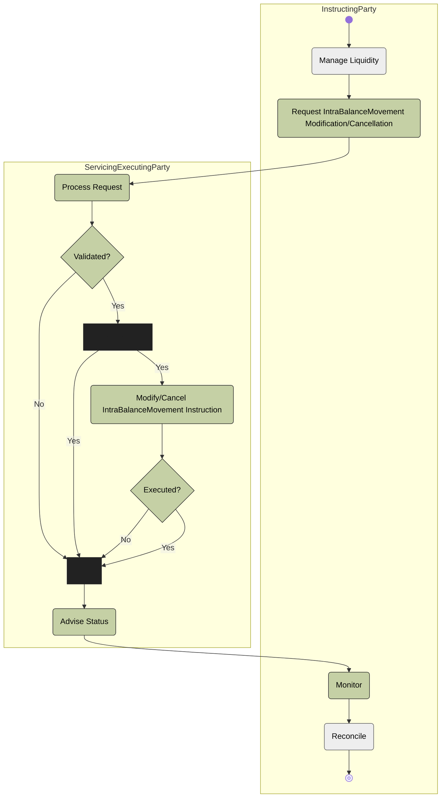

# Modification and cancellation activity

[src-000359](../../../../../../../../evidence/omitted/e6546c5f64c53f963440988a.md) archive member `ISO20022_MDR_Target2Securities_August_2026_v1/Target2-Securities_IntraBalanceMovement_MessageSet/ISO20022_MDRPart1_Target2Securities_IntraBalanceMovement_2023_2024_v2.docx`; direct-body paragraph P198; Description of BusinessActivities / Intra-Balance Movement Modification/Cancellation Process; Word-derived file page 23.

[Complete source figure / rendered composite](../../../../../../../../evidence/omitted/f552d338e60e571e6f6d7960.md) · [Complete Word-page context](../../../../../../../../evidence/omitted/d9f540d72a8800083bac71ff.md)

## Mermaid reconstruction

## Actors, entities and relationships

The reconstruction above retains the source-labelled entities, directed or undirected connectors, decision labels and lane boundaries. Each Mermaid line is the maintained relationship transcription; source activity-table definitions and responsibilities are linked below.

- [Account owner](../../../../../../../../shared/reference/participants/participant-src-000359-account-owner.md)
- [Instructing Party](../../../../../../../../shared/reference/participants/participant-src-000359-instructing-party.md)
- [Servicing/Executing Party](../../../../../../../../shared/reference/participants/participant-src-000359-servicing-executing-party.md)

[Reusable flow: trigger, conditions, responsibilities and narrative](../../flows/flow-src-000359-p197-intra-balance-movement-modification-cancellation-process.md)

## Source tables and limitations

- [T11: BusinessProcess Description / Intra-Balance Management](../../documents/src-000359/tables/tbl-0011.md)
- [T12: BusinessProcess Description / Intra-Balance Management](../../documents/src-000359/tables/tbl-0012.md)
- [T13: BusinessProcess Description / Intra-Balance Management](../../documents/src-000359/tables/tbl-0013.md)
- [T22: Description of BusinessActivities / Intra-Balance Movement Modification/Cancellation Process](../../documents/src-000359/tables/tbl-0022.md)

- Both Executed? branches feed Advise Status. T22 distinguishes a positive advice when execution succeeds; the picture does not supply separate status-message nodes.
- Native Mermaid flowchart subgraphs retain source swimlane responsibility. Source start/end glyphs, labelled decisions and bars remain explicit. T19 defines bars as parallel actions; the original uses some bars at converging alternative paths, so no extra execution semantics are inferred.

[Source ambiguities: issue-000047](../../../../../../../../tracking/issues.md)

## Review evidence

Transcribed after direct original and complete native-composite inspection. Completed parsing, rendered comparison and whole-page review are recorded below.

<!-- INTRABALANCE-REVIEW-START -->
## Completed rendering and visual comparison

Mermaid browser API + Chromium 156.0.8078.81; Mermaid 12.3.0; 2026-11-09: parsing and rendering **pass**. [Rendered SVG](../../../../../../../../evidence/omitted/bd57114a9aae64e0b6f3fad5.md) · [Rendered PNG](../../../../../../../../evidence/omitted/d83423b3a7546d854dd7aaa2.md).

Original versus Mermaid: literal labels, connector endpoints/direction, decisions, solid/dashed lines, role boundaries and complete Word-page surroundings. Source-text labels clipped by the local Word rendering are explicitly disclosed, not presented as visibly read. Review **pass for extraction fidelity with the stated limitations**. Complete Word file page 23 was inspected; standalone picture reconstructions were also compared against their detailed original previews. Native sequence figures17–24 use the full Word composite, including original drawing text when labels are clipped.

[Hash-bound review and source-object inventory](../../../../../../../../evidence/archived/e5ae431e79f2d9aefaf53c2e.md). Contextual source ambiguities keep the page needs-review. This does not certify missing business context or hidden native layers.

<!-- INTRABALANCE-REVIEW-END -->
