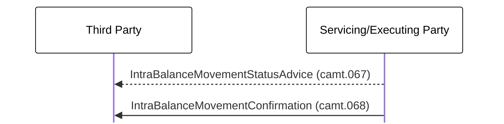

# Internal cash settlement restriction creation

[src-000359](../../../../../../../../evidence/omitted/e6546c5f64c53f963440988a.md) archive member `ISO20022_MDR_Target2Securities_August_2026_v1/Target2-Securities_IntraBalanceMovement_MessageSet/ISO20022_MDRPart1_Target2Securities_IntraBalanceMovement_2023_2024_v2.docx`; direct-body paragraph P233; BusinessTransactions / Creation Process  / In internal scenario; Word-derived file page 32.

[Complete source figure / rendered composite](../../../../../../../../evidence/omitted/989682dab1d60e3b25d6d464.md) · [Complete Word-page context](../../../../../../../../evidence/omitted/989682dab1d60e3b25d6d464.md)

## Mermaid reconstruction

## Actors, entities and relationships

| Step | Sender | Receiver | Complete source label | Line | Source colour |
| --- | --- | --- | --- | --- | --- |
| 1 | Servicing/Executing Party | Third Party | IntraBalanceMovementStatusAdvice (camt.067) | dashed | green |
| 2 | Servicing/Executing Party | Third Party | IntraBalanceMovementConfirmation (camt.068) | solid | green |

- [Account owner](../../../../../../../../shared/reference/participants/participant-src-000359-account-owner.md)
- [Instructing Party](../../../../../../../../shared/reference/participants/participant-src-000359-instructing-party.md)
- [Servicing/Executing Party](../../../../../../../../shared/reference/participants/participant-src-000359-servicing-executing-party.md)
- [Third Party](../../../../../../../../shared/reference/participants/participant-src-000359-third-party.md)

[Reusable flow: trigger, conditions, responsibilities and narrative](../../flows/flow-src-000359-p230-in-internal-scenario.md)

## Source tables and limitations

- [T8: BusinessProcess Description / Intra-Balance Management](../../documents/src-000359/tables/tbl-0008.md)
- [T9: BusinessProcess Description / Intra-Balance Management](../../documents/src-000359/tables/tbl-0009.md)
- [T10: BusinessProcess Description / Intra-Balance Management](../../documents/src-000359/tables/tbl-0010.md)
- [T21: Description of BusinessActivities / Intra-Balance Movement Process / Internal Scenario](../../documents/src-000359/tables/tbl-0021.md)

- P231 and the picture say Third Party; P235 and P237 say Instructing Party. Both explicit recipients are retained, without silently equating the roles.
- Source-native text boxes and connector objects form a complete figure. The retained Word page is the complete composite; the small WMF bank pictograms are not treated as standalone diagrams.
- Solid/dashed connectors and their directions are preserved. Source colours are recorded per message step below; colours distinguish pictured context without asserting extra protocol semantics.
- Native Mermaid boxes replace institutional pictograms; labels define the functional participants and do not bind a role to one institution.

[Source ambiguities: issue-000047](../../../../../../../../tracking/issues.md)

## Review evidence

Transcribed after direct original and complete native-composite inspection. Completed parsing, rendered comparison and whole-page review are recorded below.

<!-- INTRABALANCE-REVIEW-START -->
## Completed rendering and visual comparison

Mermaid browser API + Chromium 156.0.8078.81; Mermaid 12.3.0; 2026-11-09: parsing and rendering **pass**. [Rendered SVG](../../../../../../../../evidence/omitted/d45935440a8643a3203d9393.md) · [Rendered PNG](../../../../../../../../evidence/omitted/94c52af5093961a39026c0cc.md).

Original versus Mermaid: literal labels, connector endpoints/direction, decisions, solid/dashed lines, role boundaries and complete Word-page surroundings. Source-text labels clipped by the local Word rendering are explicitly disclosed, not presented as visibly read. Review **pass for extraction fidelity with the stated limitations**. Complete Word file page 32 was inspected; standalone picture reconstructions were also compared against their detailed original previews. Native sequence figures17–24 use the full Word composite, including original drawing text when labels are clipped.

[Hash-bound review and source-object inventory](../../../../../../../../evidence/archived/e5ae431e79f2d9aefaf53c2e.md). Contextual source ambiguities keep the page needs-review. This does not certify missing business context or hidden native layers.

<!-- INTRABALANCE-REVIEW-END -->
