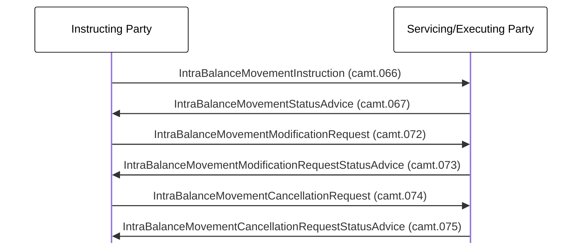

# Modification and cancellation transaction exchange

[src-000359](../../../../../../../../evidence/omitted/e6546c5f64c53f963440988a.md) archive member `ISO20022_MDR_Target2Securities_August_2026_v1/Target2-Securities_IntraBalanceMovement_MessageSet/ISO20022_MDRPart1_Target2Securities_IntraBalanceMovement_2023_2024_v2.docx`; direct-body paragraph P240; BusinessTransactions / Modification and Cancellation Process ; Word-derived file page 33.

[Complete source figure / rendered composite](../../../../../../../../evidence/omitted/3f3c8fc9d52dafe48b8608aa.md) · [Complete Word-page context](../../../../../../../../evidence/omitted/3f3c8fc9d52dafe48b8608aa.md)

## Mermaid reconstruction

## Actors, entities and relationships

| Step | Sender | Receiver | Complete source label | Line | Source colour |
| --- | --- | --- | --- | --- | --- |
| 1 | Instructing Party | Servicing/Executing Party | IntraBalanceMovementInstruction (camt.066) | solid | black |
| 2 | Servicing/Executing Party | Instructing Party | IntraBalanceMovementStatusAdvice (camt.067) | solid | black |
| 3 | Instructing Party | Servicing/Executing Party | IntraBalanceMovementModificationRequest (camt.072) | solid | green |
| 4 | Servicing/Executing Party | Instructing Party | IntraBalanceMovementModificationRequestStatusAdvice (camt.073) | solid | green |
| 5 | Instructing Party | Servicing/Executing Party | IntraBalanceMovementCancellationRequest (camt.074) | solid | green |
| 6 | Servicing/Executing Party | Instructing Party | IntraBalanceMovementCancellationRequestStatusAdvice (camt.075) | solid | green |

- [Account owner](../../../../../../../../shared/reference/participants/participant-src-000359-account-owner.md)
- [Instructing Party](../../../../../../../../shared/reference/participants/participant-src-000359-instructing-party.md)
- [Servicing/Executing Party](../../../../../../../../shared/reference/participants/participant-src-000359-servicing-executing-party.md)

[Reusable flow: trigger, conditions, responsibilities and narrative](../../flows/flow-src-000359-p238-modification-and-cancellation-process.md)

## Source tables and limitations

- [T11: BusinessProcess Description / Intra-Balance Management](../../documents/src-000359/tables/tbl-0011.md)
- [T12: BusinessProcess Description / Intra-Balance Management](../../documents/src-000359/tables/tbl-0012.md)
- [T13: BusinessProcess Description / Intra-Balance Management](../../documents/src-000359/tables/tbl-0013.md)
- [T22: Description of BusinessActivities / Intra-Balance Movement Modification/Cancellation Process](../../documents/src-000359/tables/tbl-0022.md)

- Long labels and some code suffixes are clipped in the local Word rendering. Their complete source text is preserved in the drawing text at P240; reconstructed labels recover that text. The picture supplies no alt frame making modification and cancellation alternatives, so none is invented.
- Source-native text boxes and connector objects form a complete figure. The retained Word page is the complete composite; the small WMF bank pictograms are not treated as standalone diagrams.
- Solid/dashed connectors and their directions are preserved. Source colours are recorded per message step below; colours distinguish pictured context without asserting extra protocol semantics.
- Native Mermaid boxes replace institutional pictograms; labels define the functional participants and do not bind a role to one institution.

[Source ambiguities: issue-000047](../../../../../../../../tracking/issues.md)

## Review evidence

Transcribed after direct original and complete native-composite inspection. Completed parsing, rendered comparison and whole-page review are recorded below.

<!-- INTRABALANCE-REVIEW-START -->
## Completed rendering and visual comparison

Mermaid browser API + Chromium 156.0.8078.81; Mermaid 12.3.0; 2026-11-09: parsing and rendering **pass**. [Rendered SVG](../../../../../../../../evidence/omitted/eb2e88b11402b6ca71b65b9a.md) · [Rendered PNG](../../../../../../../../evidence/omitted/377bd04565e4a285f4e50769.md).

Original versus Mermaid: literal labels, connector endpoints/direction, decisions, solid/dashed lines, role boundaries and complete Word-page surroundings. Source-text labels clipped by the local Word rendering are explicitly disclosed, not presented as visibly read. Review **pass for extraction fidelity with the stated limitations**. Complete Word file page 33 was inspected; standalone picture reconstructions were also compared against their detailed original previews. Native sequence figures17–24 use the full Word composite, including original drawing text when labels are clipped.

[Hash-bound review and source-object inventory](../../../../../../../../evidence/archived/e5ae431e79f2d9aefaf53c2e.md). Contextual source ambiguities keep the page needs-review. This does not certify missing business context or hidden native layers.

<!-- INTRABALANCE-REVIEW-END -->
