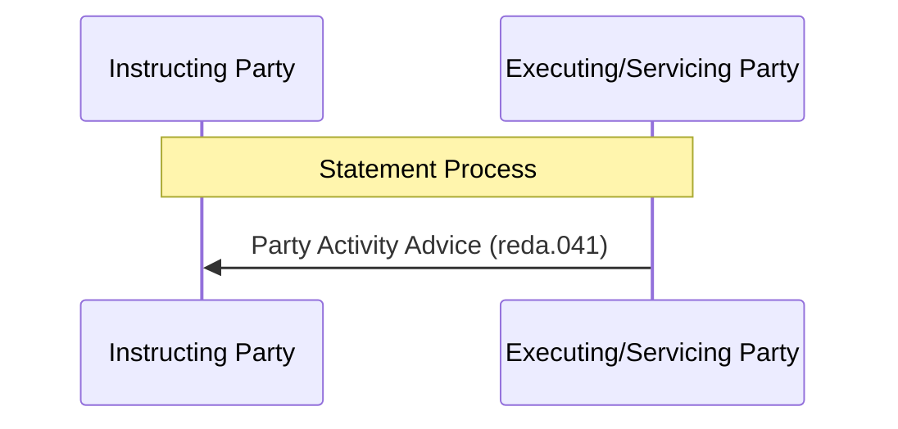

# Unsolicited party activity advice sequence

[src-000368](../../../../../../../../evidence/omitted/e6546c5f64c53f963440988a.md) archive member `ISO20022_MDR_Target2Securities_August_2026_v1/Target2-Securities_PartyReferenceData_MessageSet/ISO20022_MDRPart1_Target2Securities_PartyReferenceData_2023_2024_v2.docx`; direct-body paragraph P293; Word-rendered file page 31. Complete Word-rendered page; figure identified by its heading, actor labels and message sequence. Parent work/docx-render/src-000368/document.pdf; file page 31.

[Complete original figure/context](../../../../../../../../evidence/omitted/800cead14722f0f40442dad3.md) · [Business flow and conditional narrative](../../flows/flow-src-000368-p128-statement.md)

## Source reconstruction

## Participants

- [Instructing Party](../../../../../../../../shared/reference/participants/participant-src-000368-instructing-party.md)
- [Executing / Servicing Party](../../../../../../../../shared/reference/participants/participant-src-000368-executing-servicing-party.md)
- [Recipient Party](../../../../../../../../shared/reference/participants/participant-src-000368-recipient-party.md)

## Entities and relationships

| Source | Destination | Condition or exchange | Line notation |
| --- | --- | --- | --- |
| Executing/Servicing Party | Instructing Party | Party Activity Advice (reda.041) | -&gt;&gt; |

## Qualifications

- P296–P297 explicitly make this a unilateral, unsolicited statement concerning changes during the business day. No prior request or receipt acknowledgement arrow is invented.
- T12 additionally names Recipient Party and requires a standing instruction; the picture uses Instructing Party.
- The complete Word page is retained because the diagram uses native Word objects and reused pictograms, or the standalone EMF preview is clipped. Individual embedded assets remain unchanged but are not treated as complete figures.

## Rendering and visual review

On 2026-11-09 this reconstruction parsed and rendered with Mermaid 12.3.0 / Mermaid browser API + Chromium 156.0.8078.81. The final rendering was directly compared with the complete source for labels, participants, connector endpoints/directions, decisions and line styles. All 47 Word pages were inspected for complete composition. **Visible-source fidelity: pass.** Source conflicts remain open where listed. Mermaid changes layout, actor glyphs, arrowhead styling and final-node centre fill; the original and textual relationship description preserve them.

[Rendered SVG](../../../../../../../../evidence/omitted/2fb7ae5583273eefada0e084.md) · [Rendered PNG](../../../../../../../../evidence/omitted/6f5ee9565843551c912f531b.md) · [Hash-bound review evidence](../../../../../../../../evidence/archived/1ca62fd4d357c3eff372aec3.md)
