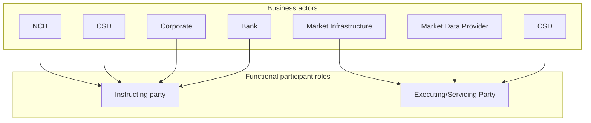

# Business actors and functional roles

[src-000371](../../../../../../../../evidence/omitted/e6546c5f64c53f963440988a.md) archive member `ISO20022_MDR_Target2Securities_August_2026_v1/Target2-Securities_SecuritiesAccountReferenceData_MessageSet/ISO20022_MDRPart1_Target2Securities_SecuritiesAccountReferenceData_v2.docx`; direct-body paragraph P143; Word-rendered file page11.

[Complete Word-composed source figure](../../../../../../../../evidence/omitted/5ea398c41f1e77904405d956.md)

## Source reconstruction

## Participants

- [Instructing Party](../../../../../../../../shared/reference/participants/participant-src-000371-instructing-party.md)
- [Executing/Servicing Party](../../../../../../../../shared/reference/participants/participant-src-000371-executing-servicing-party.md)
- [National Central Bank (NCB)](../../../../../../../../shared/reference/participants/participant-src-000371-national-central-bank-ncb.md)
- [Central Securities Depositories (CSD)](../../../../../../../../shared/reference/participants/participant-src-000371-central-securities-depositories-csd.md)
- [Corporate](../../../../../../../../shared/reference/participants/participant-src-000371-corporate.md)
- [Bank](../../../../../../../../shared/reference/participants/participant-src-000371-bank.md)
- [Market Infrastructure](../../../../../../../../shared/reference/participants/participant-src-000371-market-infrastructure.md)
- [Market Data Provider](../../../../../../../../shared/reference/participants/participant-src-000371-market-data-provider.md)

## Entities and relationships

| Source | Destination | Condition or exchange | Line notation |
| --- | --- | --- | --- |
| NCB | Instructing party | Unlabelled connector | --&gt; |
| CSD | Instructing party | Unlabelled connector | --&gt; |
| Corporate | Instructing party | Unlabelled connector | --&gt; |
| Bank | Instructing party | Unlabelled connector | --&gt; |
| Market Infrastructure | Executing/Servicing Party | Unlabelled connector | --&gt; |
| Market Data Provider | Executing/Servicing Party | Unlabelled connector | --&gt; |
| CSD | Executing/Servicing Party | Unlabelled connector | --&gt; |

## Qualifications

- The source has two CSD occurrences and stick-person functional-role glyphs. Boxes and explicit group labels retain those categories without claiming inheritance.
- T7 omits NCB and also assigns Market Data Provider an instructing role. T6 has no Market Data Provider definition. The source context line P142 is an unfilled source placeholder; issue-000050 preserves these limits.

## Rendering and visual review

All labels, roles, endpoints, directions, line styles, decision guards and complete Word composition were directly compared with this final Mermaid12.3.0 rendering on 2026-11-09. All42 complete Word pages were inventoried. Native text supporting clipped labels is explicitly distinguished from visible artwork; source conflicts remain open where listed. Mermaid changes layout, actor pictograms and final-node centre fill; original artwork and textual descriptions retain those features.

[Rendered SVG](../../../../../../../../evidence/omitted/5256badff3fb4119e35f0afd.md) · [Rendered PNG](../../../../../../../../evidence/omitted/aea4ea69c7d9b57530b1bbcf.md) · [Hash-bound review evidence](../../../../../../../../evidence/archived/1371923b3cb2b1a498b71abb.md)
