# Creation activity

[src-000371](../../../../../../../../evidence/omitted/e6546c5f64c53f963440988a.md) archive member `ISO20022_MDR_Target2Securities_August_2026_v1/Target2-Securities_SecuritiesAccountReferenceData_MessageSet/ISO20022_MDRPart1_Target2Securities_SecuritiesAccountReferenceData_v2.docx`; direct-body paragraph P163; Word-rendered file page16.

[Complete Word-composed source figure](../../../../../../../../evidence/omitted/697321fcc61cddc53fc615a0.md) · [Business flow and conditional narrative](../../flows/flow-src-000371-p152-create-securities-account.md)

## Source reconstruction

```mermaid
flowchart TB
subgraph group0["Instructing Party"]
start(("#160;"))
instruction(["Instruction"])
merge{"#160;"}
monitor(["Monitor"])
acceptedIP{"Accepted"}
finish((("#160;")))
end
subgraph group1["Executing Party"]
validate(["Validate"])
acceptedEP{"Accepted"}
process(["Process"])
report(["Report"])
end
start --> instruction
instruction --> validate
validate --> acceptedEP
acceptedEP -->|"Yes"| process
acceptedEP -->|"No"| report
process -->|"Status &lt;&lt;Accepted&gt;&gt;"| merge
report -->|"Status &lt;&lt;Rejected&gt;&gt;"| merge
merge --> monitor
monitor --> acceptedIP
acceptedIP -.->|"No"| instruction
acceptedIP -->|"Yes"| finish
style start fill:#333,stroke:#333
```

## Participants

- [Instructing Party](../../../../../../../../shared/reference/participants/participant-src-000371-instructing-party.md)
- [Executing/Servicing Party](../../../../../../../../shared/reference/participants/participant-src-000371-executing-servicing-party.md)

## Entities and relationships

| Source | Destination | Condition or exchange | Line notation |
| --- | --- | --- | --- |
| start | Instruction | Unlabelled connector | --&gt; |
| Instruction | Validate | Unlabelled connector | --&gt; |
| Validate | Accepted | Unlabelled connector | --&gt; |
| Accepted | Process | Yes | --&gt; |
| Accepted | Report | No | --&gt; |
| Process | merge | Status &lt;&lt;Accepted&gt;&gt; | --&gt; |
| Report | merge | Status &lt;&lt;Rejected&gt;&gt; | --&gt; |
| merge | Monitor | Unlabelled connector | --&gt; |
| Monitor | Accepted | Unlabelled connector | --&gt; |
| Accepted | Instruction | No | -.-&gt; |
| Accepted | finish | Yes | --&gt; |

## Qualifications

- The Executing Party lane corresponds to the Executing/Servicing Party responsibilities in T14–T16. The dashed No path returns to Instruction; the two status paths merge before Monitor.
- Accepted/Rejected are literal activity labels. The tables and sequences separately define COMPLETED, QUEUED and REJECTED outcomes, including revalidation after a night-time cycle. These labels are not silently equated to exact XML codes.

## Rendering and visual review

All labels, roles, endpoints, directions, line styles, decision guards and complete Word composition were directly compared with this final Mermaid12.3.0 rendering on 2026-11-09. All42 complete Word pages were inventoried. Native text supporting clipped labels is explicitly distinguished from visible artwork; source conflicts remain open where listed. Mermaid changes layout, actor pictograms and final-node centre fill; original artwork and textual descriptions retain those features.

[Rendered SVG](../../../../../../../../evidence/omitted/b0c71d3d96c781ea735c5aae.md) · [Rendered PNG](../../../../../../../../evidence/omitted/f2721ebc3b326bf6a4703a68.md) · [Hash-bound review evidence](../../../../../../../../evidence/archived/1371923b3cb2b1a498b71abb.md)
