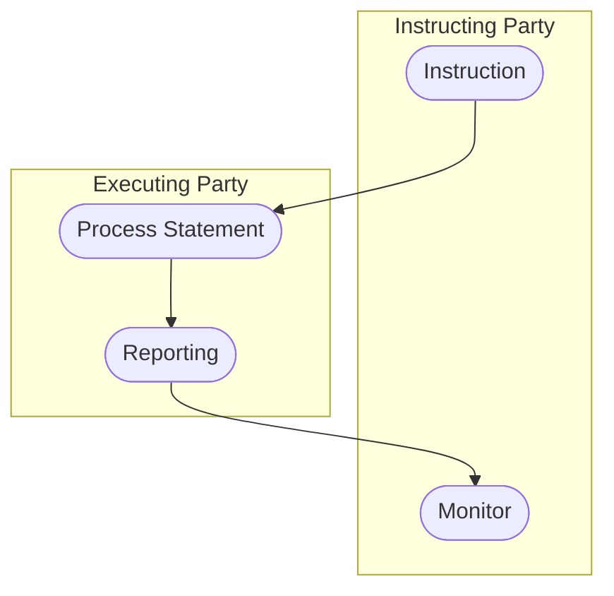

# Statement activity

[src-000371](../../../../../../../../evidence/omitted/e6546c5f64c53f963440988a.md) archive member `ISO20022_MDR_Target2Securities_August_2026_v1/Target2-Securities_SecuritiesAccountReferenceData_MessageSet/ISO20022_MDRPart1_Target2Securities_SecuritiesAccountReferenceData_v2.docx`; direct-body paragraph P173; Word-rendered file page21.

[Complete Word-composed source figure](../../../../../../../../evidence/omitted/76d0a10437cccd67e34474dd.md) · [Business flow and conditional narrative](../../flows/flow-src-000371-p157-generate-statement.md)

## Source reconstruction

## Participants

- [Instructing Party](../../../../../../../../shared/reference/participants/participant-src-000371-instructing-party.md)
- [Executing/Servicing Party](../../../../../../../../shared/reference/participants/participant-src-000371-executing-servicing-party.md)
- [Recipient Party](../../../../../../../../shared/reference/participants/participant-src-000371-recipient-party.md)

## Entities and relationships

| Source | Destination | Condition or exchange | Line notation |
| --- | --- | --- | --- |
| Instruction | Process Statement | Unlabelled connector | --&gt; |
| Process Statement | Reporting | Unlabelled connector | --&gt; |
| Reporting | Monitor | Unlabelled connector | --&gt; |

## Qualifications

- No source start/end symbols or guards are added.
- T18 explicitly puts the optional instruction outside this message process: no request message is created. T12 instead requires a standing instruction, and P326 calls the statement unsolicited. T12 also names Recipient Party, retained as a scoped receiving role.

## Rendering and visual review

All labels, roles, endpoints, directions, line styles, decision guards and complete Word composition were directly compared with this final Mermaid12.3.0 rendering on 2026-11-09. All42 complete Word pages were inventoried. Native text supporting clipped labels is explicitly distinguished from visible artwork; source conflicts remain open where listed. Mermaid changes layout, actor pictograms and final-node centre fill; original artwork and textual descriptions retain those features.

[Rendered SVG](../../../../../../../../evidence/omitted/a5d9f778fad89f1967483b65.md) · [Rendered PNG](../../../../../../../../evidence/omitted/6c8473711fd20c011a882296.md) · [Hash-bound review evidence](../../../../../../../../evidence/archived/1371923b3cb2b1a498b71abb.md)
