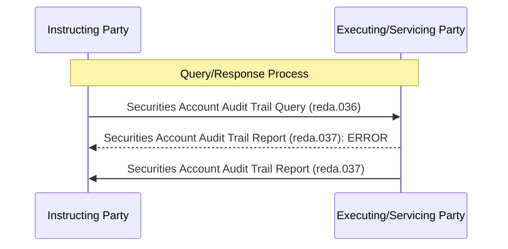

# Securities account audit trail query and report

[src-000371](../../../../../../../../evidence/omitted/e6546c5f64c53f963440988a.md) archive member `ISO20022_MDR_Target2Securities_August_2026_v1/Target2-Securities_SecuritiesAccountReferenceData_MessageSet/ISO20022_MDRPart1_Target2Securities_SecuritiesAccountReferenceData_v2.docx`; direct-body paragraph P312; Word-rendered file page30.

[Complete Word-composed source figure](../../../../../../../../evidence/omitted/16ae0451a420887a38d50fcc.md) · [Business flow and conditional narrative](../../flows/flow-src-000371-p156-query.md)

## Source reconstruction

## Participants

- [Instructing Party](../../../../../../../../shared/reference/participants/participant-src-000371-instructing-party.md)
- [Executing/Servicing Party](../../../../../../../../shared/reference/participants/participant-src-000371-executing-servicing-party.md)

## Entities and relationships

| Source | Destination | Condition or exchange | Line notation |
| --- | --- | --- | --- |
| Instructing Party | Executing/Servicing Party | Securities Account Audit Trail Query (reda.036) | -&gt;&gt; |
| Executing/Servicing Party | Instructing Party | Securities Account Audit Trail Report (reda.037): ERROR | --&gt;&gt; |
| Executing/Servicing Party | Instructing Party | Securities Account Audit Trail Report (reda.037) | -&gt;&gt; |

## Qualifications

- Error and normal responses are separately drawn without an alternative frame. P308/P317 and P310/P319 distinguish them; both are not mandatory.
- Source errors include processing-time excess, wrong criteria combination and no result set. The query result timestamp and audit user/change details are described separately in P119–P134.

## Rendering and visual review

All labels, roles, endpoints, directions, line styles, decision guards and complete Word composition were directly compared with this final Mermaid12.3.0 rendering on 2026-11-09. All42 complete Word pages were inventoried. Native text supporting clipped labels is explicitly distinguished from visible artwork; source conflicts remain open where listed. Mermaid changes layout, actor pictograms and final-node centre fill; original artwork and textual descriptions retain those features.

[Rendered SVG](../../../../../../../../evidence/omitted/b06bf1811825cd91c561e0e9.md) · [Rendered PNG](../../../../../../../../evidence/omitted/9e22191ed2f62e22124d6794.md) · [Hash-bound review evidence](../../../../../../../../evidence/archived/1371923b3cb2b1a498b71abb.md)
