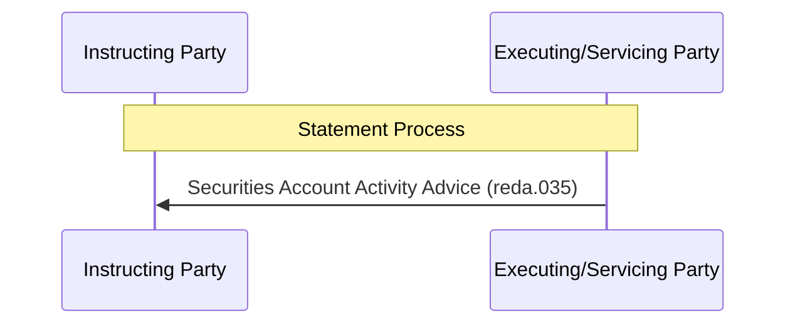

# Unsolicited securities account activity advice

[src-000371](../../../../../../../../evidence/omitted/e6546c5f64c53f963440988a.md) archive member `ISO20022_MDR_Target2Securities_August_2026_v1/Target2-Securities_SecuritiesAccountReferenceData_MessageSet/ISO20022_MDRPart1_Target2Securities_SecuritiesAccountReferenceData_v2.docx`; direct-body paragraph P322; Word-rendered file page31.

[Complete Word-composed source figure](../../../../../../../../evidence/omitted/d8387cb371b9f2a855435bf1.md) · [Business flow and conditional narrative](../../flows/flow-src-000371-p157-generate-statement.md)

## Source reconstruction

## Participants

- [Instructing Party](../../../../../../../../shared/reference/participants/participant-src-000371-instructing-party.md)
- [Executing/Servicing Party](../../../../../../../../shared/reference/participants/participant-src-000371-executing-servicing-party.md)
- [Recipient Party](../../../../../../../../shared/reference/participants/participant-src-000371-recipient-party.md)

## Entities and relationships

| Source | Destination | Condition or exchange | Line notation |
| --- | --- | --- | --- |
| Executing/Servicing Party | Instructing Party | Securities Account Activity Advice (reda.035) | -&gt;&gt; |

## Qualifications

- P325–P326 makes this unilateral and unsolicited, reporting changes during the business day. T12 names Recipient Party and a standing instruction; no new request or acknowledgement message is inferred.

## Rendering and visual review

All labels, roles, endpoints, directions, line styles, decision guards and complete Word composition were directly compared with this final Mermaid12.3.0 rendering on 2026-11-09. All42 complete Word pages were inventoried. Native text supporting clipped labels is explicitly distinguished from visible artwork; source conflicts remain open where listed. Mermaid changes layout, actor pictograms and final-node centre fill; original artwork and textual descriptions retain those features.

[Rendered SVG](../../../../../../../../evidence/omitted/6042b8d93d6e90f73768091e.md) · [Rendered PNG](../../../../../../../../evidence/omitted/0ea1c67c976ec1deb0f26d5e.md) · [Hash-bound review evidence](../../../../../../../../evidence/archived/1371923b3cb2b1a498b71abb.md)
