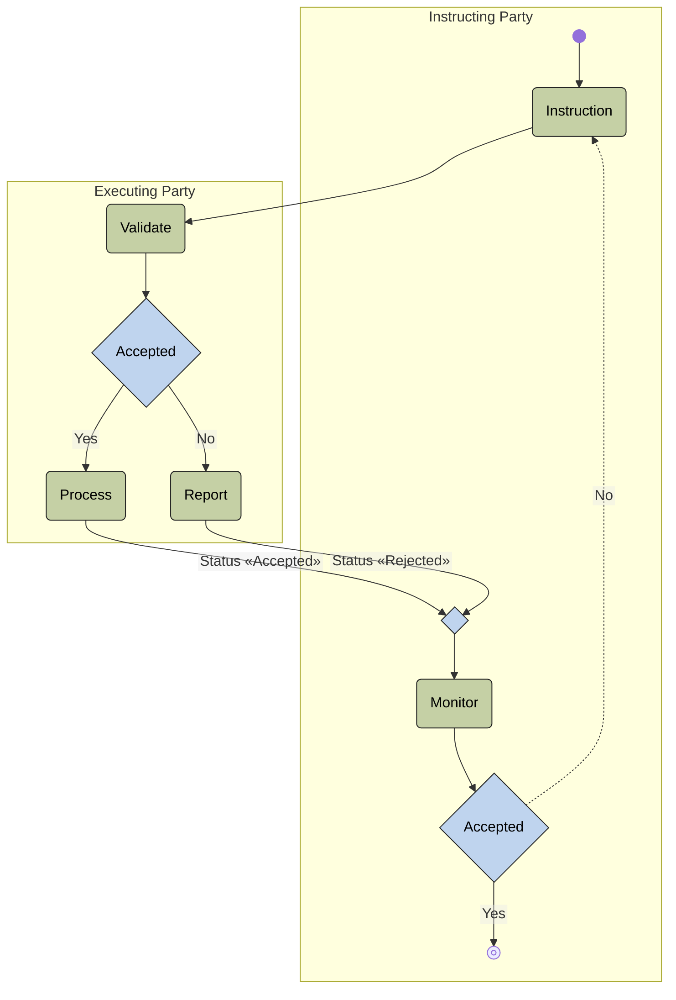

# Security deletion activity

[src-000377](../../../../../../../../evidence/omitted/e6546c5f64c53f963440988a.md) archive member `ISO20022_MDR_Target2Securities_August_2026_v1/Target2-Securities_SecuritiesReferenceData_MessageSet/ISO20022_MDRPart1_Target2Securities_SecuritiesReferenceData_v2.docx`; direct-body paragraph P160; Description of BusinessActivities / Deletion Process; rendered Word file page 18.

[Complete source figure / composite](../../../../../../../../evidence/omitted/76e5ec6920b8b39a17fb275b.md) · [Whole Word-page context](../../../../../../../../evidence/omitted/34a50c9c67b686637a199625.md)

## Mermaid reconstruction

## Participants and responsibilities

- [Instructing Party](../../../../../../../../shared/reference/participants/participant-src-000377-instructing-party.md)
- [Executing Party](../../../../../../../../shared/reference/participants/participant-src-000377-executing-party.md)
- [Executing/Servicing Party](../../../../../../../../shared/reference/participants/participant-src-000377-executing-servicing-party.md)

The maintained Mermaid transcription above retains the source labels, direction, actor/lane associations and decision branches. Contextual activity definitions remain separate in the complete source tables below.

[Reusable flow, conditions and source narrative](../../flows/flow-src-000377-p159-deletion-process.md)

## Source tables and limitations

- [T10](../../documents/src-000377/tables/tbl-0010.md)
- [T16](../../documents/src-000377/tables/tbl-0016.md)

- The source artwork uses Accepted/Rejected activity labels. The activity table and transaction messages distinguish COMPLETED, QUEUED and REJECTED. No equality of these separate status vocabularies is inferred.
- Source edge labels are literally Status <<Accepted>> and Status <<Rejected>>. Mermaid uses typographic double-angle guillemets around the unchanged values because ASCII angle groups are stripped as HTML by this renderer.
- The final No branch is dashed and returns to Instruction; the source does not supply a retry deadline or retry count. The blank diamond merges the accepted/rejected reporting paths without an added condition.
- Executing Party is the literal swimlane label; corresponding table rows use Executing/Servicing Party. Scoped records retain that explicit contextual relationship.
- Source377 is June2021; companion source378 is March2024. Matching full identifiers do not erase the publication difference (issue-000010).

[issue-000010 publication difference; issue-000051 copied role/restriction wording](../../../../../../../../tracking/issues.md)

<!-- SECURITIES-REFERENCE-DIAGRAM-REVIEW-START -->
## Completed rendering and visual review

Mermaid browser API + Chromium 156.0.8078.81; Mermaid 12.3.0; 2026-11-09: parse/render **pass**. [Rendered SVG](../../../../../../../../evidence/omitted/e13635c6203dc82d53c494bc.md) · [Rendered PNG](../../../../../../../../evidence/omitted/f8a90a2710f9708ec583bca1.md).

Each original figure and final Mermaid render was directly compared for all labels, endpoints, arrow direction, solid/dashed connectors, decision branches and lane/role boundaries. Native composites12–20 were inspected as full Word pages; figures1–2 received explicit high-priority role/process review. Extraction-fidelity comparison **pass with the page’s explicit notation limitations**. Whole Word page 18 was also inspected. This does not resolve source ambiguities or claim review of hidden native-application layers.

[Hash-bound review evidence](../../../../../../../../evidence/archived/bfd1249e720d5175e7885274.md).

<!-- SECURITIES-REFERENCE-DIAGRAM-REVIEW-END -->
