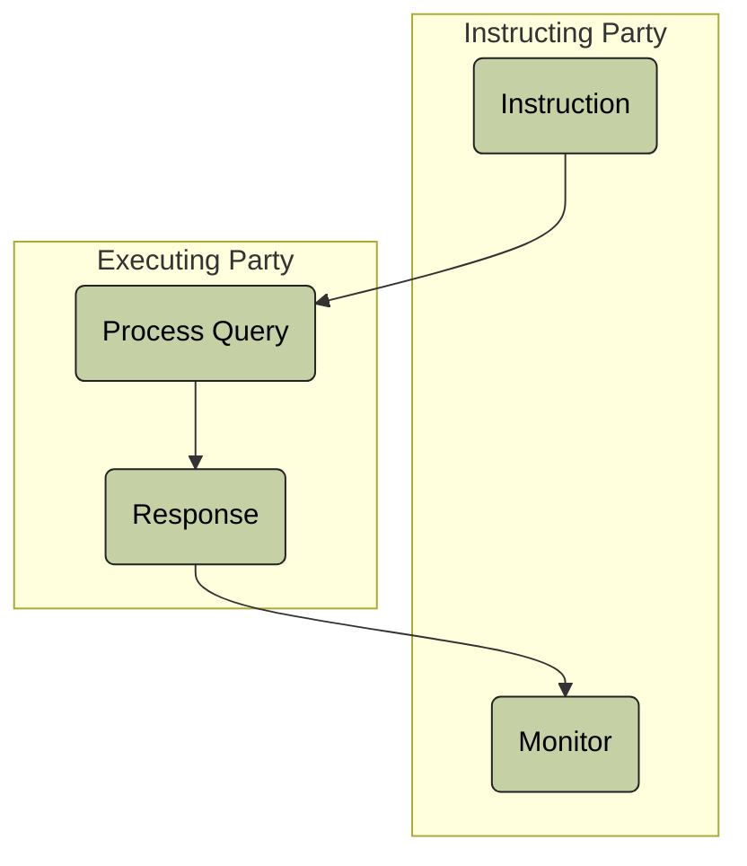

# Security query and audit-trail query activity

[src-000377](../../../../../../../../evidence/omitted/e6546c5f64c53f963440988a.md) archive member `ISO20022_MDR_Target2Securities_August_2026_v1/Target2-Securities_SecuritiesReferenceData_MessageSet/ISO20022_MDRPart1_Target2Securities_SecuritiesReferenceData_v2.docx`; direct-body paragraph P163; Description of BusinessActivities / Query/Query Response Process; rendered Word file page 19.

[Complete source figure / composite](../../../../../../../../evidence/omitted/fb775eaa4c1dea6dd8045e73.md) · [Whole Word-page context](../../../../../../../../evidence/omitted/bd71972f617e00af1e7927b4.md)

## Mermaid reconstruction

## Participants and responsibilities

- [Instructing Party](../../../../../../../../shared/reference/participants/participant-src-000377-instructing-party.md)
- [Executing Party](../../../../../../../../shared/reference/participants/participant-src-000377-executing-party.md)
- [Executing/Servicing Party](../../../../../../../../shared/reference/participants/participant-src-000377-executing-servicing-party.md)

The maintained Mermaid transcription above retains the source labels, direction, actor/lane associations and decision branches. Contextual activity definitions remain separate in the complete source tables below.

[Reusable flow, conditions and source narrative](../../flows/flow-src-000377-p162-query-query-response-process.md)

## Source tables and limitations

- [T11](../../documents/src-000377/tables/tbl-0011.md)
- [T17](../../documents/src-000377/tables/tbl-0017.md)

- No start/end glyph or error decision is supplied in this activity picture. The linked table/narrative preserves additional error conditions without adding unseen diagram nodes.
- Source377 is June2021; companion source378 is March2024. Matching full identifiers do not erase the publication difference (issue-000010).

[issue-000010 publication difference; issue-000051 copied role/restriction wording](../../../../../../../../tracking/issues.md)

<!-- SECURITIES-REFERENCE-DIAGRAM-REVIEW-START -->
## Completed rendering and visual review

Mermaid browser API + Chromium 156.0.8078.81; Mermaid 12.3.0; 2026-11-09: parse/render **pass**. [Rendered SVG](../../../../../../../../evidence/omitted/cf757a6b3a7c1435935e3b09.md) · [Rendered PNG](../../../../../../../../evidence/omitted/bd338b2cca091019345eac4b.md).

Each original figure and final Mermaid render was directly compared for all labels, endpoints, arrow direction, solid/dashed connectors, decision branches and lane/role boundaries. Native composites12–20 were inspected as full Word pages; figures1–2 received explicit high-priority role/process review. Extraction-fidelity comparison **pass with the page’s explicit notation limitations**. Whole Word page 19 was also inspected. This does not resolve source ambiguities or claim review of hidden native-application layers.

[Hash-bound review evidence](../../../../../../../../evidence/archived/bfd1249e720d5175e7885274.md).

<!-- SECURITIES-REFERENCE-DIAGRAM-REVIEW-END -->
