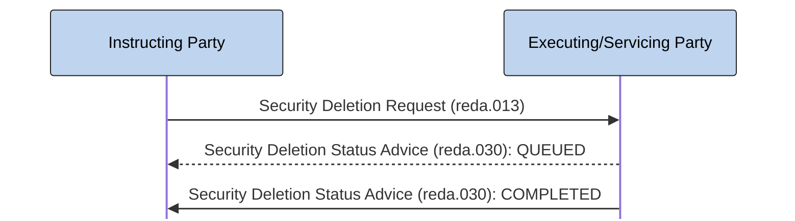

# Security deletion — confirmation

[src-000377](../../../../../../../../evidence/omitted/e6546c5f64c53f963440988a.md) archive member `ISO20022_MDR_Target2Securities_August_2026_v1/Target2-Securities_SecuritiesReferenceData_MessageSet/ISO20022_MDRPart1_Target2Securities_SecuritiesReferenceData_v2.docx`; direct-body paragraph P257; BusinessTransactions / Deletion Process / Confirmation Scenario; rendered Word file page 26.

[Complete source figure / composite](../../../../../../../../evidence/omitted/d51ac31ff5b155ddd24b1a36.md) · [Whole Word-page context](../../../../../../../../evidence/omitted/d51ac31ff5b155ddd24b1a36.md)

## Mermaid reconstruction

## Participants and responsibilities

- [Instructing Party](../../../../../../../../shared/reference/participants/participant-src-000377-instructing-party.md)
- [Executing/Servicing Party](../../../../../../../../shared/reference/participants/participant-src-000377-executing-servicing-party.md)

| Step | Sender | Receiver | Literal source message | Line |
| --- | --- | --- | --- | --- |
| 1 | Instructing Party | Executing/Servicing Party | Security Deletion Request (reda.013) | solid |
| 2 | Executing/Servicing Party | Instructing Party | Security Deletion Status Advice (reda.030): QUEUED | dashed |
| 3 | Executing/Servicing Party | Instructing Party | Security Deletion Status Advice (reda.030): COMPLETED | solid |

[Reusable flow, conditions and source narrative](../../flows/flow-src-000377-p254-confirmation-scenario.md)

## Source tables and limitations

- [T10](../../documents/src-000377/tables/tbl-0010.md)
- [T16](../../documents/src-000377/tables/tbl-0016.md)

- The dashed QUEUED advice is conditional in the narrative, for example a running night-time cycle; the picture does not make it compulsory.
- Source377 is June2021; companion source378 is March2024. Matching full identifiers do not erase the publication difference (issue-000010).
- The original figure is assembled from native Word connector/text objects and institutional pictograms. The retained full Word page is the complete composite; its pictograms alone are not counted as diagrams.
- Native Mermaid participant boxes replace the institutional drawings; sender and receiver roles, solid/dashed lines and visible arrow direction remain explicit. No institution is equated with a functional role.

[issue-000010 publication difference; issue-000051 copied role/restriction wording](../../../../../../../../tracking/issues.md)

<!-- SECURITIES-REFERENCE-DIAGRAM-REVIEW-START -->
## Completed rendering and visual review

Mermaid browser API + Chromium 156.0.8078.81; Mermaid 12.3.0; 2026-11-09: parse/render **pass**. [Rendered SVG](../../../../../../../../evidence/omitted/a90698002c8025f7b0721304.md) · [Rendered PNG](../../../../../../../../evidence/omitted/17eb6cd363468aed1176e1c0.md).

Each original figure and final Mermaid render was directly compared for all labels, endpoints, arrow direction, solid/dashed connectors, decision branches and lane/role boundaries. Native composites12–20 were inspected as full Word pages; figures1–2 received explicit high-priority role/process review. Extraction-fidelity comparison **pass with the page’s explicit notation limitations**. Whole Word page 26 was also inspected. This does not resolve source ambiguities or claim review of hidden native-application layers.

[Hash-bound review evidence](../../../../../../../../evidence/archived/bfd1249e720d5175e7885274.md).

<!-- SECURITIES-REFERENCE-DIAGRAM-REVIEW-END -->
