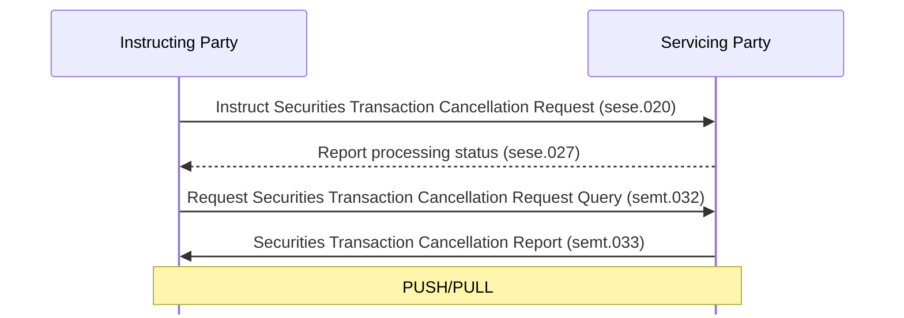

# Transaction cancellation request query and report

[src-000380](../../../../../../../../evidence/omitted/e6546c5f64c53f963440988a.md) archive member `ISO20022_MDR_Target2Securities_August_2026_v1/Target2-Securities_SettlementRestrictions_MessageSet/ISO20022_MDRPart1_Target2Securities_SettlementRestrictions_v2.docx`; direct-body paragraph P116; Scope and Functionality / Scope / Securities Transaction Cancellation Request Query/Report; rendered Word file page 8.

[Complete original figure / composite](../../../../../../../../evidence/omitted/250c650e06edd5b6dc0b9519.md) · [Whole Word-page context](../../../../../../../../evidence/omitted/250c650e06edd5b6dc0b9519.md)

## Mermaid reconstruction

## Participants and source relationships

- [Instructing Party](../../../../../../../../shared/reference/participants/participant-src-000380-instructing-party.md)
- [Executing / Servicing Party](../../../../../../../../shared/reference/participants/participant-src-000380-executing-servicing-party.md)
- [Servicing Party](../../../../../../../../shared/reference/participants/participant-src-000380-servicing-party.md)

| Step | Sender | Receiver | Literal source message | Line |
| --- | --- | --- | --- | --- |
| 1 | Instructing Party | Servicing Party | Instruct Securities Transaction Cancellation Request (sese.020) | solid |
| 2 | Servicing Party | Instructing Party | Report processing status (sese.027) | dashed |
| 3 | Instructing Party | Servicing Party | Request Securities Transaction Cancellation Request Query (semt.032) | solid |
| 4 | Servicing Party | Instructing Party | Securities Transaction Cancellation Report (semt.033) | solid |

[Reusable flow, triggers, conditions and alternatives](../../flows/flow-src-000380-p111-transaction-cancellation-request-query-and-report.md)

## Source tables and limitations

- [T4](../../documents/src-000380/tables/tbl-0004.md)
- [T5](../../documents/src-000380/tables/tbl-0005.md)
- [T6](../../documents/src-000380/tables/tbl-0006.md)
- [T7](../../documents/src-000380/tables/tbl-0007.md)
- [T8](../../documents/src-000380/tables/tbl-0008.md)

- The original green arrows are query/report scope; black cancellation/status arrows provide context. Exact versions of context families sese.020 and sese.027 are not identified in this picture.
- The query/report concerns previously sent cancellation instructions for settlement or intra-position movements (P117). It is not a settlement reversal. P119 requires the Business Application Header family head.001 without choosing an exact version.
- P117 supports either pull or push. No query is inferred as a prerequisite for an independently configured push report.
- The retained full Word page preserves the native connector/text composite and institutional pictograms. Component images alone do not contain the complete figure. Mermaid participant boxes replace the artwork while preserving the functional labels, sender/receiver direction and solid/dashed lines.

[issue-000056: source wording remains visible](../../../../../../../../tracking/issues.md)

<!-- SETTLEMENT-RESTRICTIONS-DIAGRAM-REVIEW-START -->
## Completed rendering and visual review

Mermaid browser API + Chromium 156.0.8078.81; Mermaid 12.3.0; 2026-11-09: parse/render **pass**. [Rendered SVG](../../../../../../../../evidence/omitted/e24af7acaf7f3455eda23ed6.md) · [Rendered PNG](../../../../../../../../evidence/omitted/1286f603a84c734a5bda3ff9.md).

All ten original figures and final Mermaid renderings were directly compared for labels, endpoints, message direction, solid/dashed connectors, decision branches and scoped roles. Figures2–3 were checked as complete native Word composites on pages7–8. Role/process scope figure4 and native use-case figure5 received explicit label/edge review. Source colors, pictograms and bar geometry have the documented notation adaptations. Extraction-fidelity comparison **pass with the page’s explicit notation limitations**. Whole Word page 8 was also inspected. This does not resolve source ambiguities or claim review of hidden native-application layers.

[Hash-bound review evidence](../../../../../../../../evidence/archived/bf3168ec2e91f4e70046c906.md).

<!-- SETTLEMENT-RESTRICTIONS-DIAGRAM-REVIEW-END -->
