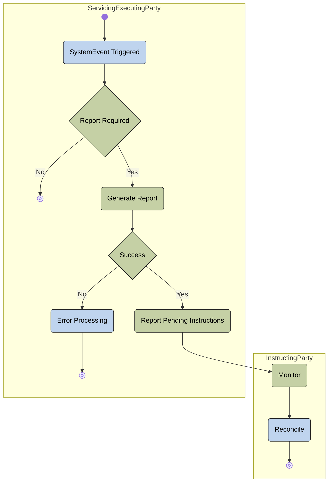

# Push-mode pending intra-position movement reporting

[src-000380](../../../../../../../../evidence/omitted/e6546c5f64c53f963440988a.md) archive member `ISO20022_MDR_Target2Securities_August_2026_v1/Target2-Securities_SettlementRestrictions_MessageSet/ISO20022_MDRPart1_Target2Securities_SettlementRestrictions_v2.docx`; direct-body paragraph P264; Description of BusinessActivities / Intra Position Movement Query, Query Response and Pending Report / Push mode; rendered Word file page 19.

[Complete original figure / composite](../../../../../../../../evidence/omitted/16c455a3c4f4ef8ebbe7d060.md) · [Whole Word-page context](../../../../../../../../evidence/omitted/b6701070a0974f7f3795b46b.md)

## Mermaid reconstruction

## Participants and source relationships

- [Instructing Party](../../../../../../../../shared/reference/participants/participant-src-000380-instructing-party.md)
- [Executing / Servicing Party](../../../../../../../../shared/reference/participants/participant-src-000380-executing-servicing-party.md)
- [Servicing/Executing Party](../../../../../../../../shared/reference/participants/participant-src-000380-servicing-executing-party.md)

The transcription retains all source node labels, visible endpoints, arrow directions, process/lane boundaries and decision labels. Activity responsibilities are defined separately by the source tables; the scope diagrams do not establish a runtime message order.

[Reusable flow, triggers, conditions and alternatives](../../flows/flow-src-000380-p263-push-mode.md)

## Source tables and limitations

- [T8](../../documents/src-000380/tables/tbl-0008.md)
- [T11](../../documents/src-000380/tables/tbl-0011.md)

- Source lane labels omit spaces/slashes; these literal labels remain in the picture while T11 supplies Executing/Servicing Party responsibilities.
- Reporting depends on subscription rules in Static Data. No-report and failed-generation branches terminate locally; no error message is added to these push paths. P216 allows full or delta; P217 defines the T2S delta contents as new pending instructions or pending instructions modified/cancelled since the previous report.

[issue-000056: source wording remains visible](../../../../../../../../tracking/issues.md)

<!-- SETTLEMENT-RESTRICTIONS-DIAGRAM-REVIEW-START -->
## Completed rendering and visual review

Mermaid browser API + Chromium 156.0.8078.81; Mermaid 12.3.0; 2026-11-09: parse/render **pass**. [Rendered SVG](../../../../../../../../evidence/omitted/054d428be1160e2824f90b2f.md) · [Rendered PNG](../../../../../../../../evidence/omitted/4638db6c155f948f67972102.md).

All ten original figures and final Mermaid renderings were directly compared for labels, endpoints, message direction, solid/dashed connectors, decision branches and scoped roles. Figures2–3 were checked as complete native Word composites on pages7–8. Role/process scope figure4 and native use-case figure5 received explicit label/edge review. Source colors, pictograms and bar geometry have the documented notation adaptations. Extraction-fidelity comparison **pass with the page’s explicit notation limitations**. Whole Word page 19 was also inspected. This does not resolve source ambiguities or claim review of hidden native-application layers.

[Hash-bound review evidence](../../../../../../../../evidence/archived/bf3168ec2e91f4e70046c906.md).

<!-- SETTLEMENT-RESTRICTIONS-DIAGRAM-REVIEW-END -->
