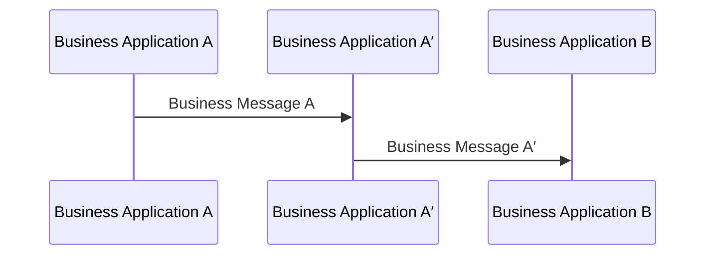

# Business intermediary creates a different business message

[src-000012](../../../../../../../../evidence/omitted/2bef0f7d99f68f11e72a140f.md), file/printed page 4, §1.3 Sending and Receiving MessagingEndpoint.

[Original extracted artwork](../../../../../../../../evidence/omitted/208fc7d25d03beed173cf26b.md) · [Complete rendered source page](../../../../../../../../evidence/omitted/733037d5cc88b012a0f9239c.md) · [Rendered Mermaid SVG](../../../../../../../../evidence/omitted/098ed0d8666e60f4c56e02fc.md) · [Rendered Mermaid PNG](../../../../../../../../evidence/omitted/40fe742533b13a8cf3d7868c.md)

## Reconstruction

## Entities, actors and relationships

A business application in the middle receives A and sends a different Business Message A′. The prime in both labels is preserved.

## Participant and flow links

- [bah-sending-messaging-endpoint](../../../../../../participants/bah-sending-messaging-endpoint.md).
- [bah-receiving-messaging-endpoint](../../../../../../participants/bah-receiving-messaging-endpoint.md).
- [bah-business-intermediary](../../../../../../participants/bah-business-intermediary.md).

- [bah-business-message-exchange](../../../flows/business-message-exchange.md).

## Rendering and visual review

Mermaid 12.3.0 parsed and rendered this reconstruction with Chromium 156.0.8078.81 on 2026-11-09. The source artwork and rendered PNG were visually compared for labels, endpoints, direction, boundaries, choices and visible multiplicity. Raster icons become labelled lifelines or nodes; raster layout is not normative. [Render evidence](../../../../../../../../evidence/archived/4ff67b35f45807a343aeb94b.md).

