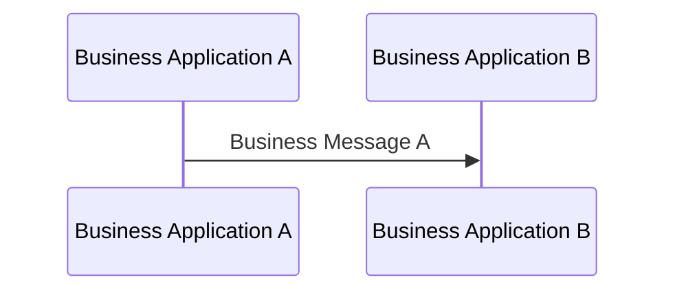

# Basic exchange from Business Application A to B

[src-000012](../../../../../../../../evidence/omitted/2bef0f7d99f68f11e72a140f.md), file/printed page 9, §2.2 Basic exchange.

[Original extracted artwork](../../../../../../../../evidence/omitted/dc9e2968a5e95b36abd25609.md) · [Complete rendered source page](../../../../../../../../evidence/omitted/e76eaf707076cfcc63b14f85.md) · [Rendered Mermaid SVG](../../../../../../../../evidence/omitted/219d8ed4b3bfddf6202f0a7c.md) · [Rendered Mermaid PNG](../../../../../../../../evidence/omitted/2de6ca38b1f40918a75f0ee7.md)

## Reconstruction

## Entities, actors and relationships

The direct exchange diagram is repeated byte-for-byte in the implementation-specification and processing-date scenarios on pages13 and14. Each occurrence is retained.

## Participant and flow links

- [bah-sending-messaging-endpoint](../../../../../../participants/bah-sending-messaging-endpoint.md).
- [bah-receiving-messaging-endpoint](../../../../../../participants/bah-receiving-messaging-endpoint.md).

- [bah-business-message-exchange](../../../flows/business-message-exchange.md).
- [bah-market-practice](../../../flows/market-practice.md).
- [bah-business-processing-date](../../../flows/business-processing-date.md).

## Rendering and visual review

Mermaid 12.3.0 parsed and rendered this reconstruction with Chromium 156.0.8078.81 on 2026-11-09. The source artwork and rendered PNG were visually compared for labels, endpoints, direction, boundaries, choices and visible multiplicity. Raster icons become labelled lifelines or nodes; raster layout is not normative. [Render evidence](../../../../../../../../evidence/archived/4ff67b35f45807a343aeb94b.md).

