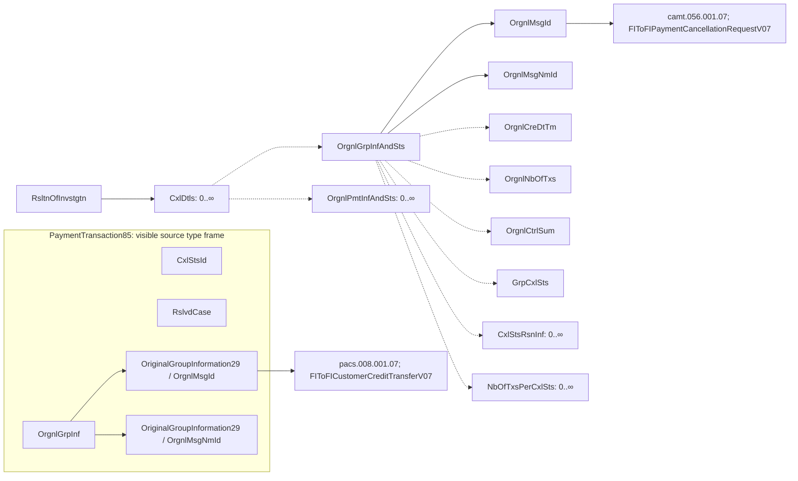

# Resolution of investigation refers to cancellation request and payment

[src-000012](../../../../../../../../evidence/omitted/2bef0f7d99f68f11e72a140f.md), file/printed page 23, §2.13 ResolutionOfInvestigation references.

[Original extracted artwork](../../../../../../../../evidence/omitted/6a559ea60807861013676cb5.md) · [Complete rendered source page](../../../../../../../../evidence/omitted/6f982fa1fe5ba659726b2427.md) · [Rendered Mermaid SVG](../../../../../../../../evidence/omitted/9876bbd33f131335cfd6d305.md) · [Rendered Mermaid PNG](../../../../../../../../evidence/omitted/c550779af94f6a07cdca5b66.md)

## Reconstruction

## Entities, actors and relationships

The upper green arrow maps OrgnlGrpInfAndSts/OrgnlMsgId to the cancellation request camt.056.001.07. The lower green arrow maps OrgnlGrpInf/OrgnlMsgId within the visible PaymentTransaction85 excerpt to pacs.008.001.07. All visible field labels and printed 0..∞ marks are retained. The source image is an excerpt whose frame/connector continues beyond the shown region; the reconstruction does not invent the unshown connecting element or complete structural cardinalities. No cancellation-versus-reversal semantics are inferred merely from containment.

The source excerpt does not show how the PaymentTransaction85 frame connects to the upper tree. No missing connector or intermediate schema path is invented. The detached frame remains explicitly separate.

## Participant and flow links

- [bah-sending-messaging-endpoint](../../../../../../participants/bah-sending-messaging-endpoint.md).
- [bah-receiving-messaging-endpoint](../../../../../../participants/bah-receiving-messaging-endpoint.md).

- [bah-related-message](../../../flows/related-message.md).

## Rendering and visual review

Mermaid 12.3.0 parsed and rendered this reconstruction with Chromium 156.0.8078.81 on 2026-11-09. The source artwork and rendered PNG were visually compared for labels, endpoints, direction, boundaries, choices and visible multiplicity. Raster icons become labelled lifelines or nodes; raster layout is not normative. [Render evidence](../../../../../../../../evidence/archived/4ff67b35f45807a343aeb94b.md).

Limitations: Source screenshot is a cropped XML-tree excerpt; unshown connecting structure and defaults are not inferred. [Issue register](../../../../../../../../tracking/issues.md). A successful faithful reconstruction does not resolve a conflict inside the source.
