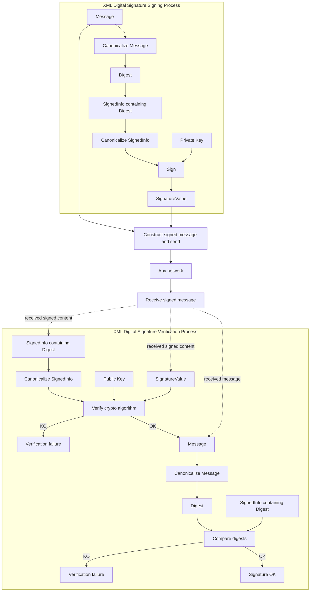

# XML digital-signature signing and verification processes

[src-000012](../../../../../../../../evidence/omitted/2bef0f7d99f68f11e72a140f.md), file/printed page 29, §4.2.2, Figure 2 Signing and verifying process.

[Original extracted artwork](../../../../../../../../evidence/omitted/eecea4987a4dfb4bcadf57a6.md) · [Complete rendered source page](../../../../../../../../evidence/omitted/5825d511fbb53a49282361b0.md) · [Rendered Mermaid SVG](../../../../../../../../evidence/omitted/13c3b69785f9508bb767d0fd.md) · [Rendered Mermaid PNG](../../../../../../../../evidence/omitted/c585bf6199779c71aab0e434.md)

## Reconstruction

## Entities, actors and relationships

Figure2 depicts signing with a private key and verification with a public key. The signing process canonicalizes the message, obtains its digest, canonicalizes SignedInfo and signs it. The signed message passes over any network. Verification checks the cryptographic signature and then compares message digests; either KO branch fails. The dotted links from the receive node clarify the source grouping of received content; they are editorial connectors for the bracketed source layout. The source gives no institution-specific sender/receiver roles.

## Participant and flow links

- [bah-sending-messaging-endpoint](../../../../../../participants/bah-sending-messaging-endpoint.md).
- [bah-receiving-messaging-endpoint](../../../../../../participants/bah-receiving-messaging-endpoint.md).
- [bah-authorised-signatory](../../../../../../participants/bah-authorised-signatory.md).
- [bah-signature-verifier](../../../../../../participants/bah-signature-verifier.md).

- [bah-signed-message](../../../flows/signed-message.md).

## Rendering and visual review

Mermaid 12.3.0 parsed and rendered this reconstruction with Chromium 156.0.8078.81 on 2026-11-09. The source artwork and rendered PNG were visually compared for labels, endpoints, direction, boundaries, choices and visible multiplicity. Raster icons become labelled lifelines or nodes; raster layout is not normative. [Render evidence](../../../../../../../../evidence/archived/4ff67b35f45807a343aeb94b.md).

