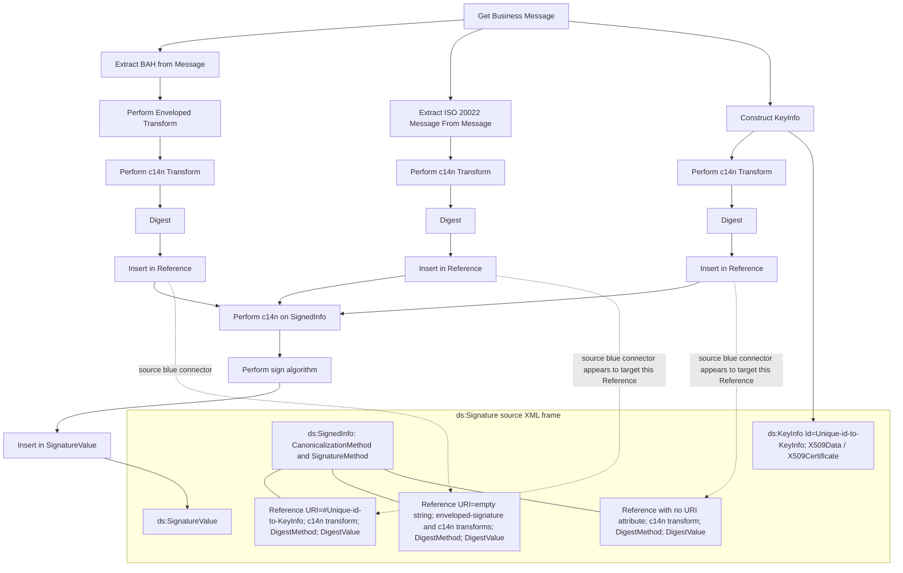

# Signing a BAH and mapping generated values

[src-000012](../../../../../../../../evidence/omitted/2bef0f7d99f68f11e72a140f.md), file/printed page 34, §4.4, Figure 4 Signing the BAH.

[Original extracted artwork](../../../../../../../../evidence/omitted/9d07ab67581f31cc045532ef.md) · [Complete rendered source page](../../../../../../../../evidence/omitted/632bfe7c200e3a81e8b4f739.md) · [Rendered Mermaid SVG](../../../../../../../../evidence/omitted/84f67c9f951daf10941e3eb9.md) · [Rendered Mermaid PNG](../../../../../../../../evidence/omitted/260eae250c3ea1da52a1249d.md)

## Reconstruction

## Entities, actors and relationships

Figure4 has three digest branches: BAH (with enveloped-signature transform), ISO message and constructed KeyInfo. All feed canonicalized SignedInfo, signing and SignatureValue. Orange arrows map SignatureValue and constructed KeyInfo to the corresponding XML elements. The drawn blue reference connectors appear to cross the ISO-document and KeyInfo destinations relative to §§4.2.7–4.2.10 and Figure5. The reconstruction retains the apparent drawn destinations, with explicit uncertainty, rather than silently correcting them. The text-defined URI rules remain separate: KeyInfo uses #id, BAH uses empty URI, ISO message omits URI.

## Participant and flow links

- [bah-sending-messaging-endpoint](../../../../../../participants/bah-sending-messaging-endpoint.md).
- [bah-receiving-messaging-endpoint](../../../../../../participants/bah-receiving-messaging-endpoint.md).
- [bah-authorised-signatory](../../../../../../participants/bah-authorised-signatory.md).
- [bah-signature-verifier](../../../../../../participants/bah-signature-verifier.md).

- [bah-signed-message](../../../flows/signed-message.md).

## Rendering and visual review

Mermaid 12.3.0 parsed and rendered this reconstruction with Chromium 156.0.8078.81 on 2026-11-09. The source artwork and rendered PNG were visually compared for labels, endpoints, direction, boundaries, choices and visible multiplicity. Raster icons become labelled lifelines or nodes; raster layout is not normative. [Render evidence](../../../../../../../../evidence/archived/4ff67b35f45807a343aeb94b.md).

Limitations: Open source connector discrepancy: issue-000017. [Issue register](../../../../../../../../tracking/issues.md). A successful faithful reconstruction does not resolve a conflict inside the source.
