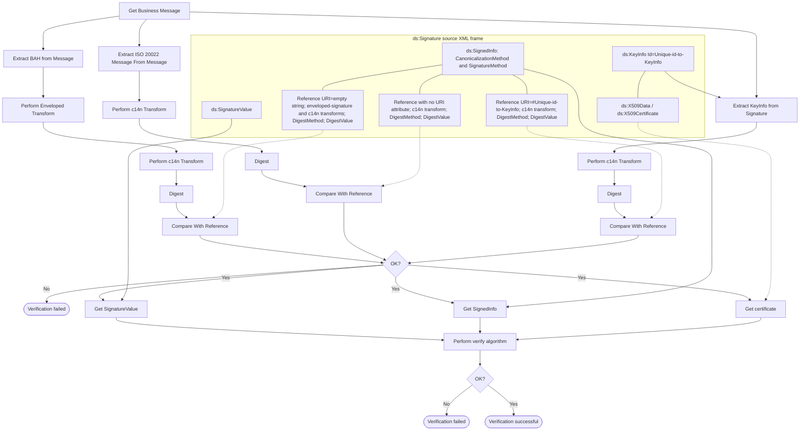

# Verifying a BAH signature

[src-000012](../../../../../../../../evidence/omitted/2bef0f7d99f68f11e72a140f.md), file/printed page 35, §4.4, Figure 5 Verifying the BAH.

[Original extracted artwork](../../../../../../../../evidence/omitted/f6667218cf73fc7b05644aeb.md) · [Complete rendered source page](../../../../../../../../evidence/omitted/eecce39576681689154b0d02.md) · [Rendered Mermaid SVG](../../../../../../../../evidence/omitted/55526313174de2eb970eecb4.md) · [Rendered Mermaid PNG](../../../../../../../../evidence/omitted/a3e9b855889f9ff55f40ad50.md)

## Reconstruction

## Entities, actors and relationships

Figure5 extracts BAH, ISO message and KeyInfo, transforms and digests them, then compares all three references. Any failed comparison ends in verification failed. If references pass, SignatureValue, SignedInfo and certificate feed the verification algorithm. Its No branch fails; Yes is verification successful. Blue source connectors map the empty-URI reference to BAH, URI-absent reference to ISO message, and #KeyInfo-id reference to KeyInfo. Orange and green data-source arrows from Signature, SignedInfo and certificate are retained by labelled nodes and arrows.

## Participant and flow links

- [bah-sending-messaging-endpoint](../../../../../../participants/bah-sending-messaging-endpoint.md).
- [bah-receiving-messaging-endpoint](../../../../../../participants/bah-receiving-messaging-endpoint.md).
- [bah-authorised-signatory](../../../../../../participants/bah-authorised-signatory.md).
- [bah-signature-verifier](../../../../../../participants/bah-signature-verifier.md).

- [bah-signed-message](../../../flows/signed-message.md).

## Rendering and visual review

Mermaid 12.3.0 parsed and rendered this reconstruction with Chromium 156.0.8078.81 on 2026-11-09. The source artwork and rendered PNG were visually compared for labels, endpoints, direction, boundaries, choices and visible multiplicity. Raster icons become labelled lifelines or nodes; raster layout is not normative. [Render evidence](../../../../../../../../evidence/archived/4ff67b35f45807a343aeb94b.md).

