# Resend request technical validation and routing

[src-000343](../../../../../../../evidence/omitted/e6546c5f64c53f963440988a.md) archive member `ISO20022_MDR_Target2Securities_August_2026_v1/Target2-Securities_Administration_MessageSet/ISO20022_MDRPart1_Target2Securities_Administration_2023_2024_v2.docx`; direct-body paragraph P131; Word file page 16.

[Original complete figure](../../../../../../../evidence/omitted/8dbc22814ce514ac76ed7755.md) · [Readable original](../../../../../../../evidence/omitted/c9441dc1a1ace0bc0687cde8.md) · [Business flow and participant responsibilities](../../flows/flow-src-000343-p131-technical-processing.md)

## Source reconstruction

```mermaid
flowchart TB
subgraph group0["Inbound Processing Module – A2A"]
stored["Stored inbound communication - A2A individual message"]
schema(["A2A Message Schema"])
sd{"#160;"}
valid["A2A Schema validated inbound message"]
parse(["A2A Message Parsing"])
pd{"#160;"}
data1["Inbound business data"]
priv(["Check Privilege"])
vd{"#160;"}
data2["Inbound business data"]
router(["Information Router"])
data3["Inbound business data"]
route{"#160;"}
permission(["Check Permission - Resend"])
permissionDecision{"#160;"}
fork@{ shape: fork }
schemaReject["Inbound processing rejection – A2A Schema"]
permissionReject["Inbound processing rejection - Permission"]
result["Validation result - resend"]
resend["Resend message"]
store1["&lt;&lt;data store&gt;&gt; Resendable messages"]
store2["&lt;&lt;data store&gt;&gt; Permission relevant Static Data"]
end
subgraph group1["Adjacent modules"]
comm(["INTF: Communication Module - A2A"])
liquid(["LIQUIDITY MANAGEMENT"])
lcmm(["LCMM"])
static(["STATIC DATA MANAGEMENT"])
stats(["STATISTICS, QUERIES, REPORTS AND ARCHIVE"])
ops(["OPERATIONAL SERVICES"])
out(["INTF: Outbound Processing Module - A2A"])
end
subgraph group2["Outbound-bound merges"]
merge1{"#160;"}
merge2{"#160;"}
merge3{"#160;"}
end
comm --> stored
stored --> schema
schema --> sd
sd -->|"Schema validation not ok"| schemaReject
sd -->|"Schema validation ok"| valid
valid --> parse
parse --> pd
pd -->|"Additional technical validation or duplicate check ok"| data1
data1 --> priv
priv --> vd
vd -->|"Privilege ok"| data2
data2 --> router
router --> data3
data3 --> route
route -->|"Resend Message"| permission
store1 --> permission
store2 --> permission
permission --> permissionDecision
permissionDecision -->|"Message not found or permission not ok"| permissionReject
permissionDecision -->|"Permission ok"| fork
fork --> result
fork --> resend
route -->|"any request except Resend Message"| liquid
route -->|"any request except Resend Message"| lcmm
route -->|"any request except Resend Message"| static
route -->|"any request except Resend Message"| stats
route -->|"any request except Resend Message"| ops
schemaReject --> merge1
permissionReject --> merge1
merge1 --> merge2
merge2 --> merge3
merge3 --> out
result --> merge2
resend --> merge3
style fork fill:#222,stroke:#222
```

## Entities and connections

| Source node | Destination node | Source condition |
| --- | --- | --- |
| comm — INTF: Communication Module - A2A | stored — Stored inbound communication - A2A individual message | Unlabelled directed connector |
| stored — Stored inbound communication - A2A individual message | schema — A2A Message Schema | Unlabelled directed connector |
| schema — A2A Message Schema | sd —  | Unlabelled directed connector |
| sd —  | schemaReject — Inbound processing rejection – A2A Schema | Schema validation not ok |
| sd —  | valid — A2A Schema validated inbound message | Schema validation ok |
| valid — A2A Schema validated inbound message | parse — A2A Message Parsing | Unlabelled directed connector |
| parse — A2A Message Parsing | pd —  | Unlabelled directed connector |
| pd —  | data1 — Inbound business data | Additional technical validation or duplicate check ok |
| data1 — Inbound business data | priv — Check Privilege | Unlabelled directed connector |
| priv — Check Privilege | vd —  | Unlabelled directed connector |
| vd —  | data2 — Inbound business data | Privilege ok |
| data2 — Inbound business data | router — Information Router | Unlabelled directed connector |
| router — Information Router | data3 — Inbound business data | Unlabelled directed connector |
| data3 — Inbound business data | route —  | Unlabelled directed connector |
| route —  | permission — Check Permission - Resend | Resend Message |
| store1 — &lt;&lt;data store&gt;&gt; Resendable messages | permission — Check Permission - Resend | Unlabelled directed connector |
| store2 — &lt;&lt;data store&gt;&gt; Permission relevant Static Data | permission — Check Permission - Resend | Unlabelled directed connector |
| permission — Check Permission - Resend | permissionDecision —  | Unlabelled directed connector |
| permissionDecision —  | permissionReject — Inbound processing rejection - Permission | Message not found or permission not ok |
| permissionDecision —  | fork —  | Permission ok |
| fork —  | result — Validation result - resend | Unlabelled directed connector |
| fork —  | resend — Resend message | Unlabelled directed connector |
| route —  | liquid — LIQUIDITY MANAGEMENT | any request except Resend Message |
| route —  | lcmm — LCMM | any request except Resend Message |
| route —  | static — STATIC DATA MANAGEMENT | any request except Resend Message |
| route —  | stats — STATISTICS, QUERIES, REPORTS AND ARCHIVE | any request except Resend Message |
| route —  | ops — OPERATIONAL SERVICES | any request except Resend Message |
| schemaReject — Inbound processing rejection – A2A Schema | merge1 —  | Unlabelled directed connector |
| permissionReject — Inbound processing rejection - Permission | merge1 —  | Unlabelled directed connector |
| merge1 —  | merge2 —  | Unlabelled directed connector |
| merge2 —  | merge3 —  | Unlabelled directed connector |
| merge3 —  | out — INTF: Outbound Processing Module - A2A | Unlabelled directed connector |
| result — Validation result - resend | merge2 —  | Unlabelled directed connector |
| resend — Resend message | merge3 —  | Unlabelled directed connector |

## Source qualifications

- P131/image3 labels Check Permission - Resend with the separate note [Business Validation Status update]. Both data-store input arrows are retained.
- The picture shows only successful additional-validation and privilege branches before routing. No missing failure branch is invented from the fuller processing picture.
- The source shared connector trunk from any request except Resend Message reaches five backend modules; it is represented by five explicitly guarded edges. This does not mean all five process each request.
- Data/state rectangles are underlined in the original; Mermaid uses labelled boxes and does not infer database keys. Blank diamonds are merges/decisions as drawn; the bar retains its two parallel outgoing paths.

## Rendering and visual review

Mermaid 12.3.0 with Mermaid browser API + Chromium 156.0.8078.81 parsed and rendered this view. On 2026-11-09, the original artwork and final reconstruction were directly compared for labels, modules, participants, every endpoint and direction, guards, forks/merges, alternative frames and the distinction between technical and business outcomes. **Visible-source fidelity: pass.** Source conflicts remain open where listed. Layout, arrowhead styling and underlined data-box typography differ; the original and explicit descriptions remain available. Hidden native content is a separate review scope.

[Rendered SVG](../../../../../../../evidence/omitted/f6d2bae74bdd5c9e38bc8adb.md) · [Rendered PNG](../../../../../../../evidence/omitted/ef1a3d7fc4fe0f80bf7d8596.md) · [Hash-bound review evidence](../../../../../../../evidence/archived/24b9ae1ebe2bcf41380fa3c1.md)

## Complete Word composition

[Complete Word-rendered source figure with green highlight](../../../../../../../evidence/omitted/17a0e8af1b60332c8e9a8b32.md)

The standalone EMF omits the green highlight stored elsewhere in Word. P130 says the main processes are highlighted in the green box. The rectangle crosses the Check Permission - Resend node, part of Static Data Management and nearby text, so no exact membership set is inferred from its geometry. This visual feature remains in the complete crop and this explanation. The reconstruction preserves every underlying connector and label.
