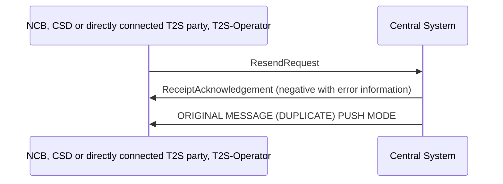

# Resend communication overview

[src-000343](../../../../../../../evidence/omitted/e6546c5f64c53f963440988a.md) archive member `ISO20022_MDR_Target2Securities_August_2026_v1/Target2-Securities_Administration_MessageSet/ISO20022_MDRPart1_Target2Securities_Administration_2023_2024_v2.docx`; direct-body paragraph P181; BusinessTransactions / Resend Request Business Transaction (admi.006); additional Word-rendered file page 30 (exact binary asset match).

[Original figure](../../../../../../../evidence/omitted/4a36e9588345ce32df89fa31.md) · [Readable preview](../../../../../../../evidence/omitted/c9c1627da0362a843cd835ea.md) · [Business flow](../../flows/flow-src-000343-p179-resend-request-business-transaction-admi-006.md)

## Source reconstruction

## Participants and context

- [System Member](../../../../../participants/participant-src-000343-system-member.md)
- [System Transaction Administrator](../../../../../participants/participant-src-000343-system-transaction-administrator.md)
- [Central Securities Depositories (CSD)](../../../../../participants/participant-src-000343-central-securities-depositories-csd.md)
- [National Central Bank (NCB)](../../../../../participants/participant-src-000343-national-central-bank-ncb.md)
- [Settlement Infrastructure Direct Participant](../../../../../participants/participant-src-000343-settlement-infrastructure-direct-participant.md)
- [T2S operator](../../../../../participants/participant-src-000343-t2s-operator.md)

## Relationships and directed exchanges

| Source / endpoint1 | Destination / endpoint2 | Condition, exchange or connector |
| --- | --- | --- |
| NCB, CSD or directly connected T2S party, T2S-Operator | Central System | ResendRequest |
| Central System | NCB, CSD or directly connected T2S party, T2S-Operator | ReceiptAcknowledgement (negative with error information) |
| Central System | NCB, CSD or directly connected T2S party, T2S-Operator | ORIGINAL MESSAGE (DUPLICATE) PUSH MODE |

## Qualifications

- The communication overview draws both possible returns without alternative frames. The separate sequence and activity pictures distinguish rejection from execution; these two returns are not interpreted as always both occurring.
- T9 additionally states that a successful permission check first generates positive Validation Result Resend and sends the duplicate in parallel. These sequence pictures show only the duplicate in their execution path; the additional table-defined exchange remains in the flow narrative.

## Rendering and visual review

Mermaid 12.3.0 with Mermaid browser API + Chromium 156.0.8078.81 parsed and rendered this view. On 2026-11-09, the original artwork and final reconstruction were directly compared for labels, modules, participants, every endpoint and direction, guards, forks/merges, alternative frames and the distinction between technical and business outcomes. **Visible-source fidelity: pass.** Source conflicts remain open where listed. Layout, arrowhead styling and underlined data-box typography differ; the original and explicit descriptions remain available. Hidden native content is a separate review scope.

[Rendered SVG](../../../../../../../evidence/omitted/8384597961f26e0512908e82.md) · [Rendered PNG](../../../../../../../evidence/omitted/d07616f4079ee95b541fd2d7.md) · [Hash-bound review evidence](../../../../../../../evidence/archived/24b9ae1ebe2bcf41380fa3c1.md)
