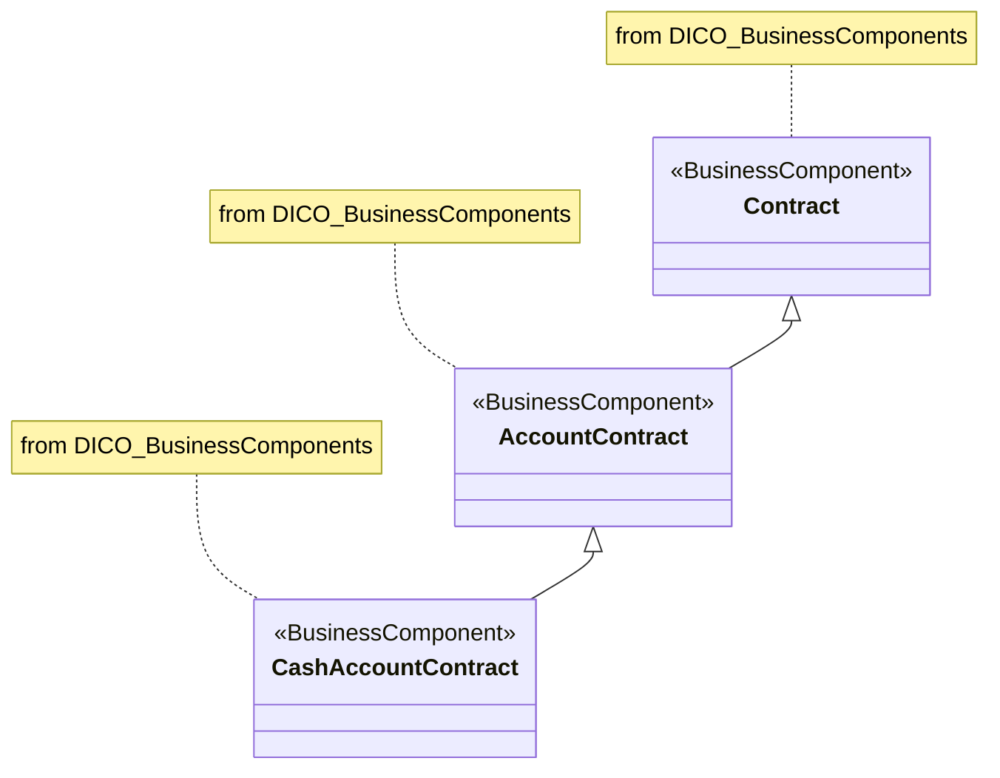

# Business component inheritance example

This is the substantive model shown in the Introduction worksheet of 23 supplied MDR workbooks. Byte-identical source artwork is represented once, with every source occurrence retained below.

[Original model](../../../../evidence/omitted/2f6fb47a51c5b17a5169c98f.md)

## Mermaid reconstruction

## Entities and relationships

All three classes carry the BusinessComponent stereotype and the source package label “from DICO_BusinessComponents”. AccountContract specializes Contract; CashAccountContract specializes AccountContract. Hollow triangles point to the parent class. The boxes show no data attributes or operations. No composition, database keys, ownership, multiplicity or business institution is inferred.

The original diagramming-tool navigation glyphs are interface ornaments, not additional semantic relationships. Their omission does not remove any model endpoint or label. Package labels are retained as Mermaid notes.

## Source occurrences

| Source | Worksheet / drawing locator | Original artwork | Occurrence page |
| --- | --- | --- | --- |
| [ISO20022_MDRPart3_SettlementAndReconciliation_2025_2026_v1.xlsx](../../../../evidence/omitted/c6a84c22fb63cab3b848bd88.md) (src-000198) | Introduction; xl/drawings/drawing1.xml anchor 1; F14 | [Image](../../../../evidence/omitted/2f6fb47a51c5b17a5169c98f.md) | [Occurrence](../../../../domains/securities/reference/message-sets/settlement-and-reconciliation/2025-2026/workbooks/src-000198/diagrams/fig-0001.md) |
| [ISO20022_MDR_Target2Securities_August_2026_v1.zip](../../../../evidence/omitted/e6546c5f64c53f963440988a.md) → archive member `ISO20022_MDR_Target2Securities_August_2026_v1/Target2-Securities_Administration_MessageSet/ISO20022_MDRPart3_Target2Securities_Administration_2023_2024_v1.xlsx` (src-000345) | Introduction; xl/drawings/drawing1.xml anchor 1; F14 | [Image](../../../../evidence/omitted/eeb9baebeae396e3a4778219.md) | [Occurrence](../../message-sets/t2s-administration/march-2024/workbooks/src-000345/diagrams/fig-0001.md) |
| [ISO20022_MDRPart3_CorporateActions_2025_2026_v1.xlsx](../../../../evidence/omitted/5d05ada13720516836bc5043.md) (src-000081) | Introduction; xl/drawings/drawing1.xml anchor 1; F14 | [Image](../../../../evidence/omitted/066a53bdc9835b0b821152fe.md) | [Occurrence](../../../../domains/securities/reference/message-sets/corporate-actions/2025-2026/workbooks/src-000081/diagrams/fig-0001.md) |
| [ISO20022_MDRPart3_CentralCounterParty_SecuritiesClearing_Maintenance_2025_2026_v1.xlsx](../../../../evidence/omitted/ea96e6afbf1f8819d68ca6f6.md) (src-000054) | Introduction; xl/drawings/drawing1.xml anchor 1; F14 | [Image](../../../../evidence/omitted/e4720bcc426bafb59e8c8590.md) | [Occurrence](../../../../domains/securities/reference/message-sets/ccp-clearing/2025-2026/workbooks/src-000054/diagrams/fig-0001.md) |
| [ISO20022_MDRPart3_PostTradeMatching_2024_2025_v1.xlsx](../../../../evidence/omitted/5096efb167050baf43bfb32a.md) (src-000182) | Introduction; xl/drawings/drawing1.xml anchor 1; F14 | [Image](../../../../evidence/omitted/8413c2ccbc57a7e138acba11.md) | [Occurrence](../../../../domains/securities/reference/message-sets/post-trade-matching/2024-2025/workbooks/src-000182/diagrams/fig-0001.md) |
| [ISO20022_MDRPart3_Investment-Funds_2025_2026_v2.xlsx](../../../../evidence/omitted/3ea6002607634c1b65cb5c88.md) (src-000097) | Introduction; xl/drawings/drawing1.xml anchor 1; F14 | [Image](../../../../evidence/omitted/0f056a341536f82943657d47.md) | [Occurrence](../../../../domains/securities/reference/message-sets/investment-funds/2025-2026/workbooks/src-000097/diagrams/fig-0001.md) |
| [ISO20022_MDRPart3_FITRR_TransactionAndFinancialInstrumentsDataReporting_FastTrackMaintenance2025_v1.xlsx](../../../../evidence/omitted/f39eee3c04bb287d206cc6a3.md) (src-000322) | Introduction; xl/drawings/drawing1.xml anchor 1; F14 | [Image](../../../../evidence/omitted/8f87a4b2e7344e153bf1dec8.md) | [Occurrence](../../../../domains/securities/reference/message-sets/fitrr/2025/workbooks/src-000322/diagrams/fig-0001.md) |
| [ISO20022_MDR_Target2Securities_August_2026_v1.zip](../../../../evidence/omitted/e6546c5f64c53f963440988a.md) → archive member `ISO20022_MDR_Target2Securities_August_2026_v1/Target2-Securities_Billing_MessageSet/ISO20022_MDRPart3_Target2Securities_Billing_v1.xlsx` (src-000348) | Introduction; xl/drawings/drawing1.xml anchor 1; F14 | [Image](../../../../evidence/omitted/c0ce05c09dfb8fe1d969fdf2.md) | [Occurrence](../../../../domains/securities/reference/message-sets/t2s-billing/december-2025/workbooks/src-000348/diagrams/fig-0001.md) |
| [ISO20022_MDR_Target2Securities_August_2026_v1.zip](../../../../evidence/omitted/e6546c5f64c53f963440988a.md) → archive member `ISO20022_MDR_Target2Securities_August_2026_v1/Target2-Securities_CashAccountQueryAndReport_MessageSet/ISO20022_MDRPart3_Target2Securities_CashAccountQueryAndReport_v1.xlsx` (src-000352) | Introduction; xl/drawings/drawing1.xml anchor 1; F14 | [Image](../../../../evidence/omitted/3646a9133dd0d4e97dc4fc48.md) | [Occurrence](../../../../domains/securities/reference/message-sets/t2s-cash-account-query-and-report/august-2026/workbooks/src-000352/diagrams/fig-0001.md) |
| [ISO20022_MDR_Target2Securities_August_2026_v1.zip](../../../../evidence/omitted/e6546c5f64c53f963440988a.md) → archive member `ISO20022_MDR_Target2Securities_August_2026_v1/Target2-Securities_CollateralManagementReferenceData_MessageSet/ISO20022_MDRPart3_Target2Securities_CollateralManagementReferenceData_v1.xlsx` (src-000355) | Introduction; xl/drawings/drawing1.xml anchor 1; F14 | [Image](../../../../evidence/omitted/03615b1a52eeb63a01c84221.md) | [Occurrence](../../../../domains/securities/reference/message-sets/t2s-collateral-management-reference-data/may-2025/workbooks/src-000355/diagrams/fig-0001.md) |
| [ISO20022_MDR_Target2Securities_August_2026_v1.zip](../../../../evidence/omitted/e6546c5f64c53f963440988a.md) → archive member `ISO20022_MDR_Target2Securities_August_2026_v1/Target2-Securities_CollateralReporting_MessageSet/ISO20022_MDRPart3_Target2Securities_CollateralReporting_2023_2024_v1.xlsx` (src-000358) | Introduction; xl/drawings/drawing1.xml anchor 1; F14 | [Image](../../../../evidence/omitted/8f29884a6107a8eddc23ede9.md) | [Occurrence](../../../../domains/securities/reference/message-sets/t2s-collateral-reporting/march-2024/workbooks/src-000358/diagrams/fig-0001.md) |
| [ISO20022_MDR_Target2Securities_August_2026_v1.zip](../../../../evidence/omitted/e6546c5f64c53f963440988a.md) → archive member `ISO20022_MDR_Target2Securities_August_2026_v1/Target2-Securities_IntraBalanceMovement_MessageSet/ISO20022_MDRPart3_Target2Securities_IntraBalanceMovement_2023_2024_v1.xlsx` (src-000361) | Introduction; xl/drawings/drawing1.xml anchor 1; F14 | [Image](../../../../evidence/omitted/14c5ec0d6dc78489d9d43b15.md) | [Occurrence](../../../../domains/securities/reference/message-sets/t2s-intra-balance-movement/march-2024/workbooks/src-000361/diagrams/fig-0001.md) |
| [ISO20022_MDR_Target2Securities_August_2026_v1.zip](../../../../evidence/omitted/e6546c5f64c53f963440988a.md) → archive member `ISO20022_MDR_Target2Securities_August_2026_v1/Target2-Securities_LimitUtilisationJournal_MessageSet/ISO20022_MDRPart3_Target2Securities_LimitUtilisationJournal_v1.xlsx` (src-000364) | Introduction; xl/drawings/drawing1.xml anchor 1; F14 | [Image](../../../../evidence/omitted/5d6241f55c84dc8f51ab0f18.md) | [Occurrence](../../../../domains/securities/reference/message-sets/t2s-limit-utilisation-journal/february-2025/workbooks/src-000364/diagrams/fig-0001.md) |
| [ISO20022_MDR_Target2Securities_August_2026_v1.zip](../../../../evidence/omitted/e6546c5f64c53f963440988a.md) → archive member `ISO20022_MDR_Target2Securities_August_2026_v1/Target2-Securities_LinkReferenceData_MessageSet/ISO20022_MDRPart3_Target2Securities_LinkReferenceData_v1.xlsx` (src-000367) | Introduction; xl/drawings/drawing1.xml anchor 1; F14 | [Image](../../../../evidence/omitted/3c2a2e3f5ad46f648ccf9eab.md) | [Occurrence](../../../../domains/securities/reference/message-sets/t2s-link-reference-data/december-2024/workbooks/src-000367/diagrams/fig-0001.md) |
| [ISO20022_MDR_Target2Securities_August_2026_v1.zip](../../../../evidence/omitted/e6546c5f64c53f963440988a.md) → archive member `ISO20022_MDR_Target2Securities_August_2026_v1/Target2-Securities_PartyReferenceData_MessageSet/ISO20022_MDRPart3_Target2Securities_PartyReferenceData_2023_2024_v1.xlsx` (src-000370) | Introduction; xl/drawings/drawing1.xml anchor 1; F14 | [Image](../../../../evidence/omitted/3744738854dce9108bb41393.md) | [Occurrence](../../../../domains/securities/reference/message-sets/t2s-party-reference-data/march-2024/workbooks/src-000370/diagrams/fig-0001.md) |
| [ISO20022_MDR_Target2Securities_August_2026_v1.zip](../../../../evidence/omitted/e6546c5f64c53f963440988a.md) → archive member `ISO20022_MDR_Target2Securities_August_2026_v1/Target2-Securities_SecuritiesAccountReferenceData_MessageSet/ISO20022_MDRPart3_Target2Securities_SecuritiesAccountReferenceData_v1.xlsx` (src-000373) | Introduction; xl/drawings/drawing1.xml anchor 1; F14 | [Image](../../../../evidence/omitted/0c22f45e66248ecf2c0f3e40.md) | [Occurrence](../../../../domains/securities/reference/message-sets/t2s-securities-account-reference-data/december-2019/workbooks/src-000373/diagrams/fig-0001.md) |
| [ISO20022_MDR_Target2Securities_August_2026_v1.zip](../../../../evidence/omitted/e6546c5f64c53f963440988a.md) → archive member `ISO20022_MDR_Target2Securities_August_2026_v1/Target2-Securities_SecuritiesAndPenaltyReporting_MessageSet/ISO20022_MDRPart3_Target2Securities_SecuritiesAndPenaltyReporting_v1.xlsx` (src-000376) | Introduction; xl/drawings/drawing1.xml anchor 1; F14 | [Image](../../../../evidence/omitted/0df55056de1d5f4ec98b0ab3.md) | [Occurrence](../../../../domains/securities/reference/message-sets/t2s-securities-and-penalty-reporting/march-2026/workbooks/src-000376/diagrams/fig-0001.md) |
| [ISO20022_MDR_Target2Securities_August_2026_v1.zip](../../../../evidence/omitted/e6546c5f64c53f963440988a.md) → archive member `ISO20022_MDR_Target2Securities_August_2026_v1/Target2-Securities_SecuritiesReferenceData_MessageSet/ISO20022_MDRPart3_Target2Securities_SecuritiesReferenceData_v1.xlsx` (src-000379) | Introduction; xl/drawings/drawing1.xml anchor 1; F14 | [Image](../../../../evidence/omitted/c5c5e1a11e5e173bf31691ae.md) | [Occurrence](../../../../domains/securities/reference/message-sets/t2s-securities-reference-data/june-2021/workbooks/src-000379/diagrams/fig-0001.md) |
| [ISO20022_MDR_Target2Securities_August_2026_v1.zip](../../../../evidence/omitted/e6546c5f64c53f963440988a.md) → archive member `ISO20022_MDR_Target2Securities_August_2026_v1/Target2-Securities_SettlementRestrictions_MessageSet/ISO20022_MDRPart3_Target2Securities_SettlementRestrictions_v1.xlsx` (src-000382) | Introduction; xl/drawings/drawing1.xml anchor 1; F14 | [Image](../../../../evidence/omitted/31ebbf01ea01e2819f1d5e4b.md) | [Occurrence](../../../../domains/securities/reference/message-sets/t2s-settlement-restrictions/september-2025/workbooks/src-000382/diagrams/fig-0001.md) |
| [ISO20022_MDRPart3_PaymentsInitiation_2025_2026_v1.xlsx](../../../../evidence/omitted/807236f9f4d5f25826f3ba17.md) (src-000175) | Introduction; xl/drawings/drawing1.xml anchor 1; F14 | [Image](../../../../evidence/omitted/b929e06280add6205ae54f0e.md) | [Occurrence](../../../../domains/payments/reference/message-sets/payments-initiation/2025-2026/workbooks/src-000175/diagrams/fig-0001.md) |
| [ISO20022_MDRPart3_PaymentsClearingandSettlement_2025_2026_v1.xlsx](../../../../evidence/omitted/87020353dd81a550a7b6ed6f.md) (src-000164) | Introduction; xl/drawings/drawing1.xml anchor 1; F14 | [Image](../../../../evidence/omitted/5f69ac283764bebfda537ac7.md) | [Occurrence](../../../../domains/payments/reference/message-sets/payments-clearing-and-settlement/2025-2026/workbooks/src-000164/diagrams/fig-0001.md) |
| [ISO20022_MDRPart3_CashManagement_2024_2025_v1.xlsx](../../../../evidence/omitted/42cf3c4088baf4d4c6dc07c1.md) (src-000016) | Introduction; xl/drawings/drawing1.xml anchor 1; F14 | [Image](../../../../evidence/omitted/eb08aec47fdfdc15512096be.md) | [Occurrence](../../../../domains/payments/reference/message-sets/cash-management/2024-2025/workbooks/src-000016/diagrams/fig-0001.md) |
| [ISO20022_MDRPart3_BanktoCustomerCashManagement_2025_2026_v1.xlsx](../../../../evidence/omitted/5e0f6b7d43fcbbe816624756.md) (src-000006) | Introduction; xl/drawings/drawing1.xml anchor 1; F14 | [Image](../../../../evidence/omitted/6bddf682b857f4878704c827.md) | [Occurrence](../../../../domains/payments/reference/message-sets/bank-to-customer-cash-management/2025-2026/workbooks/src-000006/diagrams/fig-0001.md) |

## Rendering and visual review

- Mermaid 12.3.0 browser API parsed and rendered this code successfully using Chromium 156.0.8078.81 on 2026-11-08.
- The original source image and rendered PNG were opened and compared on 2026-11-08. All three class names, stereotypes, package labels and both parent directions agree. The reconstruction changes layout only.
- [Rendered PNG](../../../../evidence/omitted/7f67e954904a23647a20a76d.md), [SVG](../../../../evidence/omitted/7d435951fc1d09312552d8a4.md), [renderer report](../../../../evidence/archived/f2eaddd77a319ee02ddfbd5e.md).
- This review covers this small figure only; it does not imply that any owning workbook or message set is fully reviewed.
