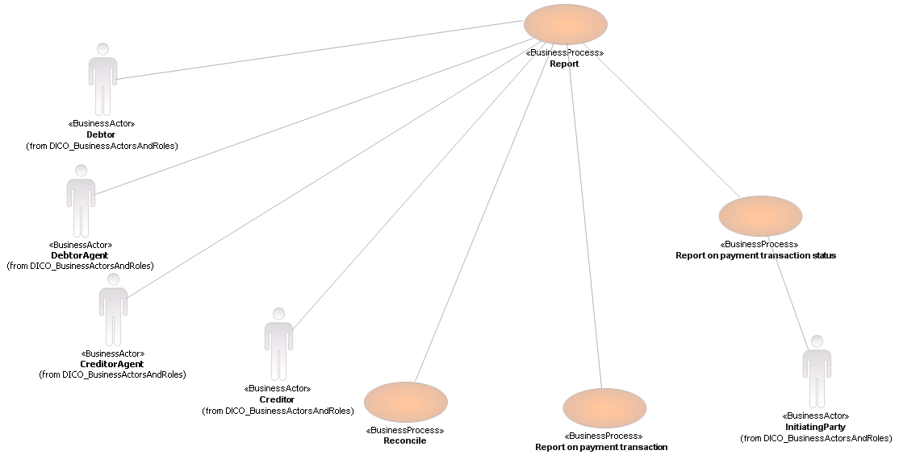

# Reporting business-process actor overview

## Source evidence

[src-000004](../../../../../../../../raw-input/banktocustomer_cash_management/ISO20022_MDRPart1_BankToCustomerCashManagement_2025_2026_v2.docx); BusinessProcess Description; direct-body paragraph P100; word/media/image2.png. [Unchanged original figure](../../../../../../assets/src-000004/originals/image2.png).



## Mermaid reconstruction

```mermaid
usecase-beta
 actor D("Debtor")
 actor DA("DebtorAgent")
 actor CA("CreditorAgent")
 actor C("Creditor")
 actor I("InitiatingParty")
 R("Report")
 REC("Reconcile")
 TX("Report on payment transaction")
 ST("Report on payment transaction status")
 D -- R
 DA -- R
 CA -- R
 C -- R
 R -- REC
 R -- TX
 R -- ST
 ST -- I
```

## Roles, activities and alternatives

The source has five BusinessActor figures and four BusinessProcess ovals, connected by undirected plain lines. Actor labels carry the source namespace note from DICO_BusinessActorsAndRoles. There is no drawn boundary, inheritance, include or extend arrow. Native use-case notation retains that actor/process topology. T9-T12 and P102-P110 supply the four process definitions, triggers and conditions; status-chain roles First Agent and Final Agent are narrative participants absent from this overview. The generic status process has no specified exact message and is not assigned a camt reporting definition.

| Source-scoped role | Canonical reference |
| --- | --- |
| account owner | [account owner](../../../../../../../../shared/reference/participants/participant-src-000004-account-owner.md) |
| account servicer | [account servicer](../../../../../../../../shared/reference/participants/participant-src-000004-account-servicer.md) |
| debtor | [debtor](../../../../../../../../shared/reference/participants/participant-src-000004-debtor.md) |
| debtor agent | [debtor agent](../../../../../../../../shared/reference/participants/participant-src-000004-debtor-agent.md) |
| creditor | [creditor](../../../../../../../../shared/reference/participants/participant-src-000004-creditor.md) |
| creditor agent | [creditor agent](../../../../../../../../shared/reference/participants/participant-src-000004-creditor-agent.md) |
| initiating party | [initiating party](../../../../../../../../shared/reference/participants/participant-src-000004-initiating-party.md) |
| forwarding agent | [forwarding agent](../../../../../../../../shared/reference/participants/participant-src-000004-forwarding-agent.md) |
| first agent | [first agent](../../../../../../../../shared/reference/participants/participant-src-000004-first-agent.md) |
| final agent | [final agent](../../../../../../../../shared/reference/participants/participant-src-000004-final-agent.md) |


Complete source responsibilities/conditions: [T9](../../documents/src-000004/tables/tbl-0009.md), [T10](../../documents/src-000004/tables/tbl-0010.md), [T11](../../documents/src-000004/tables/tbl-0011.md), [T12](../../documents/src-000004/tables/tbl-0012.md).

Reusable flows: [Report](../../flows/flow-src-000004-p101-report.md), [Reconcile](../../flows/flow-src-000004-p104-reconcile.md), [Report on Payment Transaction](../../flows/flow-src-000004-p107-report-on-payment-transaction.md), [Report on Payment Transaction Status](../../flows/flow-src-000004-p109-report-on-payment-transaction-status.md).

## Review evidence

All source actor/role labels, process nodes, source boundaries, plain/generalisation arrows, fork bar, send directions, ordering and alternative annotations compared2026-11-09. [Compared Mermaid12.3.0 rendering](../../../../../../assets/src-000004/reconstructed/fig-0002.png). Source [Word11](../../../../../../assets/src-000004/source-page-renders/word-page-11.png). The two source role-label/responsibility conflicts remain needs-review despite faithful visible reconstruction.
