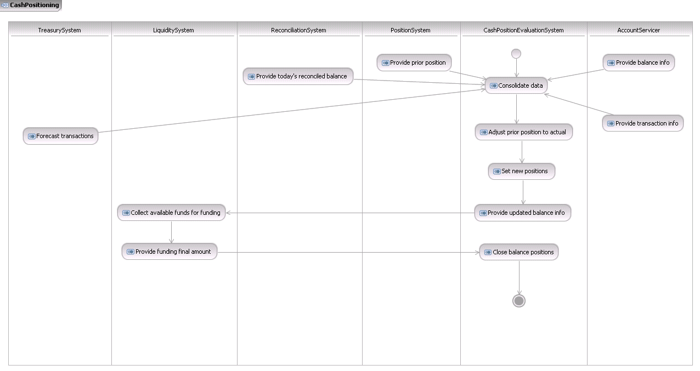
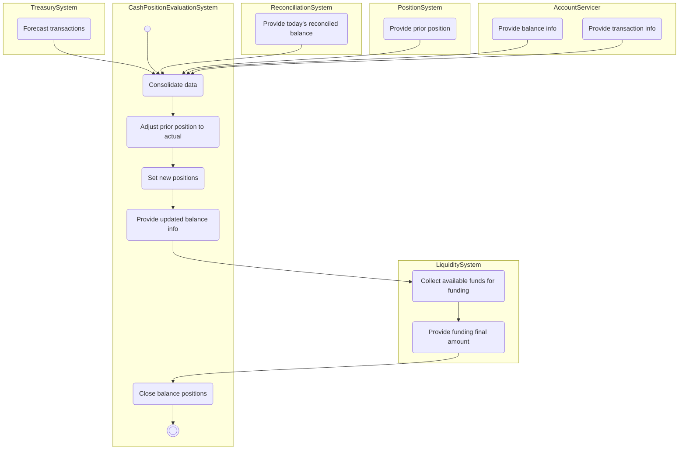

# Cash positioning across internal systems and account servicer

## Source evidence

[src-000004](../../../../../../../../raw-input/banktocustomer_cash_management/ISO20022_MDRPart1_BankToCustomerCashManagement_2025_2026_v2.docx); Description of BusinessActivities; direct-body paragraph P116; word/media/image7.png. [Unchanged original figure](../../../../../../assets/src-000004/originals/image7.png).

## Mermaid reconstruction

## Roles, activities and alternatives

Six lanes and every source information/control arrow are retained. The evaluation system combines five input streams, adjusts positions, provides updated balances to liquidity collection, receives the funding final amount and closes positions. T14 specifies ledger, available and forward balances; intraday transaction reporting may include balances although intraday reconciliation usually is not done. Forecasts may repeat. Closure occurs when cash activity ceases or market close removes funding/investment options. The two literal Cash Position Evaluation Position initiator cells differ from the System lane and other rows; both labels remain scoped under issue-000060, without an unsupported alias merge.

| Source-scoped role | Canonical reference |
| --- | --- |
| account owner | [account owner](../../../../../../../../shared/reference/participants/participant-src-000004-account-owner.md) |
| account servicer | [account servicer](../../../../../../../../shared/reference/participants/participant-src-000004-account-servicer.md) |
| treasury system | [treasury system](../../../../../../../../shared/reference/participants/participant-src-000004-treasury-system.md) |
| liquidity system | [liquidity system](../../../../../../../../shared/reference/participants/participant-src-000004-liquidity-system.md) |
| reconciliation system | [reconciliation system](../../../../../../../../shared/reference/participants/participant-src-000004-reconciliation-system.md) |
| position system | [position system](../../../../../../../../shared/reference/participants/participant-src-000004-position-system.md) |
| cash position evaluation system | [cash position evaluation system](../../../../../../../../shared/reference/participants/participant-src-000004-cash-position-evaluation-system.md) |
| cash position evaluation position | [cash position evaluation position](../../../../../../../../shared/reference/participants/participant-src-000004-cash-position-evaluation-position.md) |

Complete source responsibilities/conditions: [T14](../../documents/src-000004/tables/tbl-0014.md).

Reusable flows: [Cash Positioning](../../flows/flow-src-000004-p115-cash-positioning.md).

## Review evidence

All source actor/role labels, process nodes, source boundaries, plain/generalisation arrows, fork bar, send directions, ordering and alternative annotations compared2026-11-09. [Compared Mermaid12.3.0 rendering](../../../../../../assets/src-000004/reconstructed/fig-0007.png). Source [Word13](../../../../../../assets/src-000004/source-page-renders/word-page-13.png). The two source role-label/responsibility conflicts remain needs-review despite faithful visible reconstruction.
