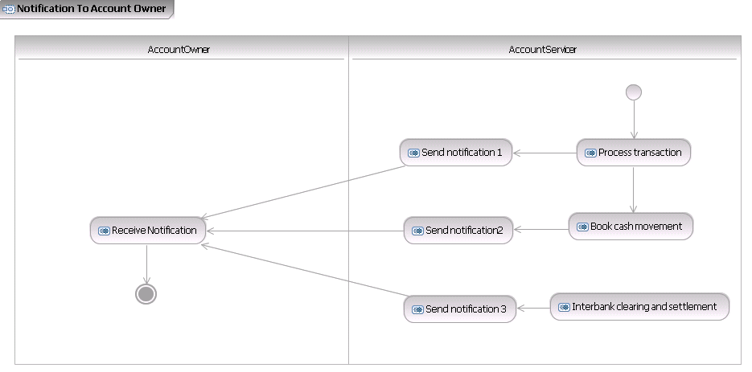
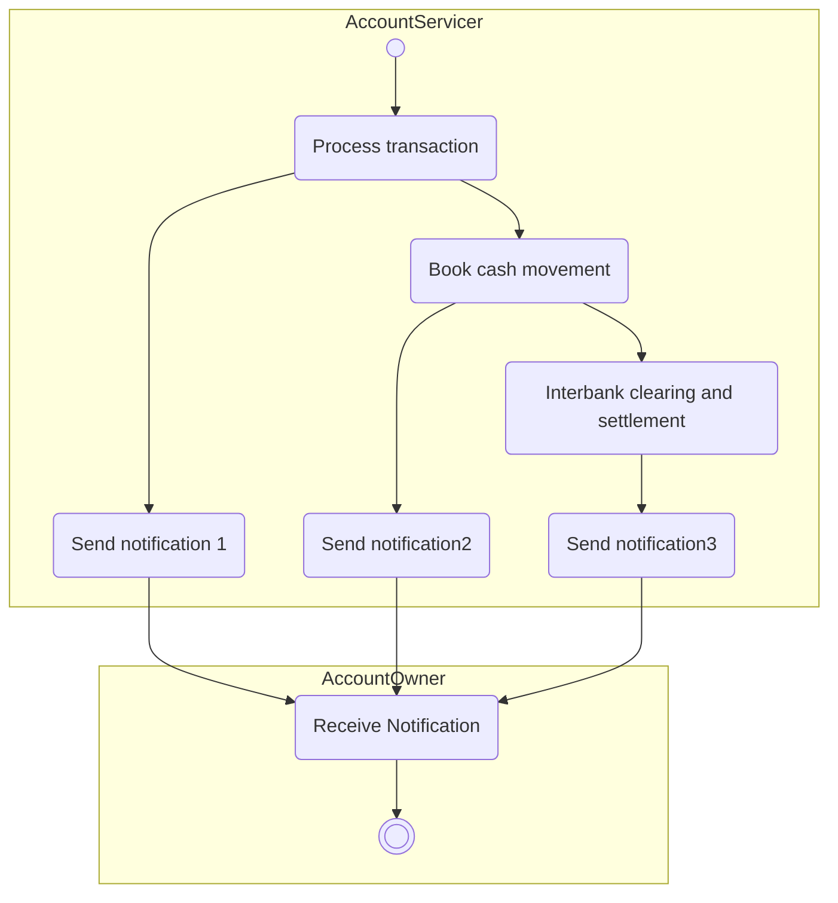

# Optional notifications to the account owner

## Source evidence

[src-000004](../../../../../../../../raw-input/banktocustomer_cash_management/ISO20022_MDRPart1_BankToCustomerCashManagement_2025_2026_v2.docx); Description of BusinessActivities; direct-body paragraph P118; word/media/image8.png. [Unchanged original figure](../../../../../../assets/src-000004/originals/image8.png).

## Mermaid reconstruction

## Roles, activities and alternatives

Each of the three processing stages can notify the Account Owner. T15 explicitly makes every depicted notification optional and dependent on the owner/servicer agreement; the artwork does not require all three sends. Early notification can precede final booking, booking can include conversion and charges, and notification may support cash positioning, reconciliation or investigation. The source Receive notification description and AccountOwner lane assign receipt to the owner while its T15 Initiator cell literally says Account Servicer. That unresolved source responsibility conflict is preserved as issue-000060. No message ID is printed in this activity.

| Source-scoped role | Canonical reference |
| --- | --- |
| account owner | [account owner](../../../../../../../../shared/reference/participants/participant-src-000004-account-owner.md) |
| account servicer | [account servicer](../../../../../../../../shared/reference/participants/participant-src-000004-account-servicer.md) |

Complete source responsibilities/conditions: [T15](../../documents/src-000004/tables/tbl-0015.md).

Reusable flows: [Notification to Account Owner](../../flows/flow-src-000004-p117-notification-to-account-owner.md).

## Review evidence

All source actor/role labels, process nodes, source boundaries, plain/generalisation arrows, fork bar, send directions, ordering and alternative annotations compared2026-11-09. [Compared Mermaid12.3.0 rendering](../../../../../../assets/src-000004/reconstructed/fig-0008.png). Source [Word14](../../../../../../assets/src-000004/source-page-renders/word-page-14.png). The two source role-label/responsibility conflicts remain needs-review despite faithful visible reconstruction.
