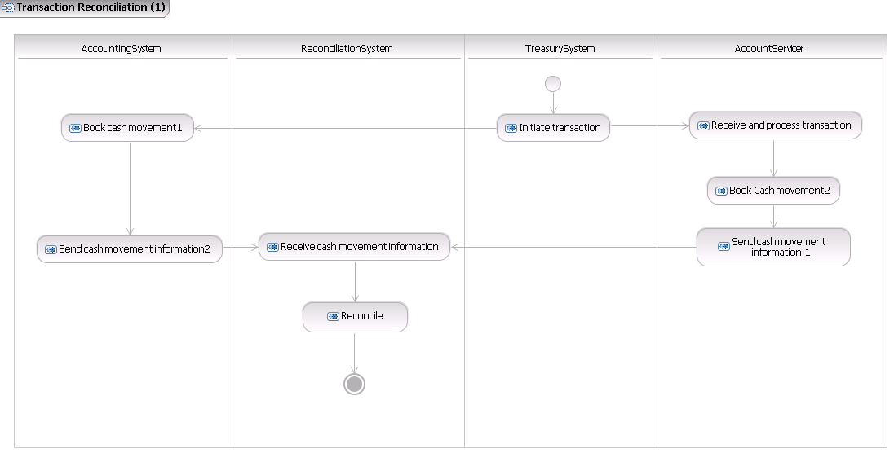
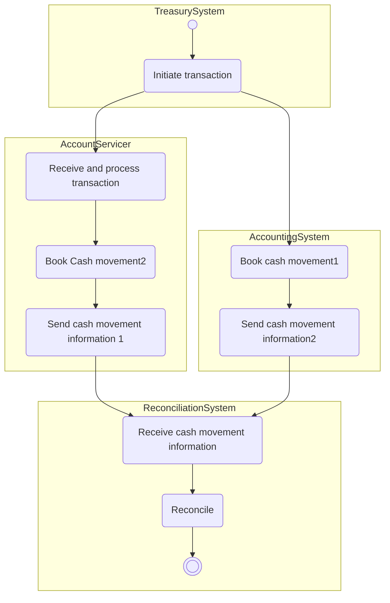

# Transaction reconciliation initiated by the account owner

## Source evidence

[src-000004](../../../../../../../../raw-input/banktocustomer_cash_management/ISO20022_MDRPart1_BankToCustomerCashManagement_2025_2026_v2.docx); Description of BusinessActivities; direct-body paragraph P120; word/media/image9.png. [Unchanged original figure](../../../../../../assets/src-000004/originals/image9.png).

## Mermaid reconstruction

## Roles, activities and alternatives

Treasury initiates the financial leg; the internal accounting and external servicing branches book and send their cash-movement information to the reconciliation system. The source contains two outgoing arrows without a fork bar; no exclusive decision is introduced. T16 requires matching internal and external feeds and identifies unmatched items as possible investigation triggers. P121 distinguishes aggregate financial reconciliation from detailed individual information; the total paid is analysed with specifications in detailed reports. The underlying transaction may be with a third party or the account servicer. This activity names systems, not an exact message exchange.

| Source-scoped role | Canonical reference |
| --- | --- |
| account owner | [account owner](../../../../../../../../shared/reference/participants/participant-src-000004-account-owner.md) |
| account servicer | [account servicer](../../../../../../../../shared/reference/participants/participant-src-000004-account-servicer.md) |
| accounting system | [accounting system](../../../../../../../../shared/reference/participants/participant-src-000004-accounting-system.md) |
| reconciliation system | [reconciliation system](../../../../../../../../shared/reference/participants/participant-src-000004-reconciliation-system.md) |
| treasury system | [treasury system](../../../../../../../../shared/reference/participants/participant-src-000004-treasury-system.md) |
| counterparty | [counterparty](../../../../../../../../shared/reference/participants/participant-src-000004-counterparty.md) |

Complete source responsibilities/conditions: [T16](../../documents/src-000004/tables/tbl-0016.md).

Reusable flows: [Transaction Reconciliation - 1](../../flows/flow-src-000004-p119-transaction-reconciliation-1.md).

## Review evidence

All source actor/role labels, process nodes, source boundaries, plain/generalisation arrows, fork bar, send directions, ordering and alternative annotations compared2026-11-09. [Compared Mermaid12.3.0 rendering](../../../../../../assets/src-000004/reconstructed/fig-0009.png). Source [Word16](../../../../../../assets/src-000004/source-page-renders/word-page-16.png). The two source role-label/responsibility conflicts remain needs-review despite faithful visible reconstruction.
