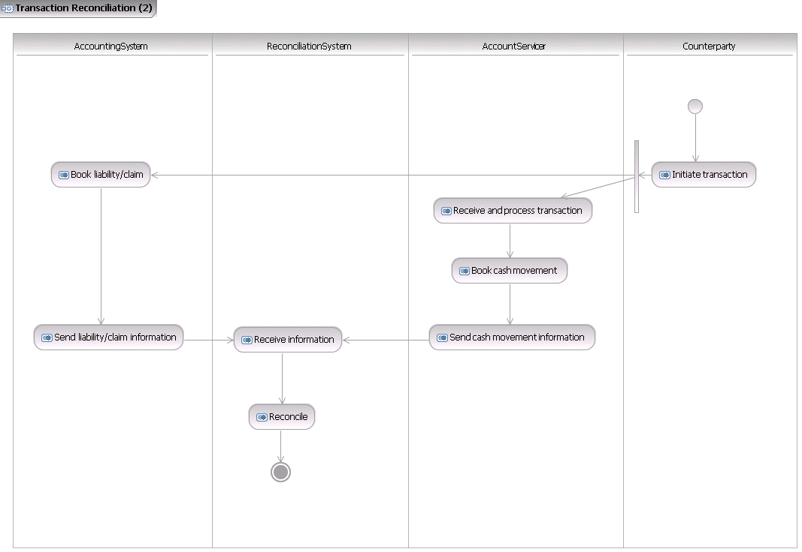
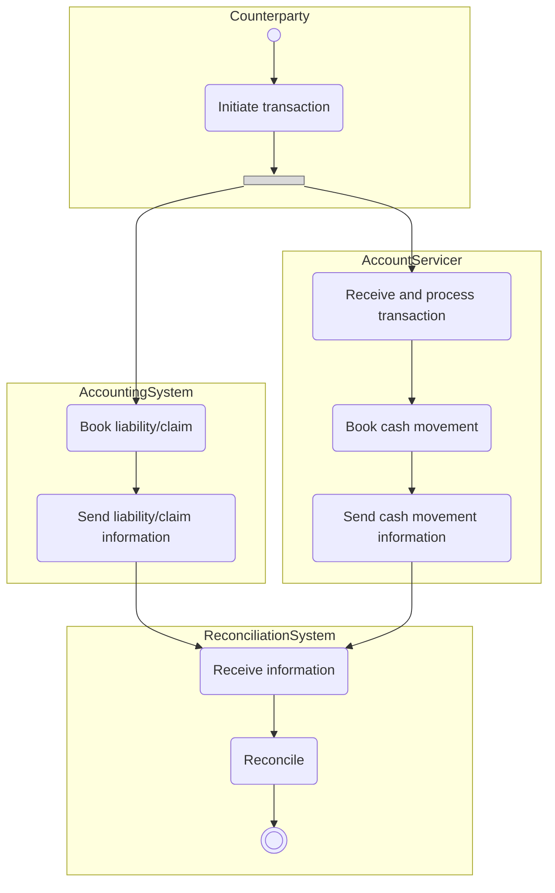

# Transaction reconciliation initiated by a counterparty

## Source evidence

[src-000004](../../../../../../../../raw-input/banktocustomer_cash_management/ISO20022_MDRPart1_BankToCustomerCashManagement_2025_2026_v2.docx); Description of BusinessActivities; direct-body paragraph P123; word/media/image10.png. [Unchanged original figure](../../../../../../assets/src-000004/originals/image10.png).

## Mermaid reconstruction

## Roles, activities and alternatives

The counterparty initiates the commercial transaction and its financial leg. A source fork bar splits toward internal liability/claim booking and servicing-side receipt/processing. The counterparty account servicer may differ from the account owner account servicer; intermediary financial institutions may transmit the transaction (T17). The two feeds converge in reconciliation; unmatched items can trigger investigation. P124 explains aggregate financial reconciliation, including lockbox, against detailed transaction specifications. The source pale vertical bar is preserved as a native fork with pale styling; it is not an exclusive choice.

| Source-scoped role | Canonical reference |
| --- | --- |
| account owner | [account owner](../../../../../../../../shared/reference/participants/participant-src-000004-account-owner.md) |
| account servicer | [account servicer](../../../../../../../../shared/reference/participants/participant-src-000004-account-servicer.md) |
| accounting system | [accounting system](../../../../../../../../shared/reference/participants/participant-src-000004-accounting-system.md) |
| reconciliation system | [reconciliation system](../../../../../../../../shared/reference/participants/participant-src-000004-reconciliation-system.md) |
| counterparty | [counterparty](../../../../../../../../shared/reference/participants/participant-src-000004-counterparty.md) |

Complete source responsibilities/conditions: [T17](../../documents/src-000004/tables/tbl-0017.md).

Reusable flows: [Transaction Reconciliation -2](../../flows/flow-src-000004-p122-transaction-reconciliation-2.md).

## Review evidence

All source actor/role labels, process nodes, source boundaries, plain/generalisation arrows, fork bar, send directions, ordering and alternative annotations compared2026-11-09. [Compared Mermaid12.3.0 rendering](../../../../../../assets/src-000004/reconstructed/fig-0010.png). Source [Word17](../../../../../../assets/src-000004/source-page-renders/word-page-17.png). The two source role-label/responsibility conflicts remain needs-review despite faithful visible reconstruction.
