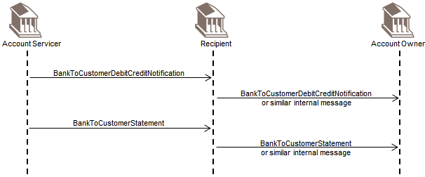
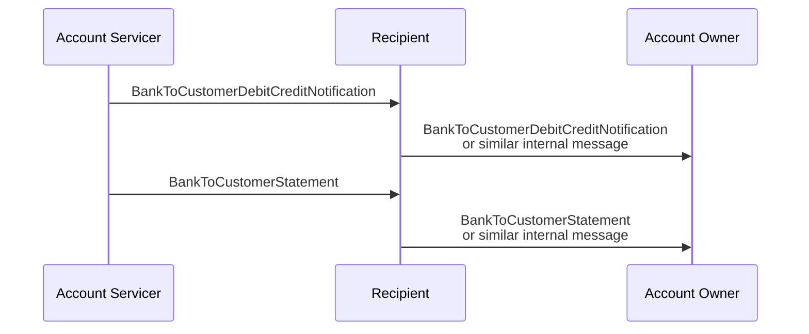

# Reporting scenario 3: authorised recipient relays information

## Source evidence

[src-000004](../../../../../../../../raw-input/banktocustomer_cash_management/ISO20022_MDRPart1_BankToCustomerCashManagement_2025_2026_v2.docx); BusinessTransactions / Reporting / Scenario 3; direct-body paragraph P139; word/media/image13.png. [Unchanged original figure](../../../../../../assets/src-000004/originals/image13.png).

## Mermaid reconstruction

## Roles, activities and alternatives

The account owner authorises the Recipient to receive account information. The source explicitly allows an internal message for the Recipient-to-Owner legs, so those legs are not guaranteed ISO 20022 exchanges. The diagram contains notification and statement only; no account-report arrow is added. Recipient is not equated with Forwarding Agent.

| Source-scoped role | Canonical reference |
| --- | --- |
| account owner | [account owner](../../../../../../../../shared/reference/participants/participant-src-000004-account-owner.md) |
| account servicer | [account servicer](../../../../../../../../shared/reference/participants/participant-src-000004-account-servicer.md) |
| recipient | [recipient](../../../../../../../../shared/reference/participants/participant-src-000004-recipient.md) |

## Exact message evidence

| Source family | Exact supplied definition | Companion MDR Part2 locator |
| --- | --- | --- |
| camt.053 | [camt.053.001.14](../../../../../messages/camt.053.001.14/index.md) | src-000005; 3 camt.053.001.14 BankToCustomerStatementV14; file pages263-522 |
| camt.054 | [camt.054.001.14](../../../../../messages/camt.054.001.14/index.md) | src-000005; 4 camt.054.001.14 BankToCustomerDebitCreditNotificationV14; file pages523-780 |

Reusable flows: [Scenario 3](../../flows/flow-src-000004-p137-scenario-3.md).

## Review evidence

All source actor/role labels, process nodes, source boundaries, plain/generalisation arrows, fork bar, send directions, ordering and alternative annotations compared2026-11-09. [Compared Mermaid12.3.0 rendering](../../../../../../assets/src-000004/reconstructed/fig-0013.png). Source [Word20](../../../../../../assets/src-000004/source-page-renders/word-page-20.png). The two source role-label/responsibility conflicts remain needs-review despite faithful visible reconstruction.
