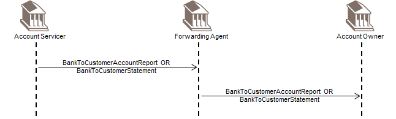
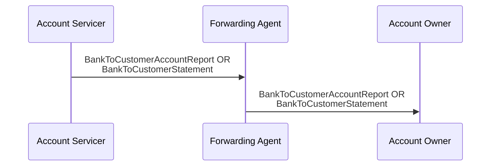

# Reporting through a forwarding agent

## Source evidence

[src-000004](../../../../../../../../raw-input/banktocustomer_cash_management/ISO20022_MDRPart1_BankToCustomerCashManagement_2025_2026_v2.docx); BusinessTransactions / Reporting through a Forwarding Agent ; direct-body paragraph P142; word/media/image14.png. [Unchanged original figure](../../../../../../assets/src-000004/originals/image14.png).

## Mermaid reconstruction

## Roles, activities and alternatives

The Forwarding Agent is a concentrating institution for the Account Owner. The three parties agree which reporting messages are sent. P141 also allows the final recipient to be a party authorised by the owner; this Recipient role is narrative context not drawn as a fourth actor. Both OR alternatives remain alternatives rather than a mandatory pair.

| Source-scoped role | Canonical reference |
| --- | --- |
| account owner | [account owner](../../../../../../../../shared/reference/participants/participant-src-000004-account-owner.md) |
| account servicer | [account servicer](../../../../../../../../shared/reference/participants/participant-src-000004-account-servicer.md) |
| forwarding agent | [forwarding agent](../../../../../../../../shared/reference/participants/participant-src-000004-forwarding-agent.md) |
| recipient | [recipient](../../../../../../../../shared/reference/participants/participant-src-000004-recipient.md) |

## Exact message evidence

| Source family | Exact supplied definition | Companion MDR Part2 locator |
| --- | --- | --- |
| camt.052 | [camt.052.001.14](../../../../../messages/camt.052.001.14/index.md) | src-000005; 2 camt.052.001.14 BankToCustomerAccountReportV14; file pages4-262 |
| camt.053 | [camt.053.001.14](../../../../../messages/camt.053.001.14/index.md) | src-000005; 3 camt.053.001.14 BankToCustomerStatementV14; file pages263-522 |

Reusable flows: [Reporting through a Forwarding Agent](../../flows/flow-src-000004-p140-reporting-through-a-forwarding-agent.md).

## Review evidence

All source actor/role labels, process nodes, source boundaries, plain/generalisation arrows, fork bar, send directions, ordering and alternative annotations compared2026-11-09. [Compared Mermaid12.3.0 rendering](../../../../../../assets/src-000004/reconstructed/fig-0014.png). Source [Word21](../../../../../../assets/src-000004/source-page-renders/word-page-21.png). The two source role-label/responsibility conflicts remain needs-review despite faithful visible reconstruction.
