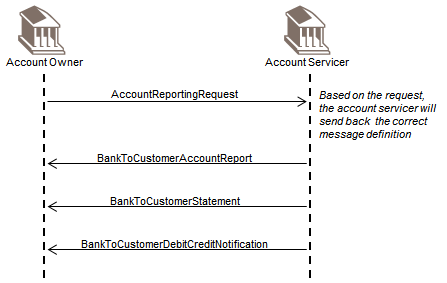
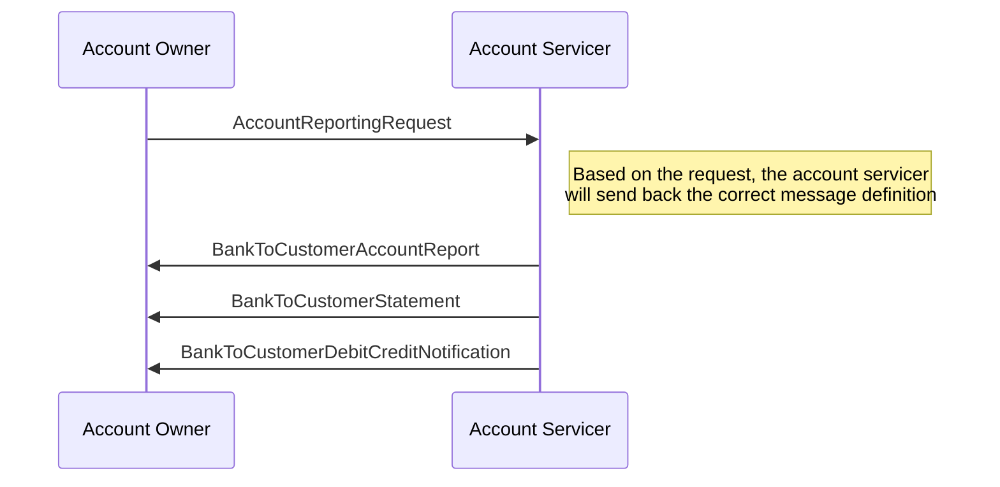

# Direct reporting request to the account servicer

## Source evidence

[src-000004](../../../../../../../../raw-input/banktocustomer_cash_management/ISO20022_MDRPart1_BankToCustomerCashManagement_2025_2026_v2.docx); BusinessTransactions / Reporting Request to Account Servicer / Direct Scenario; direct-body paragraph P148; word/media/image15.png. [Unchanged original figure](../../../../../../assets/src-000004/originals/image15.png).

## Mermaid reconstruction

## Roles, activities and alternatives

The owner requests reporting directly; the servicer sends the requested definition to the owner. The three drawn return arrows enumerate available message definitions; the annotation makes selection dependent on the request. They are not a source requirement to send all three. The order and annotation are retained without inventing explicit alt frames absent from the original.

| Source-scoped role | Canonical reference |
| --- | --- |
| account owner | [account owner](../../../../../../../../shared/reference/participants/participant-src-000004-account-owner.md) |
| account servicer | [account servicer](../../../../../../../../shared/reference/participants/participant-src-000004-account-servicer.md) |

## Exact message evidence

| Source family | Exact supplied definition | Companion MDR Part2 locator |
| --- | --- | --- |
| camt.052 | [camt.052.001.14](../../../../../messages/camt.052.001.14/index.md) | src-000005; 2 camt.052.001.14 BankToCustomerAccountReportV14; file pages4-262 |
| camt.053 | [camt.053.001.14](../../../../../messages/camt.053.001.14/index.md) | src-000005; 3 camt.053.001.14 BankToCustomerStatementV14; file pages263-522 |
| camt.054 | [camt.054.001.14](../../../../../messages/camt.054.001.14/index.md) | src-000005; 4 camt.054.001.14 BankToCustomerDebitCreditNotificationV14; file pages523-780 |
| camt.060 | [camt.060.001.07](../../../../../messages/camt.060.001.07/index.md) | src-000005; 5 camt.060.001.07 AccountReportingRequestV07; file pages781-795 |

Reusable flows: [Direct Scenario](../../flows/flow-src-000004-p144-direct-scenario.md).

## Review evidence

All source actor/role labels, process nodes, source boundaries, plain/generalisation arrows, fork bar, send directions, ordering and alternative annotations compared2026-11-09. [Compared Mermaid12.3.0 rendering](../../../../../../assets/src-000004/reconstructed/fig-0015.png). Source [Word21](../../../../../../assets/src-000004/source-page-renders/word-page-21.png). The two source role-label/responsibility conflicts remain needs-review despite faithful visible reconstruction.
