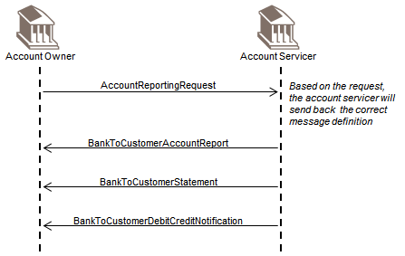

# fig-0015 - original figure evidence

Source: [src-000004](../../../../../../../../../raw-input/banktocustomer_cash_management/ISO20022_MDRPart1_BankToCustomerCashManagement_2025_2026_v2.docx). Locator: direct-body paragraph P148; BusinessTransactions / Reporting Request to Account Servicer / Direct Scenario; /w:document/w:body/w:p[148].

Original extracted asset: [image15.png](../../../../../../../assets/src-000004/originals/image15.png)

## Canonical reconstruction and review

[Canonical diagram, source qualifications, participant/flow links and recorded review evidence](../../../diagrams/curated/fig-0015.md). Original media and this occurrence's precise locator are retained. Rendering and visual comparison results above are copied from the canonical reference; any unresolved business, version or contextual limitation remains open.

## Canonical reconstruction

[Direct reporting request to the account servicer](../../../diagrams/curated/fig-0015.md). Original and complete Word artwork compared2026-11-09.
