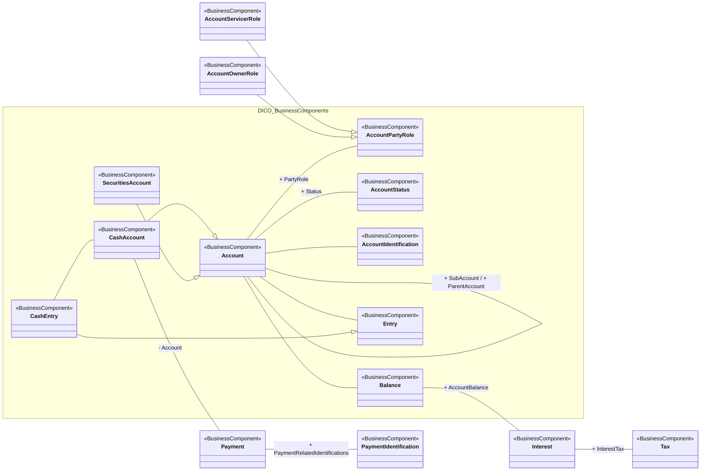

# Bank-to-customer account conceptual model

[src-000006](../../../../../../../../../raw-input/banktocustomer_cash_management/ISO20022_MDRPart3_BanktoCustomerCashManagement_2025_2026_v1.xlsx), Account!A1:T54; xl/drawings/drawing2.xml; anchor 1. Original image SHA-256: 3ef65cc36f6a0fd62985334e4c8e5493effdfa0c38ebe9553983470f1b664b9a.

[Original complete figure](../../../../../../../assets/src-000006/media/image2.png) · [Rendered Mermaid SVG](../../../../../../../assets/src-000006/reconstructed-models/src-000006-fig-0002.svg) · [Rendered Mermaid PNG](../../../../../../../assets/src-000006/reconstructed-models/src-000006-fig-0002.png)

## Source reconstruction

## Entities and relationships

AccountOwnerRole and AccountServicerRole specialize AccountPartyRole. This preserves their conceptual role distinction without equating either with an institution. Account has status, identification, balance, entries and a parent/sub-account self-association. Cash and securities accounts specialize Account; CashEntry specializes Entry. Interest, interest tax, payment and payment identification remain explicitly connected.

All 15 visible node occurrences and 16 relationship lines are retained. No numeric multiplicities are printed in this source view; none are inferred. Namespaces group only printed from-package labels for readability; the source does not draw those enclosing boxes. Nodes with no printed package remain outside these groups. No package membership is inferred from the component name. Association labels retain literal +/− prefixes and combined end names. Their re-layout position is not additional navigability evidence. The native class inheritance marker is reserved for the source’s hollow-triangle generalizations. Source editor/navigation icons are omitted as interface decoration; no business entity or relationship is excluded.

## Complete relationship register

| From node | To node | Source relationship kind | Visible source label(s) | From-end multiplicity | To-end multiplicity |
| --- | --- | --- | --- | --- | --- |
| AccountServicerRole | AccountPartyRole | generalization: subtype to supertype | (unlabelled in source) | not printed | not printed |
| AccountOwnerRole | AccountPartyRole | generalization: subtype to supertype | (unlabelled in source) | not printed | not printed |
| Account | AccountPartyRole | association | + PartyRole | not printed | not printed |
| Account | AccountStatus | association | + Status | not printed | not printed |
| Account | AccountIdentification | association | (unlabelled in source) | not printed | not printed |
| Account | Balance | association | (unlabelled in source) | not printed | not printed |
| Account | Account | association | + SubAccount / + ParentAccount | not printed | not printed |
| Account | Entry | association | (unlabelled in source) | not printed | not printed |
| CashAccount | Account | generalization: subtype to supertype | (unlabelled in source) | not printed | not printed |
| SecuritiesAccount | Account | generalization: subtype to supertype | (unlabelled in source) | not printed | not printed |
| CashEntry | Entry | generalization: subtype to supertype | (unlabelled in source) | not printed | not printed |
| CashEntry | CashAccount | association | (unlabelled in source) | not printed | not printed |
| Balance | Interest | association | + AccountBalance | not printed | not printed |
| Interest | Tax | association | + InterestTax | not printed | not printed |
| CashAccount | Payment | association | - Account | not printed | not printed |
| Payment | PaymentIdentification | association | + PaymentRelatedIdentifications | not printed | not printed |

## Entity definitions and precise workbook locators

| Visible label | Source package / stereotype | Definition evidence |
| --- | --- | --- |
| AccountPartyRole | DICO_BusinessComponents / BusinessComponent | [FullBusinessModel!A90:D90](../sheets/02-fullbusinessmodel/tbl-0002.md) — Role played by a party in the context of account operations. |
| AccountServicerRole | (package not printed) / BusinessComponent | [FullBusinessModel!A108:D108](../sheets/02-fullbusinessmodel/tbl-0002.md) — Party that manages the account on behalf of the account owner, that is manages the registration and booking of entries on the account, calculates balances on the account and provides information about the account. |
| AccountOwnerRole | (package not printed) / BusinessComponent | [FullBusinessModel!A89:D89](../sheets/02-fullbusinessmodel/tbl-0002.md) — Party that legally owns the account. |
| AccountStatus | DICO_BusinessComponents / BusinessComponent | [FullBusinessModel!A110:D110](../sheets/02-fullbusinessmodel/tbl-0002.md) — Specifies the status of an account or the status of the processing of the actions linked to the management of an account. |
| AccountIdentification | DICO_BusinessComponents / BusinessComponent | [FullBusinessModel!A71:D71](../sheets/02-fullbusinessmodel/tbl-0002.md) — Unique identifier of an account, as assigned by the account servicer. |
| Account | DICO_BusinessComponents / BusinessComponent | [FullBusinessModel!A24:D24](../sheets/02-fullbusinessmodel/tbl-0002.md) — Record of transactions in specific types of assets, maintained by a servicing party on behalf of one or more owning parties. Business relationship between an account servicer and one or more account owners. |
| Balance | DICO_BusinessComponents / BusinessComponent | [FullBusinessModel!A356:D356](../sheets/02-fullbusinessmodel/tbl-0003.md) — Numerical representation of the net increases and decreases in an account at a specific point in time. |
| Entry | DICO_BusinessComponents / BusinessComponent | [FullBusinessModel!A1814:D1814](../sheets/02-fullbusinessmodel/tbl-0011.md) — Posting to an account that results in an increase or decrease to a balance. |
| CashEntry | DICO_BusinessComponents / BusinessComponent | [FullBusinessModel!A680:D680](../sheets/02-fullbusinessmodel/tbl-0005.md) — Posting of an item to a cash account, in the context of a cash transaction, that results in an increase or decrease to the balance of the account. |
| CashAccount | DICO_BusinessComponents / BusinessComponent | [FullBusinessModel!A562:D562](../sheets/02-fullbusinessmodel/tbl-0004.md) — Account to or from which a cash entry is made. |
| SecuritiesAccount | DICO_BusinessComponents / BusinessComponent | [FullBusinessModel!A3889:D3889](../sheets/02-fullbusinessmodel/tbl-0021.md) — Account to or from which a securities entry is made. |
| Interest | (package not printed) / BusinessComponent | [FullBusinessModel!A2133:D2133](../sheets/02-fullbusinessmodel/tbl-0012.md) — Consideration, such as amount of money,  paid or received in exchange for an asset that has been invested, loaned or borrowed for a certain period. The interest is expressed as a fixed amount or percentage of the amount upon which the interest is applied. |
| Tax | (package not printed) / BusinessComponent | [FullBusinessModel!A4968:D4968](../sheets/02-fullbusinessmodel/tbl-0026.md) — Amount of money due to the government or tax authority, according to various pre-defined parameters such as thresholds or income. |
| Payment | (package not printed) / BusinessComponent | [FullBusinessModel!A3055:D3055](../sheets/02-fullbusinessmodel/tbl-0017.md) — Payment information and processes required to transfer cash end to end from the debtor to the creditor. |
| PaymentIdentification | (package not printed) / BusinessComponent | [FullBusinessModel!A3122:D3122](../sheets/02-fullbusinessmodel/tbl-0017.md) — Specifies the different identifications associated with a payment transaction. |

## Participant and flow navigation

This is a conceptual entity model, not a message exchange diagram. A business component or relationship label is not automatically a functional participant or institution. [Message-set participant references](../../../participants.md) and [Message-set business flows](../../../flows/index.md) provide the independently sourced actor/process context. These references are navigational; source figure associations do not establish message direction.

## Rendering and visual review

2026-11-09: Mermaid 12.3.0 parsed and rendered successfully with Mermaid browser API + Chromium 156.0.8078.81. Direct comparison of each complete source image and rendered PNG; checked all 15 visible node occurrences, 16 relationship lines, literal endpoint labels, inheritance direction, package labels and printed/omitted stereotypes. No multiplicities are printed or inferred. The src-000164 displaced label is resolved from FullBusinessModel A2990:F2990 and A635:F635; original source retained. [Renderer evidence](../../../../../../../../../work/payment-workbook-models/render-report.json).

