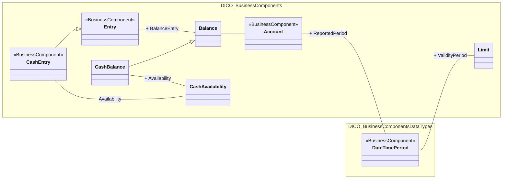

# Bank-to-customer cash balance and availability

[src-000006](../../../../../../../../../raw-input/banktocustomer_cash_management/ISO20022_MDRPart3_BanktoCustomerCashManagement_2025_2026_v1.xlsx), CashBalance!A1:AF18; xl/drawings/drawing4.xml; anchor 1. Original image SHA-256: 202ab4449b30b2c7c4cba676aa36e4086a2e80f60068180cedbfb885c030fb92.

[Original complete figure](../../../../../../../assets/src-000006/media/image4.png) · [Rendered Mermaid SVG](../../../../../../../assets/src-000006/reconstructed-models/src-000006-fig-0004.svg) · [Rendered Mermaid PNG](../../../../../../../assets/src-000006/reconstructed-models/src-000006-fig-0004.png)

## Source reconstruction

## Entities and relationships

CashEntry and CashBalance specialize Entry and Balance respectively and each associates separately with CashAvailability. Balance relates to Account; Account reports a DateTimePeriod, also used as the Limit validity period. The CashEntry–CashAvailability label is printed without a plus sign, unlike the CashBalance association.

All 8 visible node occurrences and 8 relationship lines are retained. No numeric multiplicities are printed in this source view; none are inferred. Namespaces group only printed from-package labels for readability; the source does not draw those enclosing boxes. Nodes with no printed package remain outside these groups. No package membership is inferred from the component name. Association labels retain literal +/− prefixes and combined end names. Their re-layout position is not additional navigability evidence. The native class inheritance marker is reserved for the source’s hollow-triangle generalizations. Source editor/navigation icons are omitted as interface decoration; no business entity or relationship is excluded.

## Complete relationship register

| From node | To node | Source relationship kind | Visible source label(s) | From-end multiplicity | To-end multiplicity |
| --- | --- | --- | --- | --- | --- |
| Entry | Balance | association | + BalanceEntry | not printed | not printed |
| Balance | Account | association | (unlabelled in source) | not printed | not printed |
| Account | DateTimePeriod | association | + ReportedPeriod | not printed | not printed |
| DateTimePeriod | Limit | association | + ValidityPeriod | not printed | not printed |
| CashEntry | Entry | generalization: subtype to supertype | (unlabelled in source) | not printed | not printed |
| CashEntry | CashAvailability | association | Availability | not printed | not printed |
| CashBalance | Balance | generalization: subtype to supertype | (unlabelled in source) | not printed | not printed |
| CashBalance | CashAvailability | association | + Availability | not printed | not printed |

## Entity definitions and precise workbook locators

| Visible label | Source package / stereotype | Definition evidence |
| --- | --- | --- |
| Entry | DICO_BusinessComponents / BusinessComponent | [FullBusinessModel!A1814:D1814](../sheets/02-fullbusinessmodel/tbl-0011.md) — Posting to an account that results in an increase or decrease to a balance. |
| Balance | DICO_BusinessComponents / (stereotype not printed) | [FullBusinessModel!A356:D356](../sheets/02-fullbusinessmodel/tbl-0003.md) — Numerical representation of the net increases and decreases in an account at a specific point in time. |
| Account | DICO_BusinessComponents / BusinessComponent | [FullBusinessModel!A24:D24](../sheets/02-fullbusinessmodel/tbl-0002.md) — Record of transactions in specific types of assets, maintained by a servicing party on behalf of one or more owning parties. Business relationship between an account servicer and one or more account owners. |
| DateTimePeriod | DICO_BusinessComponentsDataTypes / BusinessComponent | [FullBusinessModel!A1363:D1363](../sheets/02-fullbusinessmodel/tbl-0008.md) — Time span defined by a start date and time, and an end date and time. |
| Limit | DICO_BusinessComponents / (stereotype not printed) | [FullBusinessModel!A2559:D2559](../sheets/02-fullbusinessmodel/tbl-0014.md) — Value used for risk containment in a system or towards counterparts. The limit may be a current limit or a default limit. |
| CashEntry | DICO_BusinessComponents / BusinessComponent | [FullBusinessModel!A680:D680](../sheets/02-fullbusinessmodel/tbl-0005.md) — Posting of an item to a cash account, in the context of a cash transaction, that results in an increase or decrease to the balance of the account. |
| CashAvailability | DICO_BusinessComponents / (stereotype not printed) | [FullBusinessModel!A610:D610](../sheets/02-fullbusinessmodel/tbl-0005.md) — Indicates when the amount of money will become available, ie can be accessed and start generating interest. |
| CashBalance | DICO_BusinessComponents / (stereotype not printed) | [FullBusinessModel!A617:D617](../sheets/02-fullbusinessmodel/tbl-0005.md) — Numerical representation of the net increases and decreases in an account at a specific point in time. A cash balance is calculated from a sum of cash credits minus a sum of cash debits. |

## Participant and flow navigation

This is a conceptual entity model, not a message exchange diagram. A business component or relationship label is not automatically a functional participant or institution. [Message-set participant references](../../../participants.md) and [Message-set business flows](../../../flows/index.md) provide the independently sourced actor/process context. These references are navigational; source figure associations do not establish message direction.

## Rendering and visual review

2026-11-09: Mermaid 12.3.0 parsed and rendered successfully with Mermaid browser API + Chromium 156.0.8078.81. Direct comparison of each complete source image and rendered PNG; checked all 8 visible node occurrences, 8 relationship lines, literal endpoint labels, inheritance direction, package labels and printed/omitted stereotypes. No multiplicities are printed or inferred. The src-000164 displaced label is resolved from FullBusinessModel A2990:F2990 and A635:F635; original source retained. [Renderer evidence](../../../../../../../../../work/payment-workbook-models/render-report.json).

