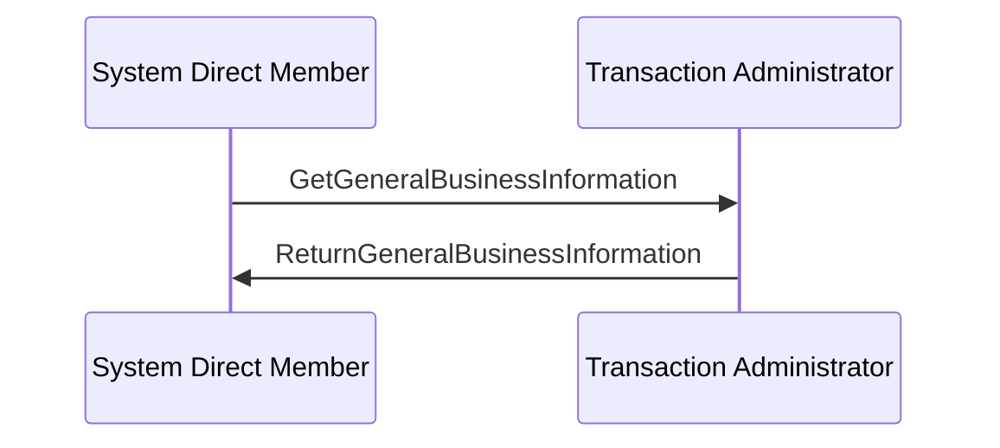

# Get/Return General Business Information Scenario

[src-000014](../../../../../../../../raw-input/cash_management/ISO20022_MDRPart1_CashManagement_2024_2025_v2.docx); direct-body paragraph P312; Word file page31.

[Complete Word page](../../../../../../assets/src-000014/word-page-context/page-0031.png) · [Original artwork](../../../../../../assets/src-000014/originals/image26.png)

## Entities and relationships

| Source | Destination | Label or relationship |
| --- | --- | --- |
| System Direct Member | Transaction Administrator | GetGeneralBusinessInformation |
| Transaction Administrator | System Direct Member | ReturnGeneralBusinessInformation |

## Participants

- [System Direct Member](../../../../../../../../shared/reference/participants/participant-src-000014-system-direct-member.md)
- [System / Transaction Administrator](../../../../../../../../shared/reference/participants/participant-src-000014-system-transaction-administrator.md)

## Qualifications

- The picture shows only the System Direct Member and Transaction Administrator. Account owner/servicing institution are narrative relationship roles (P75–78), not extra lifelines.
- Solid source exchange lines and ordering are retained. No timeout, condition, response code or mandatory Receipt is inferred solely from the picture.

[Flow, alternatives and source narrative](../../flows/flow-src-000014-p308-get-return-general-business-information-scenario.md)

## Rendering and visual review

The complete Word-composed source and final Mermaid12.3.0 reconstruction were directly compared on 2026-11-09. Actor labels, message labels, directions, order, associations, overview boundaries and execution-delay bars match. Source icons and layout are retained in the original image; the reconstruction uses text actors. Figures7/11 were corrected and re-rendered so the delay bar reaches the Return response. All38 Word pages were inventoried. Source discrepancies remain open where listed.

[Rendered PNG](../../../../../../assets/src-000014/reconstructed/fig-0026.png) · [Rendered SVG](../../../../../../assets/src-000014/reconstructed/fig-0026.svg) · [Hash-bound review evidence](../../../../../../../../tracking/reviews/operational-cash.json)
