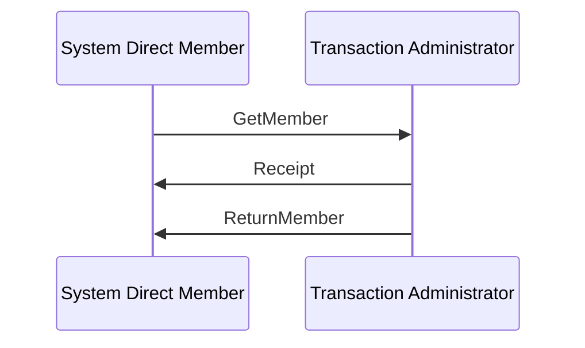

# Get/Return Member Receipt

[src-000014](../../../../../../../../raw-input/cash_management/ISO20022_MDRPart1_CashManagement_2024_2025_v2.docx); direct-body paragraph P328; Word file page33.

[Complete Word page](../../../../../../assets/src-000014/word-page-context/page-0033.png) · [Original artwork](../../../../../../assets/src-000014/originals/image29.png)

## Entities and relationships

| Source | Destination | Label or relationship |
| --- | --- | --- |
| System Direct Member | Transaction Administrator | GetMember |
| Transaction Administrator | System Direct Member | Receipt |
| Transaction Administrator | System Direct Member | ReturnMember |

## Participants

- [System Direct Member](../../../../../../../../shared/reference/participants/participant-src-000014-system-direct-member.md)
- [System / Transaction Administrator](../../../../../../../../shared/reference/participants/participant-src-000014-system-transaction-administrator.md)

## Qualifications

- The picture shows only the System Direct Member and Transaction Administrator. Account owner/servicing institution are narrative relationship roles (P75–78), not extra lifelines.
- Solid source exchange lines and ordering are retained. No timeout, condition, response code or mandatory Receipt is inferred solely from the picture.
- The source prose permits a final Receipt from member to administrator to close the cycle. It is absent from the picture and retained as a narrative-only optional step in the flow. Only Figures7/11 draw an Execution Delay activation bar; it is not added to other figures.

[Flow, alternatives and source narrative](../../flows/flow-src-000014-p323-get-return-member-receipt.md)

## Rendering and visual review

The complete Word-composed source and final Mermaid12.3.0 reconstruction were directly compared on 2026-11-09. Actor labels, message labels, directions, order, associations, overview boundaries and execution-delay bars match. Source icons and layout are retained in the original image; the reconstruction uses text actors. Figures7/11 were corrected and re-rendered so the delay bar reaches the Return response. All38 Word pages were inventoried. Source discrepancies remain open where listed.

[Rendered PNG](../../../../../../assets/src-000014/reconstructed/fig-0029.png) · [Rendered SVG](../../../../../../assets/src-000014/reconstructed/fig-0029.svg) · [Hash-bound review evidence](../../../../../../../../tracking/reviews/operational-cash.json)
