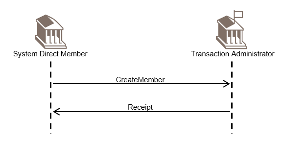

# fig-0030 - original figure evidence

Source: [src-000014](../../../../../../../../../raw-input/cash_management/ISO20022_MDRPart1_CashManagement_2024_2025_v2.docx). Locator: direct-body paragraph P332; BusinessTransactions / System Status  / Create Member Scenario; /w:document/w:body/w:p[332].

Original extracted asset: [image30.png](../../../../../../../assets/src-000014/originals/image30.png)

## Canonical reconstruction

Complete source composition and final Mermaid rendering were directly compared. [Canonical diagram, qualifications and evidence](../../../diagrams/operational-cash/fig-0030.md)

<!-- CASH-DIAGRAM -->
[Canonical complete source reconstruction](../../../diagrams/operational-cash/fig-0030.md)
