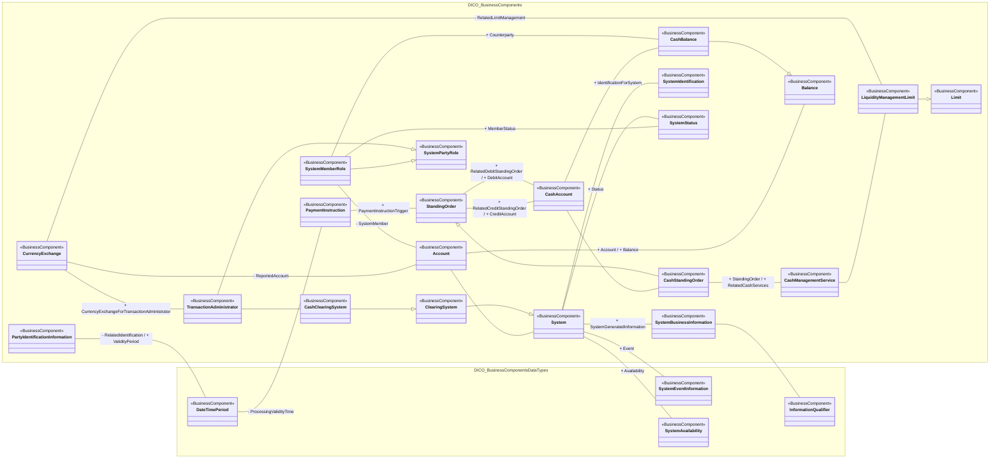

# Operational transactions, system and account model

[src-000016](../../../../../../../../../raw-input/cash_management/ISO20022_MDRPart3_CashManagement_2024_2025_v1.xlsx), TransactionsSystemAccount!A1; xl/drawings/drawing4.xml; anchor 1. Original image SHA-256: 1b213ca779b38923a81e7d57e632bab3d13eac8c6e988637be0d2d76351da1df.

[Original complete figure](../../../../../../../assets/src-000016/media/image4.png) · [Rendered Mermaid SVG](../../../../../../../assets/src-000016/reconstructed-models/src-000016-fig-0004.svg) · [Rendered Mermaid PNG](../../../../../../../assets/src-000016/reconstructed-models/src-000016-fig-0004.png)

## Source reconstruction

## Entities and relationships

Standing orders have separate credit-account and debit-account associations. CashStandingOrder specializes StandingOrder and links cash-management services. Liquidity limits connect service and exchange context. System information, identification, events, availability and status are separate components. SystemMemberRole and TransactionAdministrator specialize SystemPartyRole; their account, balance, system-status and clearing-system associations are retained. CashAccount and Account remain separate visible nodes; the source view does not draw a generalization between them.

All 25 visible node occurrences and 31 relationship lines are retained. No numeric multiplicities are printed in this source view; none are inferred. Namespaces group only printed from-package labels for readability; the source does not draw those enclosing boxes. Nodes with no printed package remain outside these groups. No package membership is inferred from the component name. Association labels retain literal +/− prefixes and combined end names. Their re-layout position is not additional navigability evidence. The native class inheritance marker is reserved for the source’s hollow-triangle generalizations. Source editor/navigation icons are omitted as interface decoration; no business entity or relationship is excluded.

## Complete relationship register

| From node | To node | Source relationship kind | Visible source label(s) | From-end multiplicity | To-end multiplicity |
| --- | --- | --- | --- | --- | --- |
| PartyIdentificationInformation | DateTimePeriod | association | - RelatedIdentification / + ValidityPeriod | not printed | not printed |
| DateTimePeriod | PaymentInstruction | association | - ProcessingValidityTime | not printed | not printed |
| PaymentInstruction | StandingOrder | association | + PaymentInstructionTrigger | not printed | not printed |
| StandingOrder | CashAccount | association | + RelatedCreditStandingOrder / + CreditAccount | not printed | not printed |
| StandingOrder | CashAccount | association | + RelatedDebitStandingOrder / + DebitAccount | not printed | not printed |
| CashStandingOrder | StandingOrder | generalization: subtype to supertype | (unlabelled in source) | not printed | not printed |
| CashAccount | CashStandingOrder | association | (unlabelled in source) | not printed | not printed |
| CashStandingOrder | CashManagementService | association | + StandingOrder / + RelatedCashServices | not printed | not printed |
| CashManagementService | LiquidityManagementLimit | association | (unlabelled in source) | not printed | not printed |
| LiquidityManagementLimit | Limit | generalization: subtype to supertype | (unlabelled in source) | not printed | not printed |
| CurrencyExchange | LiquidityManagementLimit | association | - RelatedLimitManagement | not printed | not printed |
| CurrencyExchange | Account | association | - ReportedAccount | not printed | not printed |
| CurrencyExchange | TransactionAdministrator | association | + CurrencyExchangeForTransactionAdministrator | not printed | not printed |
| Account | System | association | (unlabelled in source) | not printed | not printed |
| Account | Balance | association | + Account / + Balance | not printed | not printed |
| CashAccount | CashBalance | association | (unlabelled in source) | not printed | not printed |
| CashBalance | Balance | generalization: subtype to supertype | (unlabelled in source) | not printed | not printed |
| SystemMemberRole | CashBalance | association | + Counterparty | not printed | not printed |
| SystemMemberRole | Account | association | - SystemMember | not printed | not printed |
| SystemMemberRole | SystemStatus | association | + MemberStatus | not printed | not printed |
| SystemMemberRole | SystemPartyRole | generalization: subtype to supertype | (unlabelled in source) | not printed | not printed |
| TransactionAdministrator | SystemPartyRole | generalization: subtype to supertype | (unlabelled in source) | not printed | not printed |
| TransactionAdministrator | CashClearingSystem | association | (unlabelled in source) | not printed | not printed |
| CashClearingSystem | ClearingSystem | generalization: subtype to supertype | (unlabelled in source) | not printed | not printed |
| ClearingSystem | System | generalization: subtype to supertype | (unlabelled in source) | not printed | not printed |
| System | SystemBusinessInformation | association | + SystemGeneratedInformation | not printed | not printed |
| SystemBusinessInformation | InformationQualifier | association | (unlabelled in source) | not printed | not printed |
| System | SystemIdentification | association | + IdentificationForSystem | not printed | not printed |
| System | SystemEventInformation | association | + Event | not printed | not printed |
| System | SystemAvailability | association | + Availability | not printed | not printed |
| System | SystemStatus | association | + Status | not printed | not printed |

## Entity definitions and precise workbook locators

| Visible label | Source package / stereotype | Definition evidence |
| --- | --- | --- |
| PartyIdentificationInformation | DICO_BusinessComponents / BusinessComponent | [FullBusinessModel!A2996:D2996](../sheets/02-fullbusinessmodel/tbl-0016.md) — Unique and unambiguous way to identify a party |
| DateTimePeriod | DICO_BusinessComponentsDataTypes / BusinessComponent | [FullBusinessModel!A1346:D1346](../sheets/02-fullbusinessmodel/tbl-0008.md) — Time span defined by a start date and time, and an end date and time. |
| PaymentInstruction | DICO_BusinessComponents / BusinessComponent | [FullBusinessModel!A3092:D3092](../sheets/02-fullbusinessmodel/tbl-0017.md) — Instruction to pay an amount of money to an ultimate beneficiary, on behalf of an originator. This instruction may have to be forwarded several times to complete the settlement chain. |
| StandingOrder | DICO_BusinessComponents / BusinessComponent | [FullBusinessModel!A4728:D4728](../sheets/02-fullbusinessmodel/tbl-0025.md) — Instruction given by an account holder to an account servicer to make regular transfers on given dates to the same beneficiary. |
| CashAccount | DICO_BusinessComponents / BusinessComponent | [FullBusinessModel!A548:D548](../sheets/02-fullbusinessmodel/tbl-0004.md) — Account to or from which a cash entry is made. |
| CashStandingOrder | DICO_BusinessComponents / BusinessComponent | [FullBusinessModel!A719:D719](../sheets/02-fullbusinessmodel/tbl-0005.md) — Instruction given by a party that has explicit authority to instruct a debit on the account, ie, either the debit account owner or originating party, to a first agent, to process cash transfers at specified intervals during an implicit or explicit period of time. A standing order is given once and is valid for an open or closed period of time. |
| CashManagementService | DICO_BusinessComponents / BusinessComponent | [FullBusinessModel!A681:D681](../sheets/02-fullbusinessmodel/tbl-0005.md) — Set of applications that provides services which facilitate the management of cash positions on an account. |
| Limit | DICO_BusinessComponents / BusinessComponent | [FullBusinessModel!A2524:D2524](../sheets/02-fullbusinessmodel/tbl-0014.md) — Value used for risk containment in a system or towards counterparts. The limit may be a current limit or a default limit. |
| LiquidityManagementLimit | DICO_BusinessComponents / BusinessComponent | [FullBusinessModel!A2572:D2572](../sheets/02-fullbusinessmodel/tbl-0014.md) — Cash management feature limiting the amount of liquidity needed to perform clearing and settlement operations. At any point in time during the process, the limit imposes the maximum amount of liquidity available for operations concerning the system or other managed elements, for example, transaction amount or counterparty. |
| CurrencyExchange | DICO_BusinessComponents / BusinessComponent | [FullBusinessModel!A1293:D1293](../sheets/02-fullbusinessmodel/tbl-0008.md) — Information needed to process a currency exchange or conversion. |
| Account | DICO_BusinessComponents / BusinessComponent | [FullBusinessModel!A24:D24](../sheets/02-fullbusinessmodel/tbl-0002.md) — Record of transactions in specific types of assets, maintained by a servicing party on behalf of one or more owning parties. Business relationship between an account servicer and one or more account owners. |
| System | DICO_BusinessComponents / BusinessComponent | [FullBusinessModel!A4832:D4832](../sheets/02-fullbusinessmodel/tbl-0026.md) — Set of integrated applications that provides centralised services such as clearing, netting, reconciliation, trading and/or settlement. |
| SystemBusinessInformation | DICO_BusinessComponents / BusinessComponent | [FullBusinessModel!A4856:D4856](../sheets/02-fullbusinessmodel/tbl-0026.md) — Details about business information related to a system. |
| InformationQualifier | DICO_BusinessComponentsDataTypes / BusinessComponent | [FullBusinessModel!A2053:D2053](../sheets/02-fullbusinessmodel/tbl-0012.md) — Further qualifies the information provided in terms of its importance and its format. |
| SystemIdentification | DICO_BusinessComponents / BusinessComponent | [FullBusinessModel!A4871:D4871](../sheets/02-fullbusinessmodel/tbl-0026.md) — Parameters that identify a system. |
| SystemEventInformation | DICO_BusinessComponentsDataTypes / BusinessComponent | [FullBusinessModel!A4867:D4867](../sheets/02-fullbusinessmodel/tbl-0026.md) — Detailed information about an event occurring on a system, whether planned, for example, cut-off time for a specific type of eligible transfer, or unplanned, for example, an unsolicited failure, as stipulated in the specifications of the system. |
| SystemAvailability | DICO_BusinessComponentsDataTypes / BusinessComponent | [FullBusinessModel!A4850:D4850](../sheets/02-fullbusinessmodel/tbl-0026.md) — information about the periods of activity and non-activity of a system. |
| SystemStatus | DICO_BusinessComponents / BusinessComponent | [FullBusinessModel!A4891:D4891](../sheets/02-fullbusinessmodel/tbl-0026.md) — Status of a system and the period of time during which the status is valid. |
| ClearingSystem | DICO_BusinessComponents / BusinessComponent | [FullBusinessModel!A812:D812](../sheets/02-fullbusinessmodel/tbl-0006.md) — Specifies the system which plays a role in the clearing process. |
| CashClearingSystem | DICO_BusinessComponents / BusinessComponent | [FullBusinessModel!A613:D613](../sheets/02-fullbusinessmodel/tbl-0005.md) — Clearing system that processes only cash transfers. |
| TransactionAdministrator | DICO_BusinessComponents / BusinessComponent | [FullBusinessModel!A5111:D5111](../sheets/02-fullbusinessmodel/tbl-0027.md) — Set of integrated applications that provides centralised services such as clearing and settlement. |
| SystemPartyRole | DICO_BusinessComponents / BusinessComponent | [FullBusinessModel!A4888:D4888](../sheets/02-fullbusinessmodel/tbl-0026.md) — Role played by a party in a system. |
| SystemMemberRole | DICO_BusinessComponents / BusinessComponent | [FullBusinessModel!A4879:D4879](../sheets/02-fullbusinessmodel/tbl-0026.md) — Information about the members of a system. |
| Balance | DICO_BusinessComponents / BusinessComponent | [FullBusinessModel!A344:D344](../sheets/02-fullbusinessmodel/tbl-0003.md) — Numerical representation of the net increases and decreases in an account at a specific point in time. |
| CashBalance | DICO_BusinessComponents / BusinessComponent | [FullBusinessModel!A602:D602](../sheets/02-fullbusinessmodel/tbl-0005.md) — Numerical representation of the net increases and decreases in an account at a specific point in time. A cash balance is calculated from a sum of cash credits minus a sum of cash debits. |

## Participant and flow navigation

This is a conceptual entity model, not a message exchange diagram. A business component or relationship label is not automatically a functional participant or institution. [Message-set participant references](../../../participants.md) and [Message-set business flows](../../../flows/index.md) provide the independently sourced actor/process context. These references are navigational; source figure associations do not establish message direction.

## Rendering and visual review

2026-11-09: Mermaid 12.3.0 parsed and rendered successfully with Mermaid browser API + Chromium 156.0.8078.81. Direct comparison of each complete source image and rendered PNG; checked all 25 visible node occurrences, 31 relationship lines, literal endpoint labels, inheritance direction, package labels and printed/omitted stereotypes. No multiplicities are printed or inferred. The src-000164 displaced label is resolved from FullBusinessModel A2990:F2990 and A635:F635; original source retained. [Renderer evidence](../../../../../../../../../work/payment-workbook-models/render-report.json).

## Exact-image occurrence in src-000364 fig-0002

[T2S LimitUtilisationJournal — T2S-LimitUtilisationJournal](../../../../../../../../securities/reference/message-sets/t2s-limit-utilisation-journal/february-2025/workbooks/src-000364/diagrams/fig-0002.md) retains its archive-member provenance and message-set context. Full source-figure SHA-256 and all visible component parent/definition claims match; see its declaration-row comparison.
