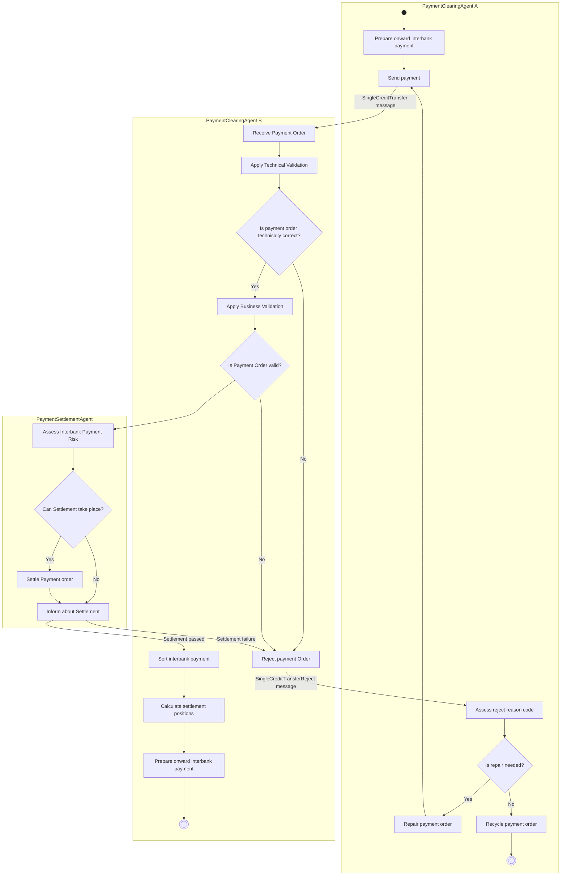

# Credit Transfer — figure 7

[src-000162](../../../../../../../../raw-input/payments_clearing_and_settlement/ISO20022_MDRPart1_PaymentsClearingAndSettlement_2025_2026_v2.docx); direct-body paragraph P139; Word file/printed page 17.

[Original figure](../../../../../../assets/src-000162/originals/image7.png) · [Complete Word-rendered page](../../../../../../assets/src-000162/word-render/page-017.png) · [Reusable flow](../../flows/flow-src-000162-p138-credit-transfer.md)

## Source reconstruction

## Participants and roles

| Occurrence | Literal label | Scoped roles |
| --- | --- | --- |
| A | PaymentClearingAgent A | [payment-clearing-agent-a](../../../../../../../../shared/reference/participants/participant-src-000162-payment-clearing-agent-a.md) |
| B | PaymentClearingAgent B | [payment-clearing-agent-b](../../../../../../../../shared/reference/participants/participant-src-000162-payment-clearing-agent-b.md) |
| S | PaymentSettlementAgent | [payment-settlement-agent](../../../../../../../../shared/reference/participants/participant-src-000162-payment-settlement-agent.md) |

## Relationships and activities

| Order | From | To | Literal connection |
| --- | --- | --- | --- |
| 1 | start | Prepare onward interbank payment | directed source connector |
| 2 | Prepare onward interbank payment | Send payment | directed source connector |
| 3 | Send payment | Receive Payment Order | SingleCreditTransfer message |
| 4 | Receive Payment Order | Apply Technical Validation | directed source connector |
| 5 | Apply Technical Validation | Is payment order technically correct? | directed source connector |
| 6 | Is payment order technically correct? | Reject payment Order | No |
| 7 | Is payment order technically correct? | Apply Business Validation | Yes |
| 8 | Apply Business Validation | Is Payment Order valid? | directed source connector |
| 9 | Is Payment Order valid? | Reject payment Order | No |
| 10 | Is Payment Order valid? | Assess Interbank Payment Risk | directed source connector |
| 11 | Reject payment Order | Assess reject reason code | SingleCreditTransferReject message |
| 12 | Assess reject reason code | Is repair needed? | directed source connector |
| 13 | Is repair needed? | Repair payment order | Yes |
| 14 | Repair payment order | Send payment | directed source connector |
| 15 | Is repair needed? | Recycle payment order | No |
| 16 | Recycle payment order | end | directed source connector |
| 17 | Assess Interbank Payment Risk | Can Settlement take place? | directed source connector |
| 18 | Can Settlement take place? | Inform about Settlement | No |
| 19 | Can Settlement take place? | Settle Payment order | Yes |
| 20 | Settle Payment order | Inform about Settlement | directed source connector |
| 21 | Inform about Settlement | Reject payment Order | Settlement failure |
| 22 | Inform about Settlement | Sort interbank payment | Settlement passed |
| 23 | Sort interbank payment | Calculate settlement positions | directed source connector |
| 24 | Calculate settlement positions | Prepare onward interbank payment | directed source connector |
| 25 | Prepare onward interbank payment | end | directed source connector |

## Source qualifications

- Lane containers preserve responsibilities; rounded source action boxes become rectangles. Final bullseye becomes a concentric open node; labelled source start/end outcomes are retained inside the reconstructed symbol. Original retains colour and precise routing.
- P140 makes these generic roles: concrete flows may use debtor agent, creditor agent or intermediary. T24 blank descriptions remain blank; no source definition is manufactured. Positive business-validation connector has no source Yes label.
- Source participant icons/labels denote contextual roles; they do not fix an institution to one role. Unused lifelines remain visible.
- Source message names establish family-level flow context; supplied exact schema versions are separately identified.
- Mermaid preserves connections and order; original retains precise geometry, pictograms and line style. Whole-page Word rendering checked for composite context.

## Rendering and visual review

Mermaid 12.3.0 parsed/rendered on 2026-11-09 with Mermaid browser API + Chromium 156.0.8078.81. [Rendered SVG](../../../../../../assets/src-000162/reconstructed-clearing/fig-0007.svg) · [Rendered PNG](../../../../../../assets/src-000162/reconstructed-clearing/fig-0007.png).

Original picture labels, endpoints, order/decision paths and complete Word-rendered source page compared with rendered Mermaid. Native use-case models include dashed source connectors without invented include/extend semantics.

Bounded reconstruction passed its actual comparison.
