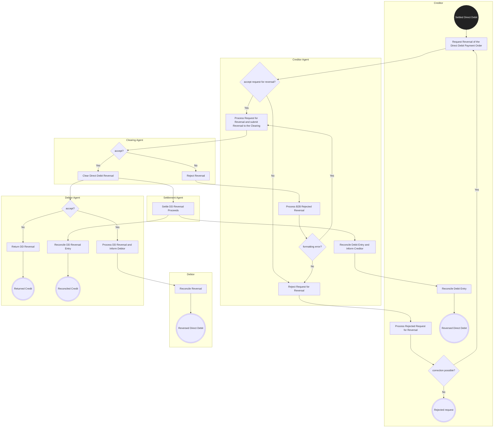

# Direct Debit / Direct Debit Reversal — figure 11

[src-000162](../../../../../../../../raw-input/payments_clearing_and_settlement/ISO20022_MDRPart1_PaymentsClearingAndSettlement_2025_2026_v2.docx); direct-body paragraph P163; Word file/printed page 22.

[Original figure](../../../../../../assets/src-000162/originals/image11.png) · [Complete Word-rendered page](../../../../../../assets/src-000162/word-render/page-022.png) · [Reusable flow](../../flows/flow-src-000162-p161-direct-debit-reversal.md)

## Source reconstruction

## Participants and roles

| Occurrence | Literal label | Scoped roles |
| --- | --- | --- |
| C | Creditor | [creditor](../../../../../../../../shared/reference/participants/participant-src-000162-creditor.md) |
| D | Debtor | [debtor](../../../../../../../../shared/reference/participants/participant-src-000162-debtor.md) |
| CA | Creditor Agent | [creditor-agent](../../../../../../../../shared/reference/participants/participant-src-000162-creditor-agent.md) |
| CL | Clearing Agent | [clearing-agent](../../../../../../../../shared/reference/participants/participant-src-000162-clearing-agent.md) |
| S | Settlement Agent | [settlement-agent](../../../../../../../../shared/reference/participants/participant-src-000162-settlement-agent.md) |
| DA | Debtor Agent | [debtor-agent](../../../../../../../../shared/reference/participants/participant-src-000162-debtor-agent.md) |

## Relationships and activities

| Order | From | To | Literal connection |
| --- | --- | --- | --- |
| 1 | Settled Direct Debit | Request Reversal of the Direct Debit Payment Order | directed source connector |
| 2 | Request Reversal of the Direct Debit Payment Order | accept request for reversal? | directed source connector |
| 3 | accept request for reversal? | Reject Request for Reversal | No |
| 4 | Reject Request for Reversal | Process Rejected Request for Reversal | directed source connector |
| 5 | Process Rejected Request for Reversal | correction possible? | directed source connector |
| 6 | correction possible? | Request Reversal of the Direct Debit Payment Order | Yes |
| 7 | correction possible? | Rejected request | No |
| 8 | accept request for reversal? | Process Request for Reversal and submit Reversal to the Clearing | Yes |
| 9 | Process Request for Reversal and submit Reversal to the Clearing | accept? | directed source connector |
| 10 | accept? | Reject Reversal | No |
| 11 | Reject Reversal | Process B2B Rejected Reversal | directed source connector |
| 12 | Process B2B Rejected Reversal | formatting error? | directed source connector |
| 13 | formatting error? | Process Request for Reversal and submit Reversal to the Clearing | Yes |
| 14 | formatting error? | Reject Request for Reversal | No |
| 15 | accept? | Clear Direct Debit Reversal | Yes |
| 16 | Clear Direct Debit Reversal | Settle DD Reversal Proceeds | directed source connector |
| 17 | Settle DD Reversal Proceeds | Reconcile Debit Entry and Inform Creditor | directed source connector |
| 18 | Reconcile Debit Entry and Inform Creditor | Reconcile Debit Entry | directed source connector |
| 19 | Reconcile Debit Entry | Reversed Direct Debit | directed source connector |
| 20 | Clear Direct Debit Reversal | accept? | directed source connector |
| 21 | accept? | Return DD Reversal | No |
| 22 | Return DD Reversal | Returned Credit | directed source connector |
| 23 | accept? | Process DD Reversal and Inform Debtor | Yes |
| 24 | Process DD Reversal and Inform Debtor | Reconcile Reversal | directed source connector |
| 25 | Reconcile Reversal | Reversed Direct Debit | directed source connector |
| 26 | Settle DD Reversal Proceeds | Reconcile DD Reversal Entry | directed source connector |
| 27 | Reconcile DD Reversal Entry | Reconciled Credit | directed source connector |

## Source qualifications

- Lane containers preserve responsibilities; rounded source action boxes become rectangles. Final bullseye becomes a concentric open node; labelled source start/end outcomes are retained inside the reconstructed symbol. Original retains colour and precise routing.
- Source P162 post-settlement reversal credits debtor if accepted. Clearing and settlement responsibilities are separate in this activity view. T26 defines initiating responsibilities and reversal rejection/correction; figure includes additional creditor/debtor reconciliation actions.
- Source participant icons/labels denote contextual roles; they do not fix an institution to one role. Unused lifelines remain visible.
- Source message names establish family-level flow context; supplied exact schema versions are separately identified.
- Mermaid preserves connections and order; original retains precise geometry, pictograms and line style. Whole-page Word rendering checked for composite context.

## Rendering and visual review

Mermaid 12.3.0 parsed/rendered on 2026-11-09 with Mermaid browser API + Chromium 156.0.8078.81. [Rendered SVG](../../../../../../assets/src-000162/reconstructed-clearing/fig-0011.svg) · [Rendered PNG](../../../../../../assets/src-000162/reconstructed-clearing/fig-0011.png).

Original picture labels, endpoints, order/decision paths and complete Word-rendered source page compared with rendered Mermaid. Native use-case models include dashed source connectors without invented include/extend semantics.

Bounded reconstruction passed its actual comparison.
