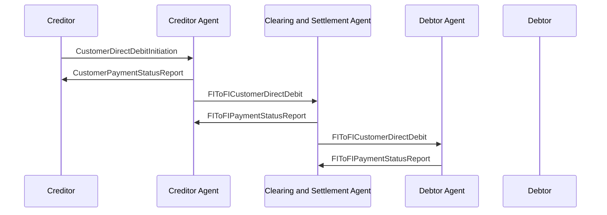

# Direct Debit / Positive FI To FI Payment Status Report with Direct Debit — figure 40

[src-000162](../../../../../../../../raw-input/payments_clearing_and_settlement/ISO20022_MDRPart1_PaymentsClearingAndSettlement_2025_2026_v2.docx); direct-body paragraph P525; Word file/printed page 52.

[Original figure](../../../../../../assets/src-000162/originals/image40.png) · [Complete Word-rendered page](../../../../../../assets/src-000162/word-render/page-052.png) · [Reusable flow](../../flows/flow-src-000162-p529-fito-fipayment-status-report-to-confirm-processability-of-fito-ficusto.md)

## Source reconstruction

## Participants and roles

| Occurrence | Literal label | Scoped roles |
| --- | --- | --- |
| C | Creditor | [creditor](../../../../../../../../shared/reference/participants/participant-src-000162-creditor.md); [initiating-party](../../../../../../../../shared/reference/participants/participant-src-000162-initiating-party.md) |
| CA | Creditor Agent | [creditor-agent](../../../../../../../../shared/reference/participants/participant-src-000162-creditor-agent.md) |
| CS | Clearing and Settlement Agent | [clearing-and-settlement-agent](../../../../../../../../shared/reference/participants/participant-src-000162-clearing-and-settlement-agent.md) |
| DA | Debtor Agent | [debtor-agent](../../../../../../../../shared/reference/participants/participant-src-000162-debtor-agent.md) |
| D | Debtor | [debtor](../../../../../../../../shared/reference/participants/participant-src-000162-debtor.md) |

## Relationships and activities

| Order | From | To | Literal connection |
| --- | --- | --- | --- |
| 1 | C | CA | CustomerDirectDebitInitiation |
| 2 | CA | C | CustomerPaymentStatusReport |
| 3 | CA | CS | FIToFICustomerDirectDebit |
| 4 | CS | CA | FIToFIPaymentStatusReport |
| 5 | CS | DA | FIToFICustomerDirectDebit |
| 6 | DA | CS | FIToFIPaymentStatusReport |

## Source qualifications

- P524/P526 positive status optional under bilateral agreement. P528 mixed group statuses allowed. P521 receiver-informs-receiver wording conflicts with P532/P534 and picture direction (issue-000054).
- Source participant icons/labels denote contextual roles; they do not fix an institution to one role. Unused lifelines remain visible.
- Source message names establish family-level flow context; supplied exact schema versions are separately identified.
- Mermaid preserves connections and order; original retains precise geometry, pictograms and line style. Whole-page Word rendering checked for composite context.

## Rendering and visual review

Mermaid 12.3.0 parsed/rendered on 2026-11-09 with Mermaid browser API + Chromium 156.0.8078.81. [Rendered SVG](../../../../../../assets/src-000162/reconstructed-clearing/fig-0040.svg) · [Rendered PNG](../../../../../../assets/src-000162/reconstructed-clearing/fig-0040.png).

Original picture labels, endpoints, order/decision paths and complete Word-rendered source page compared with rendered Mermaid. Native use-case models include dashed source connectors without invented include/extend semantics.

Source disagreement remains issue-000054.
