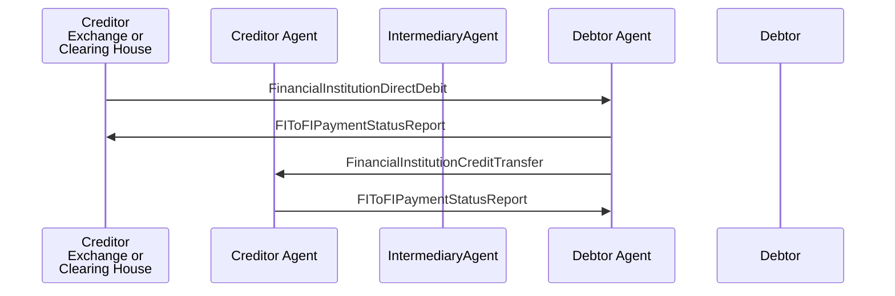

# Direct Debit / FinancialInstitutionDirectDebit / Creditor Agent and Debtor Agent are correspondents — figure 45

[src-000162](../../../../../../../../raw-input/payments_clearing_and_settlement/ISO20022_MDRPart1_PaymentsClearingAndSettlement_2025_2026_v2.docx); direct-body paragraph P597; Word file/printed page 59.

[Original figure](../../../../../../assets/src-000162/originals/image45.png) · [Complete Word-rendered page](../../../../../../assets/src-000162/word-render/page-059.png) · [Reusable flow](../../flows/flow-src-000162-p595-creditor-agent-and-debtor-agent-are-correspondents.md)

## Source reconstruction

## Participants and roles

| Occurrence | Literal label | Scoped roles |
| --- | --- | --- |
| C | Creditor Exchange or Clearing House | [creditor](../../../../../../../../shared/reference/participants/participant-src-000162-creditor.md); [exchange](../../../../../../../../shared/reference/participants/participant-src-000162-exchange.md); [clearing-house](../../../../../../../../shared/reference/participants/participant-src-000162-clearing-house.md) |
| CA | Creditor Agent | [creditor-agent](../../../../../../../../shared/reference/participants/participant-src-000162-creditor-agent.md) |
| M | IntermediaryAgent | [intermediary-agent](../../../../../../../../shared/reference/participants/participant-src-000162-intermediary-agent.md) |
| DA | Debtor Agent | [debtor-agent](../../../../../../../../shared/reference/participants/participant-src-000162-debtor-agent.md) |
| D | Debtor | [debtor](../../../../../../../../shared/reference/participants/participant-src-000162-debtor.md) |

## Relationships and activities

| Order | From | To | Literal connection |
| --- | --- | --- | --- |
| 1 | C | DA | FinancialInstitutionDirectDebit |
| 2 | DA | C | FIToFIPaymentStatusReport |
| 3 | DA | CA | FinancialInstitutionCreditTransfer |
| 4 | CA | DA | FIToFIPaymentStatusReport |

## Source qualifications

- P596 creditor authorised to request debit but funds its account at creditor agent; agents are correspondents. P606 negative status before settlement means no onward transfer.
- Source participant icons/labels denote contextual roles; they do not fix an institution to one role. Unused lifelines remain visible.
- Source message names establish family-level flow context; supplied exact schema versions are separately identified.
- Mermaid preserves connections and order; original retains precise geometry, pictograms and line style. Whole-page Word rendering checked for composite context.

## Rendering and visual review

Mermaid 12.3.0 parsed/rendered on 2026-11-09 with Mermaid browser API + Chromium 156.0.8078.81. [Rendered SVG](../../../../../../assets/src-000162/reconstructed-clearing/fig-0045.svg) · [Rendered PNG](../../../../../../assets/src-000162/reconstructed-clearing/fig-0045.png).

Original picture labels, endpoints, order/decision paths and complete Word-rendered source page compared with rendered Mermaid. Native use-case models include dashed source connectors without invented include/extend semantics.

Bounded reconstruction passed its actual comparison.
