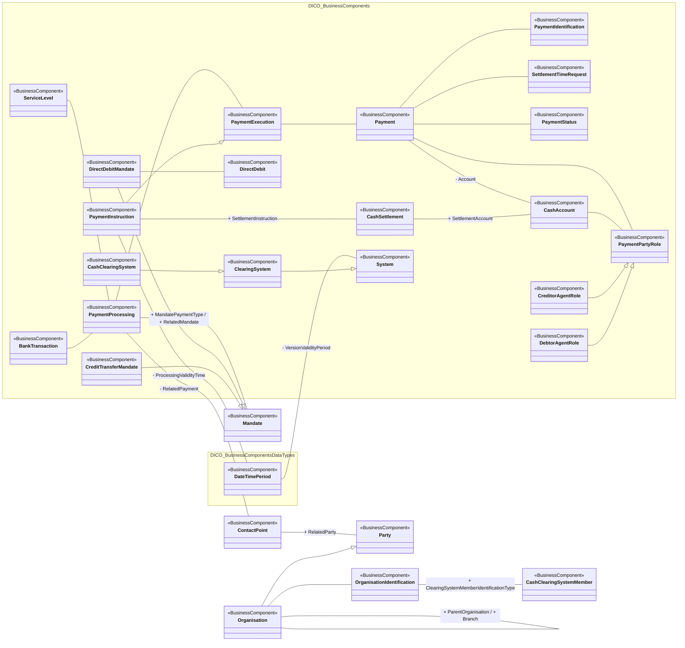

# Payments clearing and settlement conceptual model

[src-000164](../../../../../../../../../raw-input/payments_clearing_and_settlement/ISO20022_MDRPart3_PaymentsClearingandSettlement_2025_2026_v1.xlsx), PaymentsClearingAndSettlement!A1:AF61; xl/drawings/drawing2.xml; anchor 1. Original image SHA-256: 0c384532c2adf5f4c1b345e7a96fece18a8e424fa3d068181cff85c4a0dda3f0.

[Original complete figure](../../../../../../../assets/src-000164/media/image2.png) · [Rendered Mermaid SVG](../../../../../../../assets/src-000164/reconstructed-models/src-000164-fig-0002.svg) · [Rendered Mermaid PNG](../../../../../../../assets/src-000164/reconstructed-models/src-000164-fig-0002.png)

## Source reconstruction

## Entities and relationships

Payment processing connects execution, service level, bank-transaction classification, mandate and contact point. Payment connects account, payment-party role, identification, timing request and status. Cash settlement connects instruction and cash account. Role and system specializations, organisation self-association and every unlabelled source line are retained. The source places “+ ClearingSystemMemberIdentificationType” above the organisation-identification/member region, away from its connector. The label is assigned to the existing OrganisationIdentification–CashClearingSystemMember line using the same workbook FullBusinessModel!A2990:F2990 and inverse A635:F635, which explicitly identify both endpoints and this association-end name. This is a documented resolution of layout ambiguity, not an added relationship; see issue-000025. No CashClearingSystemMember–CashClearingSystem association is drawn in the supplied figure.

All 27 visible node occurrences and 29 relationship lines are retained. No numeric multiplicities are printed in this source view; none are inferred. Namespaces group only printed from-package labels for readability; the source does not draw those enclosing boxes. Nodes with no printed package remain outside these groups. No package membership is inferred from the component name. Association labels retain literal +/− prefixes and combined end names. Their re-layout position is not additional navigability evidence. The native class inheritance marker is reserved for the source’s hollow-triangle generalizations. Source editor/navigation icons are omitted as interface decoration; no business entity or relationship is excluded.

## Complete relationship register

| From node | To node | Source relationship kind | Visible source label(s) | From-end multiplicity | To-end multiplicity |
| --- | --- | --- | --- | --- | --- |
| ServiceLevel | PaymentProcessing | association | (unlabelled in source) | not printed | not printed |
| BankTransaction | PaymentProcessing | association | (unlabelled in source) | not printed | not printed |
| PaymentProcessing | PaymentExecution | association | (unlabelled in source) | not printed | not printed |
| PaymentExecution | Payment | association | (unlabelled in source) | not printed | not printed |
| Payment | PaymentIdentification | association | (unlabelled in source) | not printed | not printed |
| Payment | SettlementTimeRequest | association | (unlabelled in source) | not printed | not printed |
| Payment | PaymentStatus | association | (unlabelled in source) | not printed | not printed |
| Payment | CashAccount | association | - Account | not printed | not printed |
| Payment | PaymentPartyRole | association | (unlabelled in source) | not printed | not printed |
| PaymentProcessing | Mandate | association | + MandatePaymentType / + RelatedMandate | not printed | not printed |
| PaymentProcessing | ContactPoint | association | - RelatedPayment | not printed | not printed |
| DirectDebitMandate | Mandate | generalization: subtype to supertype | (unlabelled in source) | not printed | not printed |
| CreditTransferMandate | Mandate | generalization: subtype to supertype | (unlabelled in source) | not printed | not printed |
| DirectDebitMandate | DirectDebit | association | (unlabelled in source) | not printed | not printed |
| ContactPoint | Party | association | + RelatedParty | not printed | not printed |
| Organisation | Party | generalization: subtype to supertype | (unlabelled in source) | not printed | not printed |
| Organisation | Organisation | association | + ParentOrganisation / + Branch | not printed | not printed |
| Organisation | OrganisationIdentification | association | (unlabelled in source) | not printed | not printed |
| OrganisationIdentification | CashClearingSystemMember | association | + ClearingSystemMemberIdentificationType | not printed | not printed |
| CashSettlement | CashAccount | association | + SettlementAccount | not printed | not printed |
| PaymentInstruction | CashSettlement | association | + SettlementInstruction | not printed | not printed |
| PaymentInstruction | PaymentExecution | generalization: subtype to supertype | (unlabelled in source) | not printed | not printed |
| CashAccount | PaymentPartyRole | association | (unlabelled in source) | not printed | not printed |
| CreditorAgentRole | PaymentPartyRole | generalization: subtype to supertype | (unlabelled in source) | not printed | not printed |
| DebtorAgentRole | PaymentPartyRole | generalization: subtype to supertype | (unlabelled in source) | not printed | not printed |
| PaymentInstruction | DateTimePeriod | association | - ProcessingValidityTime | not printed | not printed |
| DateTimePeriod | System | association | - VersionValidityPeriod | not printed | not printed |
| ClearingSystem | System | generalization: subtype to supertype | (unlabelled in source) | not printed | not printed |
| CashClearingSystem | ClearingSystem | generalization: subtype to supertype | (unlabelled in source) | not printed | not printed |

## Entity definitions and precise workbook locators

| Visible label | Source package / stereotype | Definition evidence |
| --- | --- | --- |
| ServiceLevel | DICO_BusinessComponents / BusinessComponent | [FullBusinessModel!A4733:D4733](../sheets/02-fullbusinessmodel/tbl-0025.md) — Agreement under which or rules under which the transaction should be processed. |
| BankTransaction | DICO_BusinessComponents / BusinessComponent | [FullBusinessModel!A372:D372](../sheets/02-fullbusinessmodel/tbl-0003.md) — Code of the underlying bank transaction. |
| PaymentProcessing | DICO_BusinessComponents / BusinessComponent | [FullBusinessModel!A3200:D3200](../sheets/02-fullbusinessmodel/tbl-0017.md) — Specifies how a payment must be processed, for instance through which specific clearing channel. |
| PaymentExecution | DICO_BusinessComponents / BusinessComponent | [FullBusinessModel!A3109:D3109](../sheets/02-fullbusinessmodel/tbl-0017.md) — Process required for executing an end to end payment. It consists of a payment initiation which may be followed by a series of instructions. |
| Payment | DICO_BusinessComponents / BusinessComponent | [FullBusinessModel!A3055:D3055](../sheets/02-fullbusinessmodel/tbl-0017.md) — Payment information and processes required to transfer cash end to end from the debtor to the creditor. |
| PaymentIdentification | DICO_BusinessComponents / BusinessComponent | [FullBusinessModel!A3122:D3122](../sheets/02-fullbusinessmodel/tbl-0017.md) — Specifies the different identifications associated with a payment transaction. |
| SettlementTimeRequest | DICO_BusinessComponents / BusinessComponent | [FullBusinessModel!A4749:D4749](../sheets/02-fullbusinessmodel/tbl-0025.md) — Provides information on the requested settlement time(s) of the payment instruction. |
| PaymentStatus | DICO_BusinessComponents / BusinessComponent | [FullBusinessModel!A3216:D3216](../sheets/02-fullbusinessmodel/tbl-0018.md) — Specifies the status of a payment at a specified time. |
| Mandate | (package not printed) / BusinessComponent | [FullBusinessModel!A2679:D2679](../sheets/02-fullbusinessmodel/tbl-0015.md) — Authorisation given by an issuing party to a holder party to act on the issuer's behalf. |
| DirectDebitMandate | DICO_BusinessComponents / BusinessComponent | [FullBusinessModel!A1582:D1582](../sheets/02-fullbusinessmodel/tbl-0009.md) — Authorisation in favour of the creditor given by the debtor to debit its own account. |
| DirectDebit | DICO_BusinessComponents / BusinessComponent | [FullBusinessModel!A1577:D1577](../sheets/02-fullbusinessmodel/tbl-0009.md) — Payment, initiated by the creditor, to debit a debtor's account in favour of the creditor. A direct debit can be pre-authorised or not. In most countries, authorisation is in the form of a mandate between the debtor and creditor. |
| CreditTransferMandate | DICO_BusinessComponents / BusinessComponent | [FullBusinessModel!A1295:D1295](../sheets/02-fullbusinessmodel/tbl-0008.md) — Authorisation in favour of the creditor agent given by the creditor to initiate a credit transfer from its own account. |
| ContactPoint | (package not printed) / BusinessComponent | [FullBusinessModel!A994:D994](../sheets/02-fullbusinessmodel/tbl-0006.md) — Number, physical or virtual address, used for communication. |
| Party | (package not printed) / BusinessComponent | [FullBusinessModel!A3021:D3021](../sheets/02-fullbusinessmodel/tbl-0017.md) — Entity involved in an activity. |
| Organisation | (package not printed) / BusinessComponent | [FullBusinessModel!A2956:D2956](../sheets/02-fullbusinessmodel/tbl-0016.md) — Organised structure that is set up for a particular purpose. For example, a business, government body, department, charity, or financial institution. |
| OrganisationIdentification | (package not printed) / BusinessComponent | [FullBusinessModel!A2985:D2985](../sheets/02-fullbusinessmodel/tbl-0016.md) — Unique and unambiguous way to identify an organisation. |
| CashClearingSystemMember | (package not printed) / BusinessComponent | [FullBusinessModel!A634:D634](../sheets/02-fullbusinessmodel/tbl-0005.md) — Unique and unambiguous identifier for a clearing system member, as assigned by the clearing system. In some clearing systems, the accounts of the clearing system members are also assigned an identifier. The identifier can be used when transmitting, reconciling and confirming payment orders or security transfer instructions prior to settlement, and may include the netting of instructions and the establishment of final positions for settlement. |
| CashSettlement | DICO_BusinessComponents / BusinessComponent | [FullBusinessModel!A717:D717](../sheets/02-fullbusinessmodel/tbl-0005.md) — Instruction between two financial institutions stipulating the cash transfer characteristics between the two parties. |
| CashAccount | DICO_BusinessComponents / BusinessComponent | [FullBusinessModel!A562:D562](../sheets/02-fullbusinessmodel/tbl-0004.md) — Account to or from which a cash entry is made. |
| PaymentPartyRole | DICO_BusinessComponents / BusinessComponent | [FullBusinessModel!A3197:D3197](../sheets/02-fullbusinessmodel/tbl-0017.md) — Role played by a party in the context of a payment. |
| CreditorAgentRole | DICO_BusinessComponents / BusinessComponent | [FullBusinessModel!A1301:D1301](../sheets/02-fullbusinessmodel/tbl-0008.md) — Financial institution servicing an account for the creditor. |
| DebtorAgentRole | DICO_BusinessComponents / BusinessComponent | [FullBusinessModel!A1517:D1517](../sheets/02-fullbusinessmodel/tbl-0009.md) — Financial institution servicing an account for the debtor. |
| PaymentInstruction | DICO_BusinessComponents / BusinessComponent | [FullBusinessModel!A3132:D3132](../sheets/02-fullbusinessmodel/tbl-0017.md) — Instruction to pay an amount of money to an ultimate beneficiary, on behalf of an originator. This instruction may have to be forwarded several times to complete the settlement chain. |
| DateTimePeriod | DICO_BusinessComponentsDataTypes / BusinessComponent | [FullBusinessModel!A1363:D1363](../sheets/02-fullbusinessmodel/tbl-0008.md) — Time span defined by a start date and time, and an end date and time. |
| System | DICO_BusinessComponents / BusinessComponent | [FullBusinessModel!A4902:D4902](../sheets/02-fullbusinessmodel/tbl-0026.md) — Set of integrated applications that provides centralised services such as clearing, netting, reconciliation, trading and/or settlement. |
| ClearingSystem | DICO_BusinessComponents / BusinessComponent | [FullBusinessModel!A828:D828](../sheets/02-fullbusinessmodel/tbl-0006.md) — Specifies the system which plays a role in the clearing process. |
| CashClearingSystem | DICO_BusinessComponents / BusinessComponent | [FullBusinessModel!A628:D628](../sheets/02-fullbusinessmodel/tbl-0005.md) — Clearing system that processes only cash transfers. |

## Participant and flow navigation

This is a conceptual entity model, not a message exchange diagram. A business component or relationship label is not automatically a functional participant or institution. [Message-set participant references](../../../participants.md) and [Message-set business flows](../../../flows/index.md) provide the independently sourced actor/process context. These references are navigational; source figure associations do not establish message direction.

## Rendering and visual review

2026-11-09: Mermaid 12.3.0 parsed and rendered successfully with Mermaid browser API + Chromium 156.0.8078.81. Direct comparison of each complete source image and rendered PNG; checked all 27 visible node occurrences, 29 relationship lines, literal endpoint labels, inheritance direction, package labels and printed/omitted stereotypes. No multiplicities are printed or inferred. The src-000164 displaced label is resolved from FullBusinessModel A2990:F2990 and A635:F635; original source retained. [Renderer evidence](../../../../../../../../../work/payment-workbook-models/render-report.json).

