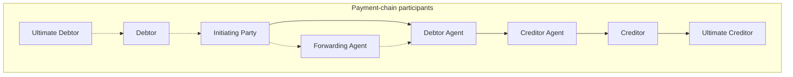

# Customer to Bank Payment Order — figure 8

[src-000173](../../../../../../../../raw-input/payments_initiation/ISO20022_MDRPart1_PaymentsInitiation_2025_2026_v2.docx); direct-body paragraph P141; Word file/printed page 17.

[Original figure](../../../../../../assets/src-000173/originals/image8.png) · [Complete Word-rendered page](../../../../../../assets/src-000173/word-render/page-17.png) · [Reusable flow](../../flows/flow-src-000173-p140-complex-scenario.md)

## Source reconstruction

## Participants and roles

| Occurrence | Literal label | Scoped roles |
| --- | --- | --- |
| U | Ultimate Debtor | [ultimate-debtor](../../../../../../../../shared/reference/participants/participant-src-000173-ultimate-debtor.md) |
| D | Debtor | [debtor](../../../../../../../../shared/reference/participants/participant-src-000173-debtor.md) |
| I | Initiating Party | [initiating-party](../../../../../../../../shared/reference/participants/participant-src-000173-initiating-party.md) |
| F | Forwarding Agent | [forwarding-agent](../../../../../../../../shared/reference/participants/participant-src-000173-forwarding-agent.md) |
| DA | Debtor Agent | [debtor-agent](../../../../../../../../shared/reference/participants/participant-src-000173-debtor-agent.md) |
| CA | Creditor Agent | [creditor-agent](../../../../../../../../shared/reference/participants/participant-src-000173-creditor-agent.md) |
| C | Creditor | [creditor](../../../../../../../../shared/reference/participants/participant-src-000173-creditor.md) |
| UC | Ultimate Creditor | [ultimate-creditor](../../../../../../../../shared/reference/participants/participant-src-000173-ultimate-creditor.md) |

## Relationships and activities

| Order | From | To | Literal label / direction |
| --- | --- | --- | --- |
| 1 | Ultimate Debtor | Debtor | dashed directed |
| 2 | Debtor | Initiating Party | dashed directed |
| 3 | Initiating Party | Debtor Agent | directed |
| 4 | Initiating Party | Forwarding Agent | dashed directed |
| 5 | Forwarding Agent | Debtor Agent | dashed directed |
| 6 | Debtor Agent | Creditor Agent | directed |
| 7 | Creditor Agent | Creditor | directed |
| 8 | Creditor | Ultimate Creditor | directed |

## Source qualifications

- Lane containers denote source responsibility columns, not new business institutions. Source rounded action boxes are rendered as rectangles; source final bullseye is a concentric Mermaid node with the central fill documented here. Colour and exact line routing remain in original.
- Source has no lane boundaries. One rendering container groups the chain for layout only. Solid and dashed arrows retain their source appearance; no undocumented condition is assigned to dashed arrows.
- Actor pictograms identify roles in this context, not a fixed institutional identity. Source narrative may describe participants/steps omitted from this bounded figure.
- Part1 message labels alone do not establish exact supplied schema versions. Original figures and their complete rendered page remain the evidence for geometry and line styling.

## Rendering and visual review

Mermaid 12.3.0 parsed and rendered on 2026-11-09 using Mermaid browser API + Chromium 156.0.8078.81. [Rendered SVG](../../../../../../assets/src-000173/reconstructed-initiation/fig-0008.svg) · [Rendered PNG](../../../../../../assets/src-000173/reconstructed-initiation/fig-0008.png).

Compared every source actor label, message/action label, connector endpoint/direction, decision branch, initial/final state and source annotation against original image/EMF preview, then checked rendered Mermaid and full Word source page context. Native use-case models1–2 retain ordinary arrows and unconnected participant icons with explicit placement tables; model2 unconnected mandate use case retained. Final-state geometry, lane layout and source colours are documented limitations.

This bounded source reconstruction passed its recorded comparison.
