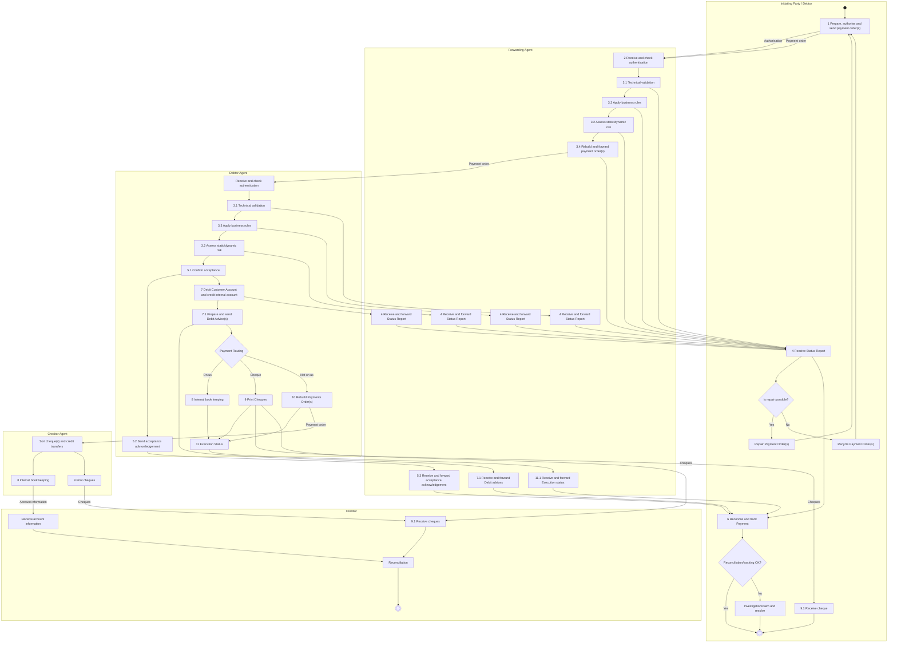

# Customer to Bank Payment Order — figure 9

[src-000173](../../../../../../../../raw-input/payments_initiation/ISO20022_MDRPart1_PaymentsInitiation_2025_2026_v2.docx); direct-body paragraph P145; Word file/printed page 18.

[Original figure](../../../../../../assets/src-000173/originals/image9.emf) · [Complete Word-rendered page](../../../../../../assets/src-000173/word-render/page-18.png) · [Reusable flow](../../flows/flow-src-000173-p136-customer-to-bank-payment-order.md)

## Source reconstruction

## Participants and roles

| Occurrence | Literal label | Scoped roles |
| --- | --- | --- |
| I | Initiating Party / Debtor | [initiating-party](../../../../../../../../shared/reference/participants/participant-src-000173-initiating-party.md); [debtor](../../../../../../../../shared/reference/participants/participant-src-000173-debtor.md) |
| F | Forwarding Agent | [forwarding-agent](../../../../../../../../shared/reference/participants/participant-src-000173-forwarding-agent.md) |
| DA | Debtor Agent | [debtor-agent](../../../../../../../../shared/reference/participants/participant-src-000173-debtor-agent.md) |
| CA | Creditor Agent | [creditor-agent](../../../../../../../../shared/reference/participants/participant-src-000173-creditor-agent.md) |
| C | Creditor | [creditor](../../../../../../../../shared/reference/participants/participant-src-000173-creditor.md) |

## Relationships and activities

| Order | From | To | Literal label / direction |
| --- | --- | --- | --- |
| 1 | start | 1 Prepare, authorise and send payment order(s) | directed |
| 2 | 1 Prepare, authorise and send payment order(s) | 2 Receive and check authentication | directed Authorisation |
| 3 | 1 Prepare, authorise and send payment order(s) | 2 Receive and check authentication | directed Payment order |
| 4 | 2 Receive and check authentication | 3.1 Technical validation | directed |
| 5 | 3.1 Technical validation | 3.3 Apply business rules | directed |
| 6 | 3.3 Apply business rules | 3.2 Assess static/dynamic risk | directed |
| 7 | 3.2 Assess static/dynamic risk | 3.4 Rebuild and forward payment order(s) | directed |
| 8 | 3.4 Rebuild and forward payment order(s) | Receive and check authentication | directed Payment order |
| 9 | 4 Receive Status Report | Is repair possible? | directed |
| 10 | Is repair possible? | Repair Payment Order(s) | directed Yes |
| 11 | Is repair possible? | Recycle Payment Order(s) | directed No |
| 12 | Repair Payment Order(s) | 1 Prepare, authorise and send payment order(s) | directed |
| 13 | Recycle Payment Order(s) | 1 Prepare, authorise and send payment order(s) | directed |
| 14 | 4 Receive Status Report | 6 Reconcile and track Payment | directed |
| 15 | 6 Reconcile and track Payment | Reconciliation/tracking OK? | directed |
| 16 | Reconciliation/tracking OK? | end | directed Yes |
| 17 | Reconciliation/tracking OK? | Investigation/claim and resolve | directed No |
| 18 | Investigation/claim and resolve | end | directed |
| 19 | 9.1 Receive cheque | end | directed |
| 20 | Receive and check authentication | 3.1 Technical validation | directed |
| 21 | 3.1 Technical validation | 3.3 Apply business rules | directed |
| 22 | 3.3 Apply business rules | 3.2 Assess static/dynamic risk | directed |
| 23 | 3.2 Assess static/dynamic risk | 5.1 Confirm acceptance | directed |
| 24 | 5.1 Confirm acceptance | 5.2 Send acceptance acknowledgement | directed |
| 25 | 5.2 Send acceptance acknowledgement | 5.3 Receive and forward acceptance acknowledgement | directed |
| 26 | 5.3 Receive and forward acceptance acknowledgement | 6 Reconcile and track Payment | directed |
| 27 | 5.1 Confirm acceptance | 7 Debit Customer Account and credit internal account | directed |
| 28 | 7 Debit Customer Account and credit internal account | 7.1 Prepare and send Debit Advice(s) | directed |
| 29 | 7.1 Prepare and send Debit Advice(s) | 7.1 Receive and forward Debit advices | directed |
| 30 | 7.1 Receive and forward Debit advices | 6 Reconcile and track Payment | directed |
| 31 | 7.1 Prepare and send Debit Advice(s) | Payment Routing | directed |
| 32 | Payment Routing | 8 Internal book keeping | directed On us |
| 33 | Payment Routing | 9 Print Cheques | directed Cheque |
| 34 | Payment Routing | 10 Rebuild Payments Order(s) | directed Not on us |
| 35 | 8 Internal book keeping | 11 Execution Status | directed |
| 36 | 9 Print Cheques | 11 Execution Status | directed |
| 37 | 10 Rebuild Payments Order(s) | 11 Execution Status | directed |
| 38 | 11 Execution Status | 11.1 Receive and forward Execution status | directed |
| 39 | 11.1 Receive and forward Execution status | 6 Reconcile and track Payment | directed |
| 40 | 9 Print Cheques | 9.1 Receive cheque | directed Cheques |
| 41 | 9 Print Cheques | 9.1 Receive cheques | directed Cheques |
| 42 | 10 Rebuild Payments Order(s) | Sort cheque(s) and credit transfers | directed Payment order |
| 43 | Sort cheque(s) and credit transfers | 8 Internal book keeping | directed |
| 44 | Sort cheque(s) and credit transfers | 9 Print cheques | directed |
| 45 | 8 Internal book keeping | Receive account information | directed Account information |
| 46 | 9 Print cheques | 9.1 Receive cheques | directed Cheques |
| 47 | 9.1 Receive cheques | Reconciliation | directed |
| 48 | Receive account information | Reconciliation | directed |
| 49 | Reconciliation | end | directed |
| 50 | 3.1 Technical validation | 4 Receive Status Report | directed |
| 51 | 3.3 Apply business rules | 4 Receive Status Report | directed |
| 52 | 3.2 Assess static/dynamic risk | 4 Receive Status Report | directed |
| 53 | 3.4 Rebuild and forward payment order(s) | 4 Receive Status Report | directed |
| 54 | 3.1 Technical validation | 4 Receive and forward Status Report | directed |
| 55 | 4 Receive and forward Status Report | 4 Receive Status Report | directed |
| 56 | 3.3 Apply business rules | 4 Receive and forward Status Report | directed |
| 57 | 4 Receive and forward Status Report | 4 Receive Status Report | directed |
| 58 | 3.2 Assess static/dynamic risk | 4 Receive and forward Status Report | directed |
| 59 | 4 Receive and forward Status Report | 4 Receive Status Report | directed |
| 60 | 7 Debit Customer Account and credit internal account | 4 Receive and forward Status Report | directed |
| 61 | 4 Receive and forward Status Report | 4 Receive Status Report | directed |

## Source qualifications

- Lane containers denote source responsibility columns, not new business institutions. Source rounded action boxes are rendered as rectangles; source final bullseye is a concentric Mermaid node with the central fill documented here. Colour and exact line routing remain in original.
- Yellow source note: Either the Payment Autorisations are sent separately or with the payment order(s). Literal spelling retained.
- Four separate forwarding-agent status nodes and the separate payment-order/authorisation arrows are preserved. Source green communications and grey internal control are listed together without equating them to schema message types.
- T23 activity definitions, including repair/rebuild conditions and non-final execution statuses, govern this view. The source Cheques connector from Debtor Agent reaches both initiating-party and creditor receive-cheque nodes.
- Actor pictograms identify roles in this context, not a fixed institutional identity. Source narrative may describe participants/steps omitted from this bounded figure.
- Part1 message labels alone do not establish exact supplied schema versions. Original figures and their complete rendered page remain the evidence for geometry and line styling.

## Rendering and visual review

Mermaid 12.3.0 parsed and rendered on 2026-11-09 using Mermaid browser API + Chromium 156.0.8078.81. [Rendered SVG](../../../../../../assets/src-000173/reconstructed-initiation/fig-0009.svg) · [Rendered PNG](../../../../../../assets/src-000173/reconstructed-initiation/fig-0009.png).

Compared every source actor label, message/action label, connector endpoint/direction, decision branch, initial/final state and source annotation against original image/EMF preview, then checked rendered Mermaid and full Word source page context. Native use-case models1–2 retain ordinary arrows and unconnected participant icons with explicit placement tables; model2 unconnected mandate use case retained. Final-state geometry, lane layout and source colours are documented limitations.

This bounded source reconstruction passed its recorded comparison.
