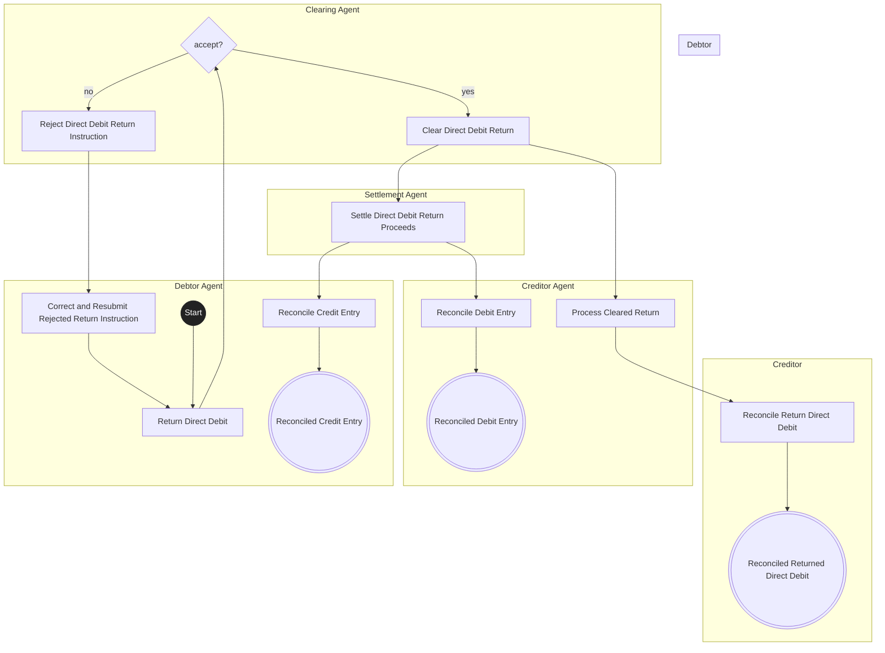

# Customer-to-bank Direct Debit — figure 11

[src-000173](../../../../../../../../raw-input/payments_initiation/ISO20022_MDRPart1_PaymentsInitiation_2025_2026_v2.docx); direct-body paragraph P150; Word file/printed page 22.

[Original figure](../../../../../../assets/src-000173/originals/image11.png) · [Complete Word-rendered page](../../../../../../assets/src-000173/word-render/page-22.png) · [Reusable flow](../../flows/flow-src-000173-p149-return-direct-debit.md)

## Source reconstruction

## Participants and roles

| Occurrence | Literal label | Scoped roles |
| --- | --- | --- |
| C | Creditor | [creditor](../../../../../../../../shared/reference/participants/participant-src-000173-creditor.md) |
| D | Debtor | [debtor](../../../../../../../../shared/reference/participants/participant-src-000173-debtor.md) |
| CA | Creditor Agent | [creditor-agent](../../../../../../../../shared/reference/participants/participant-src-000173-creditor-agent.md) |
| CS | Clearing Agent | [clearing-agent](../../../../../../../../shared/reference/participants/participant-src-000173-clearing-agent.md) |
| S | Settlement Agent | [settlement-agent](../../../../../../../../shared/reference/participants/participant-src-000173-settlement-agent.md) |
| DA | Debtor Agent | [debtor-agent](../../../../../../../../shared/reference/participants/participant-src-000173-debtor-agent.md) |

## Relationships and activities

| Order | From | To | Literal label / direction |
| --- | --- | --- | --- |
| 1 | Return Direct Debit | accept? | directed |
| 2 | accept? | Reject Direct Debit Return Instruction | directed no |
| 3 | Reject Direct Debit Return Instruction | Correct and Resubmit Rejected Return Instruction | directed |
| 4 | Correct and Resubmit Rejected Return Instruction | Return Direct Debit | directed |
| 5 | accept? | Clear Direct Debit Return | directed yes |
| 6 | Clear Direct Debit Return | Process Cleared Return | directed |
| 7 | Process Cleared Return | Reconcile Return Direct Debit | directed |
| 8 | Reconcile Return Direct Debit | Reconciled Returned Direct Debit | directed |
| 9 | Clear Direct Debit Return | Settle Direct Debit Return Proceeds | directed |
| 10 | Settle Direct Debit Return Proceeds | Reconcile Debit Entry | directed |
| 11 | Reconcile Debit Entry | Reconciled Debit Entry | directed |
| 12 | Settle Direct Debit Return Proceeds | Reconcile Credit Entry | directed |
| 13 | Start | Return Direct Debit | directed |
| 14 | Reconcile Credit Entry | Reconciled Credit Entry | directed |

## Source qualifications

- Lane containers denote source responsibility columns, not new business institutions. Source rounded action boxes are rendered as rectangles; source final bullseye is a concentric Mermaid node with the central fill documented here. Colour and exact line routing remain in original.
- All source lanes are retained, including the empty Debtor lane in figure11. Source clearing/settlement responsibilities are distinct from the combined participant in later sequence diagrams.
- Actor pictograms identify roles in this context, not a fixed institutional identity. Source narrative may describe participants/steps omitted from this bounded figure.
- Part1 message labels alone do not establish exact supplied schema versions. Original figures and their complete rendered page remain the evidence for geometry and line styling.

## Rendering and visual review

Mermaid 12.3.0 parsed and rendered on 2026-11-09 using Mermaid browser API + Chromium 156.0.8078.81. [Rendered SVG](../../../../../../assets/src-000173/reconstructed-initiation/fig-0011.svg) · [Rendered PNG](../../../../../../assets/src-000173/reconstructed-initiation/fig-0011.png).

Compared every source actor label, message/action label, connector endpoint/direction, decision branch, initial/final state and source annotation against original image/EMF preview, then checked rendered Mermaid and full Word source page context. Native use-case models1–2 retain ordinary arrows and unconnected participant icons with explicit placement tables; model2 unconnected mandate use case retained. Final-state geometry, lane layout and source colours are documented limitations.

This bounded source reconstruction passed its recorded comparison.

Mermaid collapses the empty Debtor lane to its label; the participant table and original preserve that empty source responsibility column.
