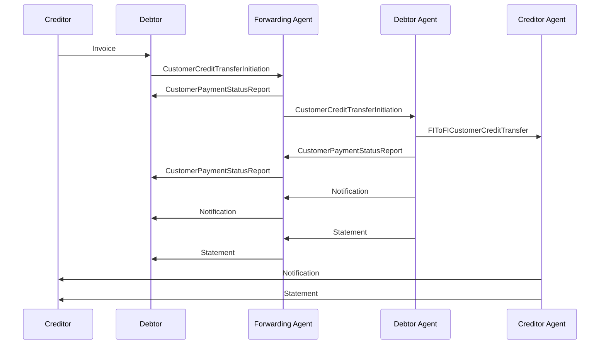

# CustomerCreditTransferInitiation - Relay / One actor plays roles of Initiating Party, Debtor and Ultimate Debtor — figure 16

[src-000173](../../../../../../../../raw-input/payments_initiation/ISO20022_MDRPart1_PaymentsInitiation_2025_2026_v2.docx); direct-body paragraph P190; Word file/printed page 28.

[Original figure](../../../../../../assets/src-000173/originals/image16.png) · [Complete Word-rendered page](../../../../../../assets/src-000173/word-render/page-28.png) · [Reusable flow](../../flows/flow-src-000173-p189-one-actor-plays-roles-of-initiating-party-debtor-and-ultimate-debtor.md)

## Source reconstruction

## Participants and roles

| Occurrence | Literal label | Scoped roles |
| --- | --- | --- |
| C | Creditor | [creditor](../../../../../../../../shared/reference/participants/participant-src-000173-creditor.md) |
| D | Debtor | [debtor](../../../../../../../../shared/reference/participants/participant-src-000173-debtor.md); [initiating-party](../../../../../../../../shared/reference/participants/participant-src-000173-initiating-party.md); [ultimate-debtor](../../../../../../../../shared/reference/participants/participant-src-000173-ultimate-debtor.md) |
| F | Forwarding Agent | [forwarding-agent](../../../../../../../../shared/reference/participants/participant-src-000173-forwarding-agent.md) |
| DA | Debtor Agent | [debtor-agent](../../../../../../../../shared/reference/participants/participant-src-000173-debtor-agent.md) |
| CA | Creditor Agent | [creditor-agent](../../../../../../../../shared/reference/participants/participant-src-000173-creditor-agent.md) |

## Relationships and activities

| Order | From | To | Literal label / direction |
| --- | --- | --- | --- |
| 1 | C | D | Invoice |
| 2 | D | F | CustomerCreditTransferInitiation |
| 3 | F | D | CustomerPaymentStatusReport |
| 4 | F | DA | CustomerCreditTransferInitiation |
| 5 | DA | CA | FIToFICustomerCreditTransfer |
| 6 | DA | F | CustomerPaymentStatusReport |
| 7 | F | D | CustomerPaymentStatusReport |
| 8 | DA | F | Notification |
| 9 | F | D | Notification |
| 10 | DA | F | Statement |
| 11 | F | D | Statement |
| 12 | CA | C | Notification |
| 13 | CA | C | Statement |

## Source qualifications

- Picture shares vertical levels for relayed status/notification/statement. The sequence view serializes each relay leg for readability without asserting extra timing. P191 source example: company holds overseas accounts and uses a concentrator bank.
- Actor pictograms identify roles in this context, not a fixed institutional identity. Source narrative may describe participants/steps omitted from this bounded figure.
- Part1 message labels alone do not establish exact supplied schema versions. Original figures and their complete rendered page remain the evidence for geometry and line styling.

## Rendering and visual review

Mermaid 12.3.0 parsed and rendered on 2026-11-09 using Mermaid browser API + Chromium 156.0.8078.81. [Rendered SVG](../../../../../../assets/src-000173/reconstructed-initiation/fig-0016.svg) · [Rendered PNG](../../../../../../assets/src-000173/reconstructed-initiation/fig-0016.png).

Compared every source actor label, message/action label, connector endpoint/direction, decision branch, initial/final state and source annotation against original image/EMF preview, then checked rendered Mermaid and full Word source page context. Native use-case models1–2 retain ordinary arrows and unconnected participant icons with explicit placement tables; model2 unconnected mandate use case retained. Final-state geometry, lane layout and source colours are documented limitations.

This bounded source reconstruction passed its recorded comparison.
