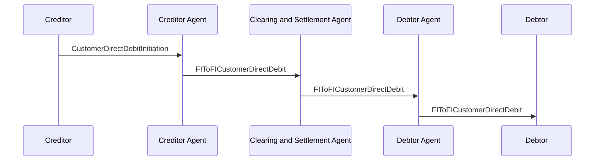

# CustomerDirectDebitInitiation and FIToFICustomerDirectDebit  — figure 19

[src-000173](../../../../../../../../raw-input/payments_initiation/ISO20022_MDRPart1_PaymentsInitiation_2025_2026_v2.docx); direct-body paragraph P205; Word file/printed page 31.

[Original figure](../../../../../../assets/src-000173/originals/image19.png) · [Complete Word-rendered page](../../../../../../assets/src-000173/word-render/page-31.png) · [Reusable flow](../../flows/flow-src-000173-p198-customer-direct-debit-initiation-and-fito-ficustomer-direct-debit.md)

## Source reconstruction

## Participants and roles

| Occurrence | Literal label | Scoped roles |
| --- | --- | --- |
| C | Creditor | [creditor](../../../../../../../../shared/reference/participants/participant-src-000173-creditor.md); [initiating-party](../../../../../../../../shared/reference/participants/participant-src-000173-initiating-party.md) |
| CA | Creditor Agent | [creditor-agent](../../../../../../../../shared/reference/participants/participant-src-000173-creditor-agent.md) |
| CS | Clearing and Settlement Agent | [clearing-and-settlement-agent](../../../../../../../../shared/reference/participants/participant-src-000173-clearing-and-settlement-agent.md) |
| DA | Debtor Agent | [debtor-agent](../../../../../../../../shared/reference/participants/participant-src-000173-debtor-agent.md) |
| D | Debtor | [debtor](../../../../../../../../shared/reference/participants/participant-src-000173-debtor.md) |

## Relationships and activities

| Order | From | To | Literal label / direction |
| --- | --- | --- | --- |
| 1 | C | CA | CustomerDirectDebitInitiation |
| 2 | CA | CS | FIToFICustomerDirectDebit |
| 3 | CS | DA | FIToFICustomerDirectDebit |
| 4 | DA | D | FIToFICustomerDirectDebit |

## Source qualifications

- P206/P224 describe the last leg as an optional simplified instruction/value-added service. P207 excludes the mandate and mandate management from the picture; P208–219 still define that context.
- Actor pictograms identify roles in this context, not a fixed institutional identity. Source narrative may describe participants/steps omitted from this bounded figure.
- Part1 message labels alone do not establish exact supplied schema versions. Original figures and their complete rendered page remain the evidence for geometry and line styling.

## Rendering and visual review

Mermaid 12.3.0 parsed and rendered on 2026-11-09 using Mermaid browser API + Chromium 156.0.8078.81. [Rendered SVG](../../../../../../assets/src-000173/reconstructed-initiation/fig-0019.svg) · [Rendered PNG](../../../../../../assets/src-000173/reconstructed-initiation/fig-0019.png).

Compared every source actor label, message/action label, connector endpoint/direction, decision branch, initial/final state and source annotation against original image/EMF preview, then checked rendered Mermaid and full Word source page context. Native use-case models1–2 retain ordinary arrows and unconnected participant icons with explicit placement tables; model2 unconnected mandate use case retained. Final-state geometry, lane layout and source colours are documented limitations.

This bounded source reconstruction passed its recorded comparison.
