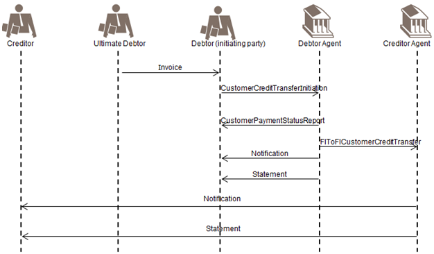

# fig-0014 - original figure evidence

Source: [src-000173](../../../../../../../../../raw-input/payments_initiation/ISO20022_MDRPart1_PaymentsInitiation_2025_2026_v2.docx). Locator: direct-body paragraph P174; BusinessTransactions / CustomerCreditTransferInitiation / One actor plays roles of Initiating Party and Debtor, second actor plays role of Ultimate Debtor; /w:document/w:body/w:p[174].

Original extracted asset: [image14.png](../../../../../../../assets/src-000173/originals/image14.png)

## Interpretation and review

The canonical reference linked below contains the source reconstruction or deduplication decision, participant/flow links, rendering results, explicit visual-review evidence and remaining source limitations. Original media remain unchanged.

<!-- INITIATION-DIAGRAM -->
[Source occurrence, canonical reconstruction and review](../../../diagrams/initiation/fig-0014.md)
