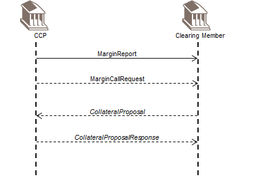
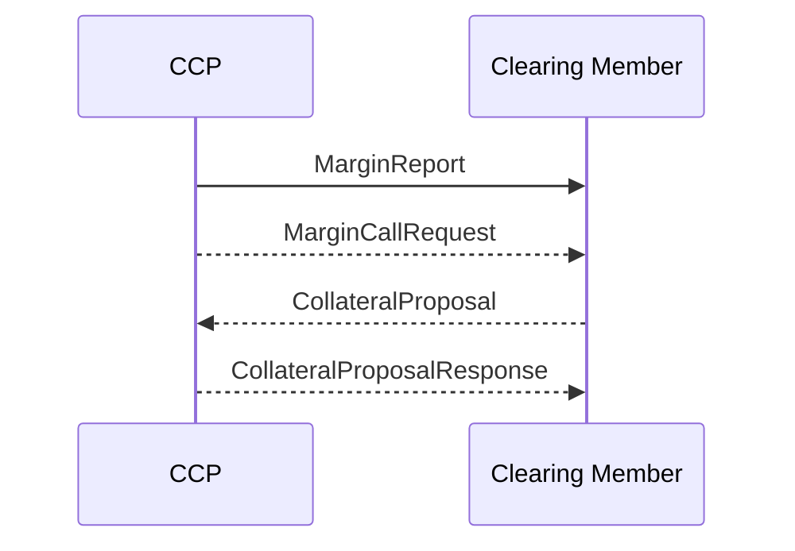

# Margining business transaction

## Source evidence

[src-000052](../../../../../../../../raw-input/central_counterparty_clearing_ccp_clearing/ISO20022_MDRPart1_CentralCounterPartySecuritiesClearing_Maintenance_2025_2026_v2.docx); P239 / Margining. [Unchanged source figure](../../../../../../assets/src-000052/originals/image14.png).

## Mermaid reconstruction

## Participants, messages and conditions

The report includes exposure from trade positions, collateral market value held by the CCP, and the resulting risk difference (P230-P233). A call may follow if calculated risk exceeds posted collateral; the clearing member may propose collateral and the CCP may accept or reject it. After rejection the proposal/response sequence may repeat (P236-P237). These optional collateral exchanges are outside this project scope (P238).

| Source order | Message label | Sender | Receiver | Source line semantics | Exact supplied definition |
| --- | --- | --- | --- | --- | --- |
| 1 | MarginReport | CCP | CM | Mandatory (solid) | [secl.005.001.02](../../../../../messages/secl.005.001.02/index.md) |
| 2 | MarginCallRequest | CCP | CM | Optional/potential (dotted) | No exact definition bound by this CCP source segment |
| 3 | CollateralProposal | CM | CCP | Optional/potential (dotted) | No exact definition bound by this CCP source segment |
| 4 | CollateralProposalResponse | CCP | CM | Optional/potential (dotted) | No exact definition bound by this CCP source segment |

P214 defines solid lines as mandatory messages and P215 defines dotted lines as optional/potential. The reconstruction preserves this distinction. Building symbols represent the two source participant endpoints; they do not identify named institutions.

[Reusable flow and complete narrative](../../flows/flow-src-000052-p229-margining-business-transaction.md); [Related source process, trigger and conditions](../../flows/flow-src-000052-p131-margining-process.md).

## Review evidence

Opened the full source image and Mermaid render; compared both participant labels, all 4 ordered message labels and directions, 3 dotted optional/potential path(s), and 1 clearing-member-to-CCP arrow(s). P214-P215 line semantics and relevant narrative conditions are retained. Building silhouettes are replaced by labeled participant boxes; they do not identify named institutions. Parsed/rendered with Mermaid 12.3.0 and Chromium 156.0.8078.81; visual review on 2026-11-09 Europe/Warsaw, rendering report UTC date 2026-11-08.

[Compared reconstruction](../../../../../../assets/src-000052/reconstructed-transactions/fig-0015.png).
